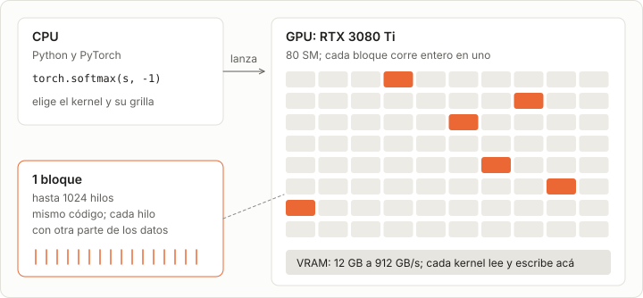
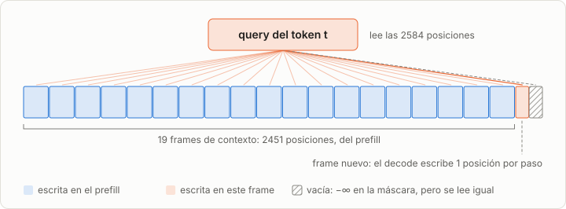
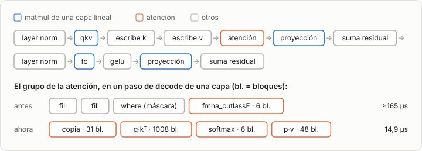
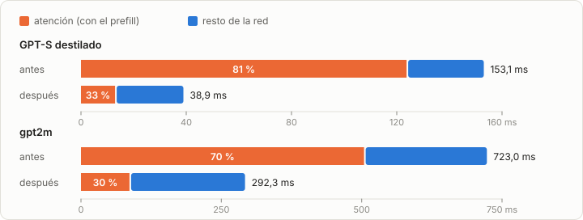
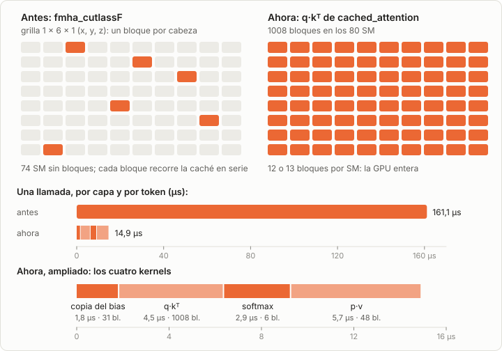
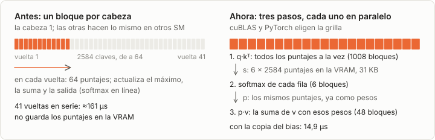
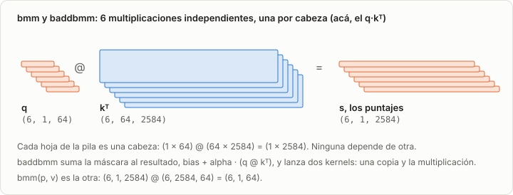
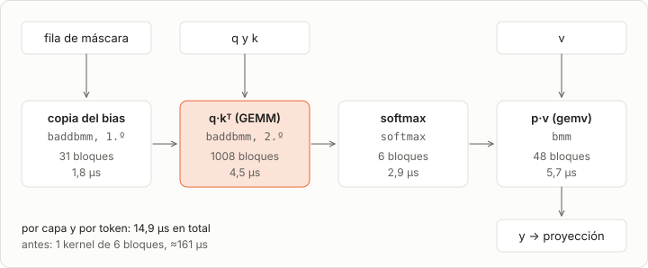
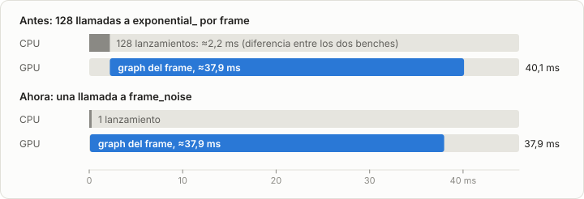
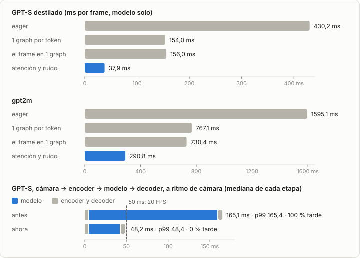

# Kernels y la atención del decode

Cómo corre el GPT en la GPU, y por qué el GPT-S destilado bajó de 154 a 38 ms por frame y gpt2m de 767 a 291 ms sin tocar los pesos. <!-- ok-numero -->

Casi toda la mejora vino de reemplazar la atención del decode por una función, `cached_attention`, junto con la máscara precalculada. Con el frame ya grabado en un CUDA graph, bajó el GPT-S de 156 a 40 ms y gpt2m de 730 a 313 ms ([GPT-S antes](../results/bench/gpt_s_kd_framegraph__fp16_graphs.json), [después](../results/bench/gpt_s_kd_attn__fp16_graphs.json); [gpt2m antes](../results/bench/gpt2m_framegraph__fp16_graphs.json), [después](../results/bench/gpt2m_attn__fp16_graphs.json)). El resto lo dio el ruido del muestreo en un solo lanzamiento ([GPT-S](../results/bench/gpt_s_kd__fp16_graphs.json), [gpt2m](../results/bench/gpt2m__fp16_graphs.json)). En gpt2m, la diferencia entre 767 ms (un graph por token) y 730 (el frame en un graph) está dentro de la variación entre corridas ([Primer intento](optimizar-decode-gpt.md#primer-intento-el-frame-entero-en-un-cuda-graph-21112026)). <!-- ok-numero -->

Este documento explica el mecanismo. La historia, con cada paso, su commit y su medición, está en [`Docs/optimizar-decode-gpt.md`](optimizar-decode-gpt.md). Todo está medido en la RTX 3080 Ti, y las figuras salen de los JSON de `results/`:

```bash
python scripts/figuras_atencion.py
```

## Qué es un kernel

Un kernel es un programa chico que corre en la GPU. La CPU no hace la cuenta: le dice a la GPU "corré este programa sobre estos datos", y eso es un lanzamiento. Casi cada operación de PyTorch sobre tensores CUDA (`a + b`, `torch.softmax`, una multiplicación de matrices) se convierte en uno o más kernels.

Lo que hace rápida a la GPU es que el kernel lo corren miles de hilos a la vez: el mismo código, cada hilo con un pedazo distinto de los datos. Los hilos se agrupan en bloques de hasta 1024 hilos, y los bloques forman la grilla del lanzamiento.



Tres reglas explican todo lo que sigue:

1. **Cada bloque corre entero en un SM.** La 3080 Ti tiene 80 SM (*streaming multiprocessors*), cada uno con sus núcleos, sus registros y su memoria rápida. Un SM puede tener varios bloques a la vez, pero un bloque no se reparte entre SM.
2. **La cantidad de bloques la decide quien escribió el kernel,** según la forma de los tensores. Si el kernel arma 6 bloques, trabajan 6 SM y los otros 74 no hacen nada en ese kernel.
3. **Entre un kernel y el siguiente, los datos pasan por la VRAM,** la memoria de la placa (12 GB a 912 GB/s según NVIDIA). Cada kernel lee sus entradas de ahí y escribe ahí su salida.

Además, lanzar cuesta tiempo de CPU. Sin CUDA graphs (en modo *eager*, en el que PyTorch lanza los kernels de cada operación cuando Python llega a esa línea), Python lanza unos 13.000 kernels por frame ([perfil, variante eager](../results/perfil/gpt_s_kd_perfil.json)) y el GPT-S tarda 430 ms ([bench](../results/bench/gpt_s_kd_eager__fp16.json)). Un CUDA graph graba la secuencia de lanzamientos una vez y después la repite con un solo lanzamiento. <!-- ok-numero -->

Antes de esta optimización ya había un graph por token (`GraphedStep`), y con él el GPT-S tardaba 154 ms ([bench](../results/bench/gpt_s_kd_base_hoy__fp16_graphs.json)). El primer paso de la optimización fue grabar el frame entero en un graph (`GPTStream`), y la latencia no bajó: 156 ms ([bench](../results/bench/gpt_s_kd_framegraph__fp16_graphs.json)). El límite ya no estaba en la CPU. <!-- ok-numero -->

## Qué hace cada paso de decode

Cada frame son 129 tokens: un token de inicio (BOS, *beginning of sequence*) y los 128 códigos del VQ-VAE, que cubren la imagen en una cuadrícula de 8 × 16. En cada frame, el GPT-S genera esos 128 códigos en dos partes:

- **Prefill:** una pasada con el contexto, 19 frames de 129 tokens más el BOS del frame nuevo (2452 tokens). Llena la caché KV (los k y los v de cada token ya visto, en cada capa) y da el primer código.
- **Decode:** 127 pasos de un token cada uno. En cada paso, cada una de las 6 capas escribe el k y el v del token nuevo en la caché y compara su query con la caché entera.

La caché es estática: siempre tiene 2584 posiciones por capa (20 frames de 129, redondeado a múltiplo de 8). Así cada paso tiene la misma forma y se puede grabar en un CUDA graph. La contracara es que se leen las 2584 posiciones en cada paso, incluso las que la máscara anula.



Son 6 capas × 127 pasos = 762 llamadas a la atención en el decode, más 6 en el prefill (768 por frame). En cada llamada del decode, 1 query se compara con 2584 claves en 6 cabezas de 64 dimensiones, y se leen k y v de esa capa: 2 × 6 × 2584 × 64 × 2 bytes ≈ 4 MB.

## Un paso de una capa, en kernels

Cuando el GPT procesa un token, cada capa es una cadena de kernels, y cada uno deja su resultado en la VRAM para el siguiente. En el decode son 15 kernels por capa y por token: los de la figura, con la atención como 4 kernels. Un frame tiene 12.921 kernels: 15 × 762 = 11.430 de las capas, más el prefill y lo que corre una vez por token fuera de las capas (los embeddings, la layer norm final, la cabeza de salida y el muestreo) ([perfil](../results/perfil/gpt_s_kd_perfil_attn.json)). Casi todos tardan entre 1 y 6 µs. <!-- ok-numero -->



Antes, uno de esos kernels tardaba unos 160 µs y se repetía en cada una de las 762 llamadas del decode: el de la atención. <!-- ok-numero -->

## Dónde se iba el tiempo

El bench tiene un modo de perfil, `python -m src.cli gpt bench --tamaño s --variante kd -- --perfil`. Usa `torch.profiler` sobre 5 frames con el contexto lleno. Suma el tiempo de GPU de cada kernel y, del registro de lanzamientos de NVIDIA (CUPTI), saca con cuántos bloques se lanzó cada uno. Los perfiles están en `results/perfil/`: los de antes, con el código de `f58358b` ([GPT-S](../results/perfil/gpt_s_kd_perfil.json), [gpt2m](../results/perfil/gpt2m_perfil.json)), y los de ahora, con el de `c796313` ([GPT-S](../results/perfil/gpt_s_kd_perfil_attn.json), [gpt2m](../results/perfil/gpt2m_perfil_attn.json)).

Los perfiles de ahora son anteriores a que el bench guardara el grid más frecuente de cada kernel (`59a99cb`). En ellos, `bloques` es el grid del primer lanzamiento, que para los kernels de las capas es el del prefill. Para los cuatro kernels de `cached_attention` es exacto, porque solo corren en el decode y siempre con el mismo grid.



Antes, la atención era el 81 % del tiempo de GPU del GPT-S (123,7 de 153,1 ms por frame) y el 70 % del de gpt2m. El resto de la red (matmuls, layer norm, muestreo) casi no cambió: en el GPT-S bajó 3,4 ms, 3,2 por los kernels de la máscara que desaparecieron ([La máscara, una sola vez](#la-máscara-una-sola-vez)) y 0,2 por el ruido del muestreo, que ahora es un solo kernel. <!-- ok-numero -->

El perfil y el bench son corridas distintas. El perfil suma la duración de cada kernel con el profiler activo, y el bench mide el frame entero sin profiler, así que sus totales no coinciden exactamente.

## Por qué tardaba: 6 bloques para 80 SM

`scaled_dot_product_attention` (SDPA), la atención de PyTorch, tiene varias implementaciones, llamadas *backends*: flash, mem-efficient y math (la cuenta escrita con una multiplicación de matrices, un softmax y otra multiplicación). SDPA elige una según la placa, el tipo de datos y la máscara. Este torch de Windows no trae flash, así que en el decode, con su máscara, SDPA usaba mem-efficient: el kernel `fmha_cutlassF_f16_aligned_64x64_rf_sm80` ([perfil](../results/perfil/gpt_s_kd_perfil.json)). Ese kernel arma un bloque por cabeza y por grupo de 64 queries:
- **En el prefill,** con 2452 queries, son 39 × 6 = 234 bloques.
- **En el decode,** con 1 query, son 1 × 6 = 6 bloques. Cada uno recorre las 2584 claves de su cabeza de a 64: 41 vueltas, una detrás de la otra.



En la figura, la ubicación de los 6 SM encendidos es ilustrativa; la cantidad sale del perfil. Lo que dura cada llamada (161 µs de promedio, contando las 6 del prefill) también sale del perfil. <!-- ok-numero -->

Por qué 6 bloques tardaban tanto:
- **Los kernels de un paso corren uno detrás del otro,** porque cada uno usa la salida del anterior. Mientras corre la atención, los otros 74 SM esperan.
- **La atención del decode casi no calcula.** Hace unos 4 millones de operaciones por los 4 MB que lee, alrededor de 1 operación por byte. La GPU puede hacer decenas de operaciones por cada byte que trae de la VRAM, así que acá los núcleos pasan casi todo el tiempo esperando datos.
- **Una lectura de la VRAM tarda en llegar.** La memoria rinde solo cuando hay muchas lecturas pedidas y todavía sin llegar a la vez. Cada uno de los 6 bloques hace sus 41 vueltas en orden: en cada una pide 16 KB de k y v y espera a que lleguen, porque la vuelta siguiente usa el máximo y la suma de esta. Son unos 3,9 µs por vuelta.

Con eso, el kernel de antes leía 4 MB en 161 µs, unos 25 GB/s: menos del 3 % de los 912 GB/s de la placa. Ahora, el q·kᵀ lee k (2 MB) en 4,5 µs y p·v lee v en 5,7 µs, unos 440 y 350 GB/s. La copia y el softmax no leen la caché y suman otros 4,7 µs. En total son 4 MB en 14,9 µs, unos 266 GB/s, 11 veces más ([perfil](../results/perfil/gpt_s_kd_perfil_attn.json)). Por qué ninguno llega al pico no está medido; suponemos que pesan el costo fijo de cada kernel y los pocos bloques de p·v y del softmax. <!-- ok-numero -->

La máscara no explica el tiempo. Convertirla eran tres kernels aparte, de unos 4 µs por llamada en total, contra los 161 µs del kernel de atención ([perfil](../results/perfil/gpt_s_kd_perfil.json)). <!-- ok-numero -->

## Cómo se hizo `cached_attention`

### Qué hacía el kernel de antes por dentro

El kernel mem-efficient está pensado para entrenamiento y prefill, donde hay miles de queries. Lo que lo hace "eficiente en memoria" es que nunca escribe la tabla de puntajes q·kᵀ en la VRAM. Cada bloque toma 64 queries de una cabeza y recorre las claves de a 64. En cada vuelta calcula esos puntajes y actualiza un máximo, una suma y la salida parcial (el softmax "en línea"). Así, con 2452 queries, no hace falta guardar una tabla de 2452 × 2584 por cabeza.

El costo es que un bloque recorre las claves en orden, porque cada vuelta depende de la anterior. Repartir las claves entre bloques exigiría un kernel más que combine los parciales, y este kernel no lo hace (esa técnica existe y se llama split-KV o Flash-Decoding). Con 1 query, además, cada bloque está armado para 64 queries y usa 1.

La alternativa usa cuBLAS, la biblioteca de multiplicación de matrices de NVIDIA, que elige sola la grilla de cada multiplicación. La figura compara los dos enfoques:



### La idea

Con una sola query, la tabla de puntajes que el kernel evitaba guardar es una fila de 2584 por cabeza: 6 × 2584 × 2 bytes = 31 KB, poco al lado de los 4 MB de k y v. Con la fila entera guardada, los puntajes ya no dependen entre sí. Cada bloque calcula su pedazo de q·kᵀ sin esperar a los otros, y el softmax corre después, sobre la fila completa.

La atención queda en tres llamadas (`baddbmm`, `softmax` y `bmm`). cuBLAS elige la grilla de las dos multiplicaciones: el q·kᵀ, con 2584 puntajes por cabeza, sale en 1008 bloques. El costo es partir la cuenta en cuatro kernels (una copia, q·kᵀ, el softmax y p·v). La copia y el softmax suman 4,7 de los 14,9 µs. <!-- ok-numero -->

### Qué es `bmm`

`bmm` (*batched matrix multiply*) es una multiplicación de matrices por lotes: varias multiplicaciones independientes, del mismo tamaño, con una sola llamada. `torch.bmm(A, B)` recibe A de forma (b, n, m) y B de forma (b, m, p), y devuelve (b, n, p): para cada i hace `A[i] @ B[i]`. `baddbmm` además suma una matriz al resultado, `entrada + alpha · (A @ B)`, y lanza dos kernels: una copia y la multiplicación.

En la atención, el lote son las cabezas: cada una tiene su q, su k y su v, y las 6 cuentas no dependen entre sí.



### El código, línea por línea

La función está en [`src/models/backbone.py`](../src/models/backbone.py). Con las formas del decode del GPT-S (batch 1, 6 cabezas, 1 query, caché de 2584, 64 dimensiones por cabeza):

```python
def cached_attention(q, k, v, bias):
  B, H, T, hd = q.shape            # q: (1, 6, 1, 64)
  S = k.shape[2]                   # k, v: la caché entera, (1, 6, 2584, 64)
  s = torch.baddbmm(
        bias.reshape(1, T, S).expand(B * H, T, S),   # la fila de la máscara, (6, 1, 2584)
        q.reshape(B * H, T, hd),                     # (6, 1, 64)
        k.reshape(B * H, S, hd).transpose(1, 2),     # (6, 64, 2584)
        alpha=hd ** -0.5)                            # × 1/8
  return torch.bmm(torch.softmax(s, -1),             # p: (6, 1, 2584)
                   v.reshape(B * H, S, hd)           # (6, 2584, 64)
                  ).view(B, H, T, hd)                # y: (1, 6, 1, 64)
```

- **`bias`:** es la fila de la máscara aditiva, con 0 donde el token puede mirar y −∞ donde no. No tiene que ver con el bias de una capa lineal.
- **`reshape(B * H, ...)`:** junta la dimensión del batch (1) y la de las cabezas (6) en una sola, de 6, que `bmm` usa como lote.
- **`transpose(1, 2)`:** no copia nada, solo cambia cómo se recorre la memoria. cuBLAS lee k traspuesta directamente de la caché.
- **`baddbmm(bias, a, b, alpha)`:** cuBLAS calcula `salida = alpha · (a @ b) + salida`, así que PyTorch primero copia la fila de la máscara a la salida, una vez por cabeza: es el kernel de copia de 31 bloques. `expand` solo cambia cómo se recorre la fila, sin copiarla, por eso la copia aparece acá. Después lanza la multiplicación, una GEMM (la multiplicación de matrices general de cuBLAS). Con alpha = 1/√64, la llamada hace q·kᵀ, la escala y la máscara.
- **`softmax(s, -1)`:** las posiciones con −∞ quedan con peso 0. La máscara sigue haciendo lo mismo que antes.
- **`bmm(p, v)`:** la suma de los v con esos pesos. cuBLAS elige el kernel según las formas. Para q·kᵀ, con 2584 salidas por cabeza, eligió una GEMM de 168 bloques por cabeza. Para p·v, con 64 salidas por cabeza, eligió un kernel de matriz por vector (gemv) de 8 bloques por cabeza.
- **`view(B, H, T, hd)`:** vuelve a la forma que espera el resto de la capa, sin copiar.

Así queda cada línea en kernels, con los bloques y el tiempo del perfil de ahora:



El softmax también usa 6 bloques, uno por cabeza, y p·v usa 48, menos que los 80 SM. Ninguno de los dos recorre la caché en serie. El softmax lee solo la fila s, de 31 KB. p·v son 48 bloques de 256 hilos, unos 12.000 hilos leyendo v a la vez, contra los 768 del kernel de antes (6 bloques de 128). <!-- ok-numero -->

Es la misma fórmula que SDPA, softmax(q·kᵀ/√d + máscara)·v, y la del backend math de PyTorch, el que fuerza el decode de comma en `third_party/commavq/utils/gpt.py`. Cambia el redondeo. El math de este torch sube fp16 a fp32 para toda la cuenta; `cached_attention` guarda los puntajes y el softmax en fp16, aunque cuBLAS acumula cada producto en fp32. El efecto en la calidad está en [El resultado](#el-resultado).

### Dónde se engancha

En `Attention.forward`, después de escribir el k y el v nuevos en la caché:

```python
if T <= TPF:   # decode del GPT (T = 1) y pasadas de MaskGIT (T = 129)
  y = cached_attention(q, k, v, attn_mask)
```

El límite de 129 queries es por el tamaño de la tabla s, que ahora sí se guarda:
- **Decode:** 31 KB.
- **Pasada de MaskGIT:** 6 × 129 × 2584 × 2 bytes ≈ 4 MB.
- **Prefill:** con 2452 queries serían 76 MB. Ahí el kernel mem-efficient sí conviene (234 bloques y ninguna tabla), así que el prefill sigue con SDPA.

En gpt2m la red es código de comma, que no tocamos. Mientras dura `next_frame`, la atención de cada capa (`blk.attn`) usa un `forward` propio. Es igual al de comma, salvo que con hasta 129 queries llama a `cached_attention`; el prefill sigue por SDPA. La máscara causal que se engancha mientras tanto es la aditiva, armada una vez en `_setup`. Al terminar, un `finally` borra ese `forward` y vuelve a poner la máscara de comma ([`src/models/gpt2m.py`](../src/models/gpt2m.py)).

### Cómo se comprobó

- **Equivalencia:** `cached_attention` contra SDPA en CPU fp32, con 1, 5 y 129 queries, y en CUDA fp16, con 1 y 129 queries contra una caché de 2584, con tolerancia de fp16 (`test_cached_attention_equals_sdpa_cpu`, `test_cached_attention_equals_sdpa_cuda_fp16` en [`tests/test_infer.py`](../tests/test_infer.py)).
- **gpt2m:** `test_gpt2m_next_frame_restores_comma_attention` verifica que la atención y la máscara de comma vuelvan después de `next_frame`.
- **Mismos tokens:** el stream y `next_frame` siguen dando los mismos tokens con la misma semilla (`test_gpt_stream_equals_generate_cpu`, `test_gpt_fused_frame_equals_next_frame`).
- **Velocidad y calidad:** el bench, el perfil y el FVD por la CLI ([El resultado](#el-resultado)).

## La máscara, una sola vez

Antes la máscara era booleana, y SDPA la convertía a 0/−∞ en cada llamada. Lo hacía con dos `fill` (llenan un tensor con un valor) y un `where` (elige elemento a elemento entre dos tensores; en el decode, de 6 bloques), antes del kernel de atención. Son 3 kernels × 768 llamadas (las 762 del decode y las 6 del prefill) = 2304 kernels por frame, unos 3,2 ms de GPU ([perfil](../results/perfil/gpt_s_kd_perfil.json)). Ahora `setup_cache` arma la máscara aditiva una vez, en fp16, y cada paso solo toma su fila: <!-- ok-numero -->

```python
self.mask_bias = additive_mask(self.mask[:, :self.cache_len].to(device), dtype)  # una vez
kw = dict(input_pos=input_pos, attn_mask=self.mask_bias[input_pos])             # cada paso: su fila
```

## El ruido del muestreo, en un lanzamiento

Para muestrear un token, `sample_logits` toma las probabilidades π de los 1024 códigos, tira un ruido E ~ Exp(1) para cada uno y elige el código con mayor π / E. Equivale exactamente a muestrear de π y no necesita volver a la CPU. El ruido se genera fuera del graph del frame, con el generador de la corrida, y entra como dato. Así el stream da los mismos tokens que `next_frame` con la misma semilla.

Antes se tiraba con una llamada por token: 128 lanzamientos desde Python antes de cada frame. La GPU no puede arrancar el graph hasta que la CPU termina de encolarlos. `frame_noise` (en [`src/models/base.py`](../src/models/base.py)) tira las 128 × 1024 exponenciales de una vez.



La figura usa las corridas guardadas: 40,1 y 40,0 ms con 128 lanzamientos ([corrida 1](../results/bench/gpt_s_kd_attn__fp16_graphs.json), [corrida 2](../results/bench/gpt_s_kd_attn_r2__fp16_graphs.json)) y 37,9 ms con uno ([bench](../results/bench/gpt_s_kd__fp16_graphs.json)). La barra de CPU es la diferencia entre esos benches, no una medición del tiempo de CPU. Otras corridas con 128 lanzamientos, cuyos JSON se pisaron, dieron bastante más y muy estables dentro de cada una; con un solo lanzamiento esa variación desapareció ([la tabla de pasos de la historia](optimizar-decode-gpt.md#resultado-21112026)). La atribuimos a la CPU (por ejemplo, el núcleo en el que quedaba el proceso), pero no está medida directamente. <!-- ok-numero -->

## El resultado

La figura muestra cuatro estados, todos medidos con el bench de la CLI: p50 del modelo solo, batch 1, fp16. La última barra junta la atención, con la máscara precalculada, y el ruido del muestreo en un lanzamiento, que en la historia son los pasos 3 y 4 ([eager](../results/bench/gpt_s_kd_eager__fp16.json), [un graph por token](../results/bench/gpt_s_kd_base_hoy__fp16_graphs.json), [el frame en un graph](../results/bench/gpt_s_kd_framegraph__fp16_graphs.json), [ahora](../results/bench/gpt_s_kd__fp16_graphs.json)).



A ritmo de cámara (cámara, encoder, modelo y decoder), la mediana de la cadena del GPT-S pasó de 165,1 a 48,2 ms y el p99, de 165,4 a 48,4 ms ([antes](../results/infer/latencia_gpt_s_kd_base_hoy__rtx3080ti.json), [ahora](../results/infer/latencia_gpt_s_kd__rtx3080ti.json)). Antes llegaban tarde todos los frames; ahora, ninguno. Entra en los 50 ms, sin margen. En bucle cerrado, sin esperar a la cámara, la mediana de antes era 172,6 ms. <!-- ok-numero -->

La calidad no cambió de forma significativa, porque el modelo es el mismo. Lo que cambia es el redondeo fp16 dentro del kernel y la secuencia de números al azar, así que los rollouts son otra muestra del mismo modelo. El FVD de los rollouts nuevos menos el de los rollouts de la tabla, pareado y con bootstrap por segmento sobre 400 clips, da +12,6 a 1 s (p = 0,18), +27,0 a 2 s (p = 0,05) y +4,4 a 3 s (p = 0,76) ([diferencia](../results/diferencia_gpt_s_kd_stream_vs_gpt_s_kd.json)). Un valor positivo significa que los rollouts nuevos dan un FVD más alto. A 2 s queda en el borde, pero con tres horizontes comparados a la vez no alcanza a ser significativa. <!-- ok-numero -->

MaskGIT-S usa la misma `cached_attention` en sus pasadas de 129 tokens: con 4 pasos bajó de 9,3 a 6,4 ms ([antes](../results/bench/maskgit_s_abs_p4_base_hoy__fp16_graphs_s4.json), [ahora](../results/bench/maskgit_s_abs_p4__fp16_graphs_s4.json)). <!-- ok-numero -->

Genie no cambió. Su atención es otra clase (`Attn`, en [`src/models/genie.py`](../src/models/genie.py)), que llama a SDPA directamente, y `cached_attention` solo está enganchada en la `Attention` del backbone y en gpt2m. Genie también reutiliza los k y v temporales del contexto, pero sin caché estática ni máscara. Su atención espacial mira los 128 tokens del frame, y la temporal, los frames del contexto. Promedia 13,5 µs por llamada, entre las dos, y es el 14 % de su tiempo de GPU ([perfil](../results/perfil/genie_s_p4_perfil.json)). <!-- ok-numero -->

## Lo que queda

Ahora un frame del GPT-S son 12.921 kernels en 38,9 ms de GPU, unos 3 µs por kernel en promedio, y la mitad del tiempo son multiplicaciones chicas ([perfil](../results/perfil/gpt_s_kd_perfil_attn.json)). Si cada token solo tuviera que leer los pesos (24,9 MB) y la caché (23,8 MB) a 912 GB/s, el frame tardaría unos 7 ms. Es una estimación gruesa, no una medición. La distancia hasta 38 ms es la cantidad de kernels chicos. <!-- ok-numero -->

Bajarla requiere fusionar kernels, es decir, juntar varios en uno para que los resultados intermedios no pasen por la VRAM. Una opción es `torch.compile`, que en Windows necesita Triton, un compilador de kernels para Python. Otra es un kernel propio de atención para decode, con split-KV, que necesita Triton o el compilador de CUDA. Decidimos no agregar dependencias.
