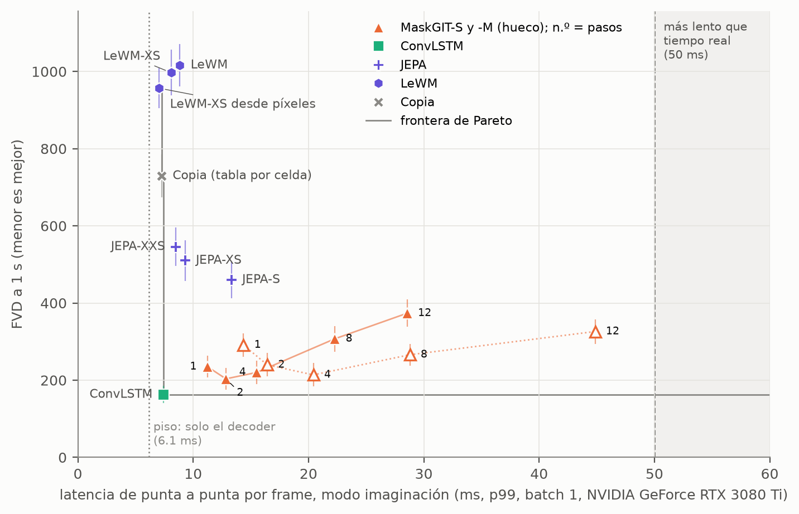

# Inferencia de punta a punta en GPU y NPU

**Estado (17/11/2026):** fases 1–7 implementadas y medidas en la RTX 3080 Ti. Falta medir en la T4 (celda nueva de [`notebooks/colab.ipynb`](../notebooks/colab.ipynb)) y en la laptop (iGPU y NPU; ver "Cómo correrlo"). Tablas completas: [`results/infer/summary_e2e.md`](../results/infer/summary_e2e.md).

## Por qué

Lo que importa en uso es la cadena completa, no el world model solo: **video de entrada → encoder VQ → world model → decoder VQ → video de salida**. El objetivo es que corra **en tiempo real (50 ms por frame, 20 FPS)** con la mejor calidad posible, con todo residente en la GPU o la NPU, sin pasar por la CPU entre etapas.

Antes de esto, el bench medía solo el world model desde tokens, el encoder de commaVQ no se usaba y el decoder se había medido aparte (15 ms en fp32).

**Para medir la cadena no hizo falta reentrenar nada:** los checkpoints sirven tal cual. Aparte, se sumó LeWM desde píxeles (E5c, más abajo), que sí es un modelo nuevo.

## Resultado

En la 3080 Ti, **todas las configuraciones entran en tiempo real salvo GPT-S**:
- **La de mejor calidad, ConvLSTM (FVD 163), hace la cadena completa en 10,3 ms** en línea y en 6,8 ms imaginando. El modelo es 0,3 ms; el resto es el codec de comma.
- **El codec es el 85–95 % del tiempo** con los modelos rápidos: encoder 3,8 ms y decoder 6,2 ms.
- **Pasar todo a la GPU en fp16 con CUDA graphs fue lo que hizo la diferencia:** el codec bajó de 21,9 a 9,9 ms sin perder calidad.



## Qué se construyó (`src/infer/`)

| Pieza | Qué hace |
|---|---|
| `codec.py` | Encoder y decoder de comma en el device, uint8 de entrada y salida. fp16 con el cuantizador en fp32 (distancia al codebook con la fórmula original, lookup exacto) y un CUDA graph por etapa. |
| `video.py` | El video de cámara de ejemplo de commaVQ (1200 frames de 1208×1928) recortado a 128×256 como el dataset, con sus tokens de referencia; lectura de videos propios y escritura de mp4. |
| `stream.py` | Estado de inferencia por frame (`observe`, `predict(k)`, `imagine`, `step`), con un adaptador por familia: buffer de tokens (genérico), MaskGIT con el frame entero en un graph, ConvLSTM con (h, c), y caché de latentes para JEPA y LeWM (con `observe_pixels` para LeWM desde píxeles). Pasos puros: el ruido del muestreo entra como dato. |
| `bench_codec.py` | Latencia y fidelidad del codec en cada dispositivo. |
| `bench_e2e.py` | Latencia de la cadena: modos en línea, imaginación y predicción a k frames; bucle cerrado o a ritmo de cámara; p50, p99, máximo, % tarde y desglose por etapa. Si los graphs fallan (ROCm), mide sin graphs y lo anota. |
| `quality.py` | Calidad a 1 paso en línea (acierto de tokens y LPIPS contra el frame real siguiente) y verificación del camino nuevo contra los rollouts de la tabla. |
| `report_e2e.py` | `results/infer/summary_e2e.md` y `results/fig_pareto_e2e.png` (una por dispositivo). |
| `demo.py` | mp4 con el video real y el predicho lado a lado. |
| `export_codec.py`, `bench_ort.py` | Codec y paso de ConvLSTM en ONNX, y la cadena en ONNX Runtime eligiendo el dispositivo de cada etapa (NPU, iGPU con DirectML o CPU), con el reporte de qué nodos caen en la CPU. |
| `scripts/e2e_all.sh` | Todo lo anterior por dispositivo. `RANDOM_MODELS=1` usa modelos sin entrenar con la arquitectura de cada corrida (`random:<corrida>`), para medir latencia sin bajar checkpoints. |

Tests en [`tests/test_infer.py`](../tests/test_infer.py):
- **En CPU, el estado por frame da exactamente los mismos tokens que `generate`** en las cuatro familias, a temperatura 0 y 1.
- **En CUDA, con graphs da lo mismo que sin graphs.**
- **El paso de ConvLSTM en ONNX coincide con PyTorch.**

## Resultados (RTX 3080 Ti, batch 1)

### Codec

| Variante | Encoder | Decoder | Codec (host → encoder → decoder → host) |
|---|---:|---:|---:|
| fp32 | 7,8 ms | 14,2 ms | 21,9 ms |
| fp16 | 7,5 ms | 11,9 ms | 19,5 ms |
| **fp16 + CUDA graphs** | **3,7 ms** | **6,1 ms** | **9,9 ms** |

- **Sin graphs, fp16 casi no acelera:** el costo es lanzar kernels, no calcular.
- **Fidelidad**, con 200 frames del video de cámara de comma:
  - **Preprocesado:** el encoder en PyTorch (fp32, CPU) da 100 % los mismos tokens que `encoder.onnx`. La entrada es RGB en [0, 255], sin normalizar.
  - **Contra los tokens que calculó comma:** 99,87 % iguales en fp32 y 99,68 % en fp16.
  - **fp16 contra fp32:** 99,71 % de tokens iguales, y el decoder da PSNR 61 dB.
  - **Efecto en calidad:** el LPIPS de la reconstrucción contra el frame de entrada es 0,102 en las dos precisiones; entre ellas, 0,0008. **fp16 no pierde calidad.**
  - **El techo del propio VQ-VAE es 0,102 de LPIPS contra la cámara real.**
- **`channels_last` y `cudnn.benchmark` no aceleran el decoder.** A batch 320 está limitado por cómputo: ~90 GFLOP y 4,1 ms por frame.

### Cadena completa

3000 frames por configuración, en bucle cerrado. Tiempo de reloj desde que el frame está en la memoria de la CPU hasta que el predicho vuelve. Tarde = más de 50 ms.

| Configuración | FVD@1s | En línea p50 / p99 | Imaginación p50 / p99 | Etapas en línea (enc / modelo / dec) |
|---|---:|---:|---:|---|
| Solo codec | – | 10,0 / 10,1 | – | 3,8 / – / 6,2 |
| ConvLSTM | 163 | 10,3 / 10,5 | 6,8 / 7,4 | 3,8 / 0,3 / 6,2 |
| MaskGIT-S, 2 pasos | 204 | 16,1 / 16,3 | 12,5 / 12,8 | 3,8 / 6,1 / 6,2 |
| MaskGIT-S, 4 pasos | 220 | 18,9 / 19,0 | 15,3 / 15,5 | 3,8 / 8,9 / 6,1 |
| MaskGIT-M, 4 pasos | 214 | 23,5 / 23,7 | 19,8 / 20,4 | 3,8 / 13,5 / 6,2 |
| MaskGIT-M, 12 pasos | 326 | 39,0 / 39,3 | 39,3 / 44,9 | 3,8 / 29,0 / 6,1 |
| JEPA-S | 460 | 13,0 / 14,9 | 9,2 / 13,3 | 3,9 / 2,8 / 6,2 |
| LeWM-XS | 997 | 10,8 / 12,4 | 7,0 / 8,1 | 3,8 / 0,7 / 6,2 |
| GPT-S | 230 | 167 / 171 | 164 / 171 | 3,8 / 157 / 6,1 |

**Lo que muestran las mediciones:**
- **Solo GPT-S no entra en 50 ms**: tarda 167 ms. El que más se acerca al límite es MaskGIT-M con 12 pasos: p99 de 44,9 ms en imaginación, con 0,13 % de frames tarde.
- **Más pasos de MaskGIT no mejoran la calidad.** Con MaskGIT-S, 12 pasos dan FVD 374, contra 307 con 8 y 220 con 4. Sobra presupuesto, pero gastarlo en pasos no sirve.
- **Predecir k frames adelante en línea cuesta k pasos del modelo y un decode.** Solo es viable con los modelos rápidos:
  - ConvLSTM: 11,5 ms a k = 5 y 15,7 ms a k = 20.
  - JEPA-XXS: 29 ms a k = 20.
  - MaskGIT-S con 4 pasos ya tarda 55 ms a k = 5.
- **El primer segundo va aparte.** Con el contexto incompleto no hay graphs, y al llenarse se capturan: el peor frame tarda 0,5–0,65 s.
- **A ritmo de cámara (un frame cada 50 ms), la latencia sube a ~20 ms en todas las configuraciones.** Con la GPU ociosa entre frames bajan los relojes: el decoder pasa de 6 a 12–19 ms. Sigue entrando en 50 ms. Se evitaría con el modo de energía "máximo rendimiento" del panel de NVIDIA; no lo cambié.

### Calidad en línea

El modelo ve los frames reales de val (50 segmentos × 400 frames) y en cada uno predice el siguiente:

| Configuración | Acierto de tokens, T = 1 | Acierto de tokens, T = 0 | LPIPS, T = 0 |
|---|---:|---:|---:|
| Repetir el último frame | 38,9 % | | 0,075 |
| ConvLSTM | 24,0 % | **40,0 %** | **0,073** |
| MaskGIT-S, 4 pasos | 30,9 % | 38,6 % | 0,076 |
| MaskGIT-M, 8 pasos | 33,5 % | 38,7 % | 0,075 |
| JEPA-S | 24,1 % | 38,9 % | 0,075 |
| LeWM-XS | 0,2 % | 0,4 % | 0,536 |

- **A 20 FPS, repetir el último frame es una referencia muy fuerte.** Muestrear a temperatura 1 es peor; para predecir el frame siguiente en línea conviene argmax.
- **A temperatura 0, JEPA y la tabla de copia terminan copiando el frame anterior.** Solo ConvLSTM le gana apenas.
- **LeWM no predice tokens a 1 paso:** da lo mismo por el stream que por `generate`, así que es el modelo, no la inferencia.
- **ConvLSTM no deriva en streams de 1 minuto.** En 20 segmentos × 1200 frames, arrastrando el estado acierta 26,9 % en los frames 400–1200; recalculándolo con la ventana de 19 frames, 27,1 %. Se queda con el estado continuo, sin reinicios.
- **El camino nuevo da lo mismo que la tabla en los 400 clips:**
  - MaskGIT-S con 4 pasos: tokens 100 % idénticos.
  - ConvLSTM: FVD 160,0 [138, 182] contra 162,8 [140, 186]. Los tokens divergen después de alguna diferencia numérica mínima, pero la calidad es la misma.

### MaskGIT: dónde se va el tiempo

- **Meter el frame entero en un graph gana poco:** con 4 pasos, de 9,3 a 8,7 ms.
- **El 65 % del frame es la atención con máscara sobre la caché de 2584 posiciones.** Con 129 consultas, el kernel mem-efficient usa pocos bloques en paralelo.
- **Lo que probé:**
  - **Backend "math":** 2–3 veces más lento.
  - **Flash attention:** no viene compilado en PyTorch para Windows.
  - **Recortar la caché a las claves válidas y sacar la máscara:** baja de 209 a 123 µs por capa, ~0,5 ms por paso. Hay que tocar el backbone; queda como mejora.

### ONNX Runtime

- **El export está validado:** encoder sin el cuantizador, decoder desde los embeddings y paso de ConvLSTM. Las piezas en ONNX, con el argmin y el lookup en numpy, dan **100 % los mismos tokens que PyTorch**, y las imágenes difieren en 1 nivel de gris como máximo.
- **En la CPU de este desktop tarda 460 ms por frame**, todo en `CPUExecutionProvider`.
- **La NPU y la iGPU quedan para la laptop.**

## LeWM desde píxeles (E5c)

El LeWM del paper aprende desde píxeles; el de E5 recibía los tokens de comma, cada uno como su vector del codebook. Ese desvío lo ataba al encoder de comma en inferencia: 3,8 ms para ir de la cámara a tokens, contra 0,7 ms del modelo.

Ahora `LeWM.Config.input = "pixels"`:
- **Arquitectura:** ViT sobre parches de 16×16 de la imagen RGB de 128×256 (la misma grilla de 8×16), como en el paper.
- **Datos de entrenamiento:** el dataset solo trae tokens, así que los frames se generan al vuelo con el decoder de comma congelado (fp16, sin gradiente; 4,1 ms por frame).
- **En inferencia, la cámara entra directo al modelo** (`observe_pixels`), sin el encoder de comma.

Resultado de `lewm_px_xs`, la misma arquitectura que LeWM-XS (detalle en la sección 7 de [`resultados.md`](resultados.md)):

| | Desde tokens | Desde píxeles |
|---|---:|---:|
| FVD a 1 s | 997 | 957 (rollout latente: 952) |
| Cadena en línea, cámara → video (p50 / p99) | 10,8 / 12,4 ms | **7,0 / 7,1 ms** |
| Cámara → latente | 4,5 ms | **0,8 ms** |
| Imaginar un frame en el latente (solo el modelo) | – | 0,53 ms |

- **La calidad de video no cambia.** El límite es el vector de 192 por frame, no la entrada.
- **En inferencia gana claro.** Lo que queda de la cadena es el decoder de comma (6,1 ms), que solo hace falta para mostrar video. Para planificar o detectar eventos alcanza con el latente: 0,8 ms desde la cámara.
- **Costo de entrenar:** 59 min contra 3 min, casi todo en generar los frames.
- **`lewm_px`, el tamaño S, está registrado pero sin entrenar:** ~1 h de GPU.

## Cómo correrlo

### En una GPU NVIDIA con los checkpoints (esta máquina)

```bash
bash scripts/e2e_all.sh all        # codec, cadena completa y a ritmo de cámara (~1 h)
bash scripts/e2e_all.sh quality    # calidad a 1 paso, deriva de ConvLSTM, verificación contra los rollouts
.venv/bin/python -m src.infer.report_e2e
.venv/bin/python -m src.infer.demo --model convlstm                  # results/demo/convlstm_imagine.mp4
.venv/bin/python -m src.infer.demo --model maskgit_s --steps 4 --mode online --k 10
```

### En la T4 (Colab)

Correr la celda "Inferencia de punta a punta en la T4" de `notebooks/colab.ipynb`, unos 30–40 minutos. Usa modelos sin entrenar con la arquitectura de cada corrida, así que no hace falta bajar los checkpoints. Los resultados se copian a Drive (`results/infer/`) para sumarlos al repo. Después, `python -m src.infer.report_e2e` arma una tabla y una figura por dispositivo.

### En la laptop (Ryzen AI 7 350)

**iGPU (Radeon 860M) con PyTorch y ROCm:**
```bash
pip install -r requirements-rocm.txt -r requirements.txt -r requirements-metrics.txt
python -m src.infer.bench_codec --tag radeon860m
RANDOM_MODELS=1 TAG=radeon860m FRAMES=1000 PY=python bash scripts/e2e_all.sh bench
```
Si los CUDA graphs no andan en ROCm, el bench lo anota (`graphs_error`) y mide sin graphs.

**NPU (XDNA 2) con ONNX Runtime y el Vitis AI EP:** requiere el entorno de `requirements-npu.txt` y la sección 2.5 del plan del proyecto (`ML2_VITISAI_EP_DIR`). Los pasos:
```bash
python -m src.infer.export_codec --convlstm random:convlstm            # checkpoints/onnx/
python -m src.infer.bench_ort --enc vitisai --only enc --profile        # 1. encoder solo
python -m src.infer.bench_ort --dec vitisai --only dec --profile        # 1. decoder solo
python -m src.infer.bench_ort --enc vitisai --dec vitisai --profile     # 3. los dos a la vez (comparten memoria)
python -m src.infer.bench_ort --enc vitisai --dec dml --model random_convlstm --model-provider vitisai
```
- **`--profile` reporta cuántos nodos y cuánto tiempo cae en cada provider:** lo que la NPU no soporta vuelve a la CPU (paso 2 del orden de medición).
- **`--fp16`** usa los ONNX exportados con `export_codec --fp16`.

## Decisiones

- **No fusionar las tres etapas en un solo graph.** La cadena ya da la suma de sus partes; subir y bajar un frame cuesta menos de 0,1 ms.
- **GPT sin adaptador propio:** tarda 167 ms por frame.
- **ConvLSTM con el estado continuo:** no deriva.
- **Para predecir el frame siguiente en línea, temperatura 0.** Para imaginar, se mantiene T = 1 como en la tabla de calidad.
- **Verificar el camino nuevo contra los rollouts antes de usarlo.** Sale lo mismo, así que la calidad de la tabla vale para la inferencia por stream.

## Lo que queda

1. **Medir en la T4 y en la laptop.** Si en algún dispositivo el codec solo pasa los ~35 ms, la palanca es el codec: TensorRT, un decoder más liviano o la entrada desde píxeles de LeWM. Eso rompe la regla de "codec fijo" del plan del proyecto y se decide en grupo.
2. **LeWM desde píxeles:** entrenar `lewm_px`, el tamaño S, si hace falta la simetría con la versión desde tokens. La XS no mostró diferencias de calidad.
3. **Atención de MaskGIT sin máscara sobre la caché recortada:** ~0,5 ms por paso.
4. **Planificación con CEM en fp16 y CUDA graphs:** hoy tarda 300–535 ms por plan con LeWM. Solo vale la pena si además mejora la calidad del plan, que hoy es peor que repetir la última pose.
