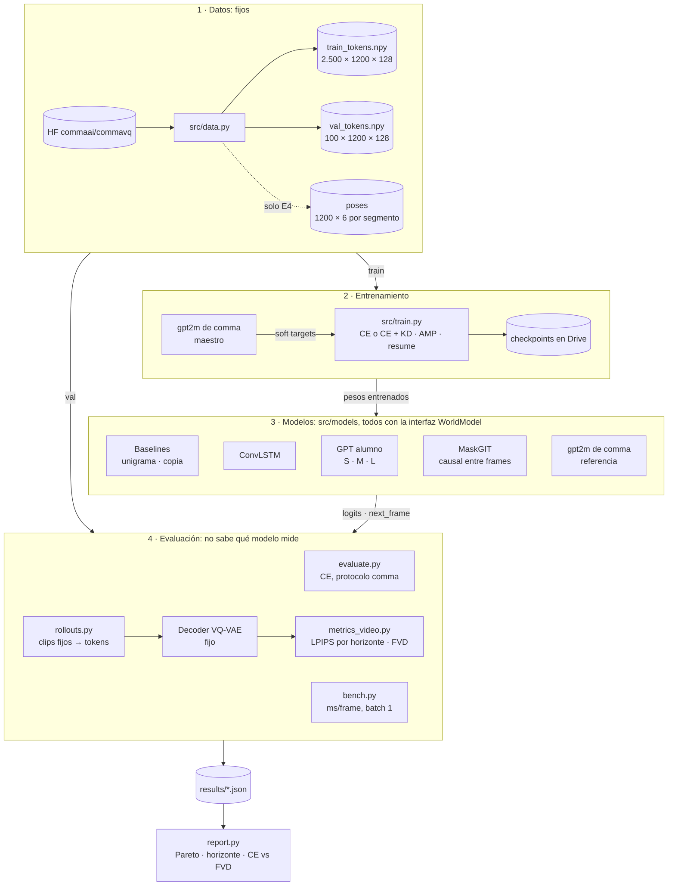
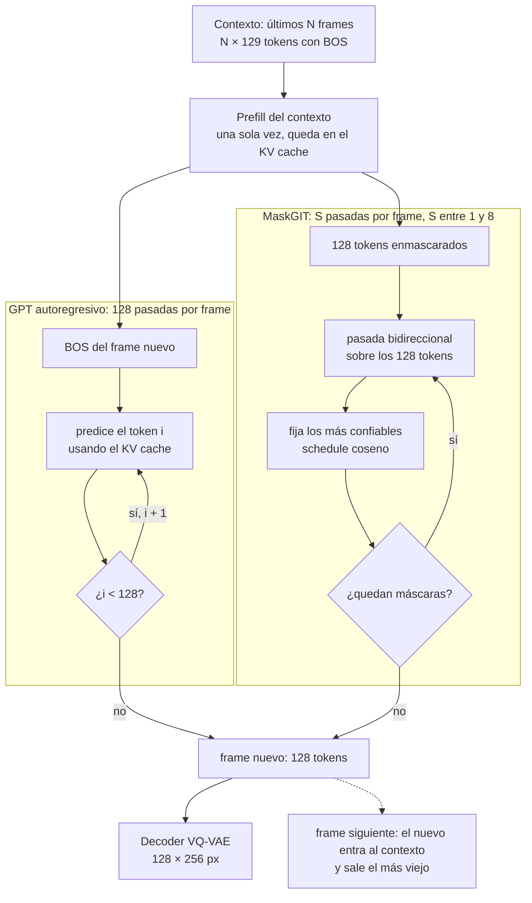
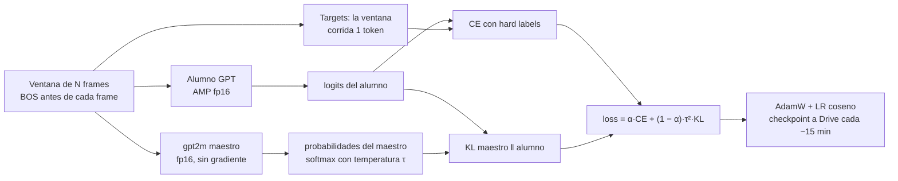
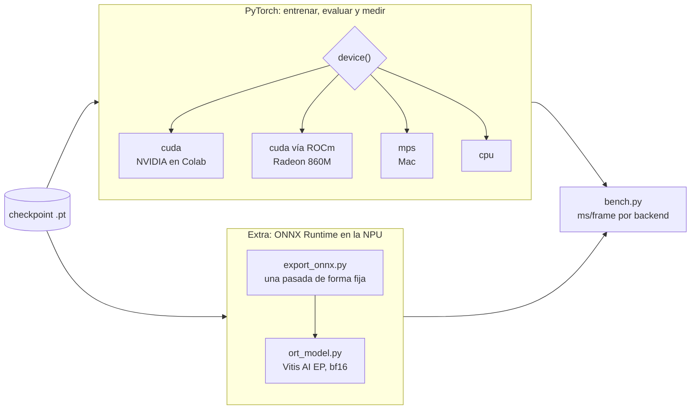
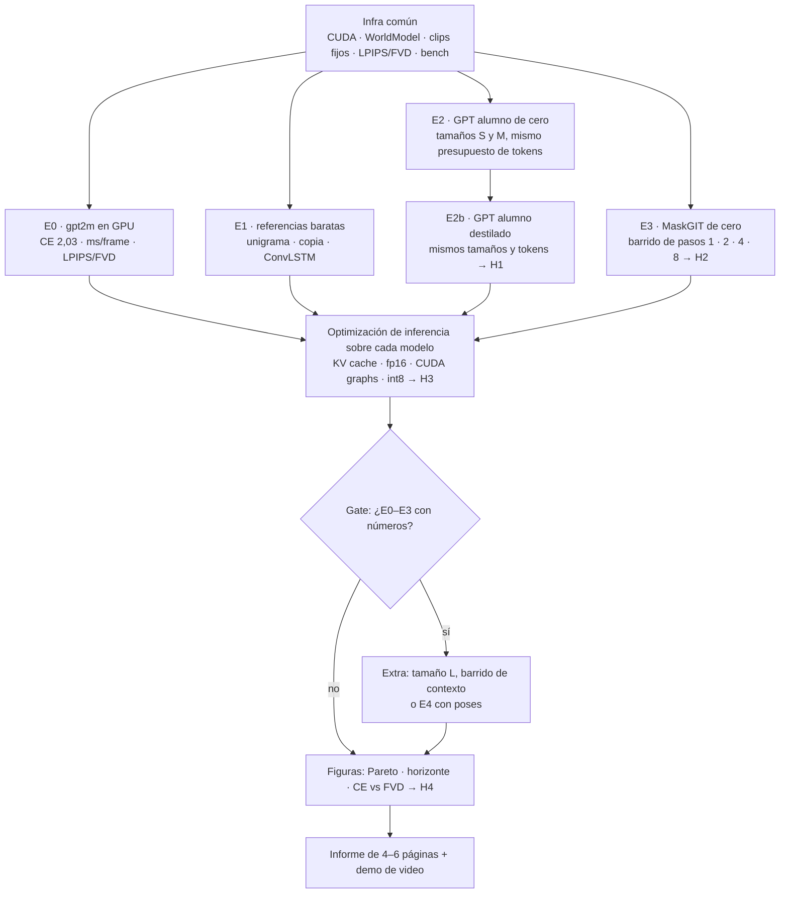
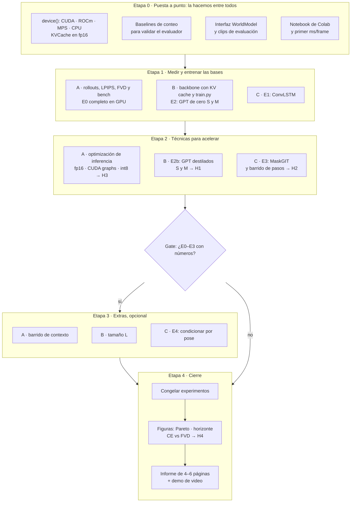

# Plan de implementación: world models de manejo más chicos y más rápidos

> Propuesta para discutir en el grupo. Parte de la pre-entrega ([`pre-entrega/index.html`](../pre-entrega/index.html)), del documento de papers ([`world-models-conduccion-papers.md`](world-models-conduccion-papers.md)) y del estado actual del repo. Las decisiones abiertas están en la [sección 4](#4-decisiones-para-tomar-en-grupo).

**Pregunta:** ¿cuánto se puede achicar y acelerar un world model de video de manejo sin perder calidad?

**Resultado buscado:** la curva calidad vs. velocidad y qué configuración llega a **50 ms por frame** (tiempo real a 20 FPS) sin alejarse del **CE 2,03** del GPT de comma.

## 1. Qué comprometimos en la pre-entrega

La pre-entrega fija un alcance más chico que el documento de papers. Esto es lo que dijimos que vamos a hacer:

| Bloque | Qué incluye | Fuera del alcance |
|---|---|---|
| Pipeline | Encoder y decoder del VQ-VAE de commaVQ fijos. Todo el trabajo es sobre el transformer que predice el próximo frame. | Entrenar o cambiar el tokenizer. |
| Técnicas | Destilación del GPT de comma a un modelo chico. Generación en paralelo estilo MaskGIT (~8 pasadas en vez de 128). KV cache y menor precisión (fp16 / int8). | Speculative decoding, atención factorizada, DiT, JEPA. |
| Calidad | CE en val con el protocolo de comma. LPIPS y FVD del video generado vs. el real a distintos horizontes. | FID (opcional), diversidad, L2 de pose. |
| Velocidad | Milisegundos por frame generado. | Throughput con batch grande (opcional). |
| Referencias | Baselines de conteo (unigrama, copia), ConvLSTM sobre la grilla 8×16 y GPT de comma (gpt2m). | |
| Roadmap | 1) Modelos chicos: de cero vs. destilado, y ConvLSTM. 2) Más rápido: MaskGIT, KV cache, fp16/int8 y ms/frame. 3) Cierre: curva calidad vs. velocidad. | E4 (poses) y E5 (JEPA/DiT) del documento de papers. |

### Estado actual vs. alcance

| Ítem | Estado | Dónde está | Qué falta |
|---|---|---|---|
| Datos: shard 0 de train (2.500 segmentos) + val oficial (100) | Hecho | [`src/data.py`](../src/data.py) | Las poses no se extraen; solo hacen falta para E4. |
| Benchmark de CE con el protocolo de comma | Hecho, solo gpt2m | [`src/evaluate.py`](../src/evaluate.py): `ce_all = 2,026` | Generalizarlo a cualquier modelo. Correrlo en GPU: hoy 2 segmentos tardan 15 min en CPU. |
| Baselines de conteo (unigrama, copia del frame anterior) | Pendiente | Las slides muestran números de pruebas previas (6,85 y 3,48) | Implementarlos como los primeros `WorldModel`. Sirven para validar el evaluador. |
| GPT chico | Pendiente | Las slides muestran una prueba previa (11M parámetros, CE 3,19) | Implementarlo desde cero, con KV cache, AMP, checkpoints y resume. |
| Rollouts y métricas por horizonte | Pendiente | | Set fijo de clips, rollouts por lotes, LPIPS y FVD. |
| Rollout de gpt2m con KV cache | Hecho para gpt2m | [`pre-entrega/generar_imagenes.py`](../pre-entrega/generar_imagenes.py) | Generalizarlo a cualquier `WorldModel`. |
| Latencia gpt2m: 1,25 s/frame | Medido, sin documentar el hardware | Slides | Bench reproducible en una GPU fija. |
| ConvLSTM | Pendiente | | |
| Destilación | Pendiente | | |
| MaskGIT | Pendiente | | |
| fp16 / int8 | Pendiente | | |
| LPIPS y FVD por horizonte | Pendiente | | |
| Curva calidad vs. velocidad | Pendiente | | |

En la escalera de experimentos del documento de papers, **solo E0 está completo**. Faltan el pipeline de video (LPIPS/FVD), la ConvLSTM (E1), el barrido de GPT chicos (E2) y MaskGIT (E3).

### Hallazgos del repo que cambian el plan

- **`device()` no elige CUDA.** [`src/common.py`](../src/common.py) devuelve MPS o CPU, así que en Colab todo correría en CPU. Es lo primero que hay que arreglar, de forma que elija CUDA o ROCm según el equipo (ver [2.5](#25-hardware-cuda-en-colab-rocm-y-npu-en-la-laptop)).
- **El `KVCache` de comma usa bf16 por defecto** ([`third_party/commavq/utils/gpt.py`](../third_party/commavq/utils/gpt.py)). La T4 no tiene bf16 nativo: hay que pasar `dtype=torch.float16`.
- **Las poses existen, pero no en val.** Cada segmento del shard de train trae `pose.npy` de forma (1200, 6) en float32, un vector por frame, con algunos NaN. El `val.zip` oficial trae solo tokens. Si se hace E4, hay que armar un val propio separando rutas del shard (o bajar otro shard).
- **El gpt2m tiene ~307M parámetros:** 24 capas, 16 cabezas, d=1024, vocabulario 1025, bloque de 20×129 = 2.580 tokens. Contados en el checkpoint: pesa 1,39 GB porque en fp32 también guarda las máscaras causales de atención (~160M valores) además de los pesos.

## 2. Arquitectura

### 2.1 Sistema

Todo modelo implementa la misma interfaz (`WorldModel`). Así, la evaluación, los rollouts y el bench no saben qué modelo están midiendo, y cada persona puede trabajar en un modelo sin tocar la evaluación.



**Interfaz común** (propuesta, a ajustar):

```python
class WorldModel(Protocol):
    ctx_frames: int  # cuántos frames de contexto usa

    def logits(self, frames: LongTensor) -> Tensor:
        """(B, F, 128) tokens -> logits del próximo token para el protocolo de CE.
        Solo para modelos con verosimilitud (GPT, ConvLSTM, baselines)."""

    def next_frame(self, ctx: LongTensor, temperature: float = 1.0, steps: int | None = None) -> LongTensor:
        """(B, F, 128) contexto -> (B, 128) tokens del frame siguiente.
        GPT: 128 pasadas con KV cache. MaskGIT: `steps` pasadas. ConvLSTM: 1 pasada."""
```

**Estructura de código propuesta** (lo existente queda donde está):

```text
src/
  common.py         constantes, with_bos, device()  ← CUDA/ROCm, MPS o CPU
  data.py           descarga y extracción           ← poses opcionales para E4
  windows.py        dataset de ventanas de N frames para entrenar
  models/
    baselines.py    unigrama, copia
    backbone.py     transformer propio: KV cache, máscara causal o causal por bloques
    gpt.py          GPT alumno sobre el backbone (máscara causal)
    maskgit.py      MaskGIT sobre el backbone: causal entre frames, bidireccional dentro del frame
    gpt2m.py        wrapper del GPT de comma (maestro y referencia)
    convlstm.py
  train.py          CE o CE + KD, AMP fp16, checkpoints y resume en Drive
  evaluate.py       CE con el protocolo de comma, para cualquier WorldModel
  rollouts.py       set fijo de clips → rollouts → results/rollouts/<modelo>.npy
  metrics_video.py  decodifica, LPIPS por segundo de horizonte, FVD (y FID opcional)
  bench.py          latencia ms/frame con batch 1
  report.py         figuras del informe
  export_onnx.py    extra: exporta una pasada de forma fija a ONNX, para la NPU (D8)
  ort_model.py      extra: WorldModel sobre ONNX Runtime con el EP de la NPU (D8)
notebooks/
  colab.ipynb       clona el repo, monta Drive, corre los scripts
```

### 2.2 Generación de un frame: GPT vs. MaskGIT

Esta es la diferencia que explica la velocidad. Los dos modelos comparten el contexto con KV cache; cambia cuántas pasadas hacen falta para el frame nuevo.



**Presupuesto de latencia para 50 ms por frame:**

| Configuración | Pasadas por frame | Tiempo máximo por pasada |
|---|---|---|
| GPT autoregresivo | 128 | 0,39 ms |
| MaskGIT, 8 pasos | 8 | 6,25 ms |
| MaskGIT, 4 pasos | 4 | 12,5 ms |
| ConvLSTM | 1 | 50 ms |

Estimaciones gruesas a validar con `bench.py` apenas exista:

- **gpt2m en una T4 con fp16 y KV cache:** cada token tiene que leer ~600 MB de pesos. A ~300 GB/s eso da ~2 ms por token y ~0,3 s por frame: lejos de 50 ms aun en GPU.
- **Un alumno de decenas de millones de parámetros con batch 1:** no lo limita la memoria sino el overhead de lanzar kernels. Sin CUDA graphs (`torch.compile(mode="reduce-overhead")`) probablemente no baje de 0,39 ms por token.
- **int8:** con modelos chicos y batch 1, la cuantización suele no acelerar por el costo de decuantizar. Si pasa, refuta H3, y eso también es un resultado.
- **Referencia externa:** el baseline GENIE del [1X World Model Challenge](https://github.com/1x-technologies/1xgpt) (MaskGIT de 35M, 2 pasos, 256 tokens por frame) reporta ~30 ms/frame en una RTX 4090. Es un dato del README, no lo verificamos.

### 2.3 Entrenamiento con destilación



**Receta de partida:** α = 0,5, τ = 1–2, forward KL (Hinton 2015). Alternativas para citar: reverse KL ([MiniLLM](https://arxiv.org/abs/2306.08543)) y on-policy ([GKD](https://arxiv.org/abs/2306.13649)).

- **Comparación justa (H1):** el alumno destilado y el de cero tienen la misma arquitectura, los mismos datos, el mismo número de tokens vistos y la misma semilla. Lo único que cambia es la loss.
- **Costo:** el forward del maestro (~2 × 307M FLOPs por token) cuesta entre ~1× (alumno L) y ~8× (alumno S) el paso de entrenamiento del alumno (~6 × N FLOPs por token). Con un presupuesto fijo de ~100M tokens por alumno, en una T4 son unas horas por corrida (estimación gruesa). Si solo hay T4 y entrenamos 3 tamaños, conviene cachear el top-k del maestro una vez (ver D4).

### 2.4 Protocolo de evaluación

| Qué | Cómo |
|---|---|
| CE | Protocolo de comma tal cual (59 ventanas de 20 frames por segmento, 100 segmentos de val). Vale para GPT, ConvLSTM y baselines: un modelo que predice las 128 celdas independientes también define una verosimilitud válida. Para MaskGIT, la CE con 1 paso (todo enmascarado) es válida pero pesimista: para comparar familias manda LPIPS/FVD. |
| Set fijo de clips | 100 segmentos de val × 4 puntos de arranque = 400 clips. Cada clip tiene 1 s de contexto (20 frames) y 3 s de rollout (60 frames). Semillas fijas y temperatura 1,0 para todos los modelos. Se guarda en `results/clips_eval.json`. |
| Referencia "real" | Los tokens reales **decodificados** con el mismo decoder, no el video original. Así se aísla el world model: el decoder es el techo común. |
| LPIPS por horizonte | Pareado frame a frame contra el real, a 0,25 · 0,5 · 1 · 2 · 3 s. |
| FVD | Ventanas de 16 frames de los rollouts, por tramo de horizonte. Con [cd-fvd](https://github.com/songweige/content-debiased-fvd) (I3D para comparar con la literatura; VideoMAE como control del sesgo de contenido, ver [Ge et al. 2024](https://arxiv.org/abs/2404.12391)). Con 400 clips el FVD es ruidoso: reportar el intervalo por bootstrap y usar siempre los mismos clips. |
| Latencia | `bench.py`: batch 1, CUDA events, `torch.cuda.synchronize()`, 20 frames de warm-up y mediana de ≥100 frames. Se mide `next_frame` sin el decoder; el decoder se reporta aparte. Siempre en la misma GPU (D1). |

Los rollouts para medir calidad se generan con batch grande (más barato). Solo la latencia se mide con batch 1.

### 2.5 Hardware: CUDA en Colab, ROCm y NPU en la laptop

Entrenar, evaluar y medir corre en PyTorch. `device()` elige `cuda`, que cubre NVIDIA y también AMD con ROCm: los builds ROCm usan la misma API `torch.cuda`, y `torch.version.hip` dice cuál es. Si no hay, elige `mps` en Apple, y si no, `cpu`. Una variable de entorno (por ejemplo `ML2_DEVICE=cpu`) fuerza CPU para comparar. La NPU es un camino aparte y opcional, solo para inferencia (D8).



| Equipo | `device()` | Cómo se instala torch |
|---|---|---|
| Colab, NVIDIA T4/L4/A100 | `cuda` | PyPI |
| Laptop Ryzen AI 7 350 (Radeon 860M, gfx1152) | `cuda` vía ROCm | Ruedas de AMD para gfx1152, en Python 3.14: `--index-url https://stable.repo.amd.com/rocm/whl-next/` y `torch[device-gfx1152]==2.14.0+rocm10.1.0`, instaladas antes que `requirements.txt`. Ya probado en la copia `ml2-gen-world-model-rocm`. |
| Mac, Apple Silicon | `mps` | PyPI |

En la laptop hay que prender AOTriton (`TORCH_ROCM_AOTRITON_ENABLE_EXPERIMENTAL=1`). En gfx1152 viene apagado, y sin él `scaled_dot_product_attention` cae al backend math, que arma la matriz de atención entera.

Las mediciones de gpt2m en la laptop están en el README de la copia `ml2-gen-world-model-rocm` (sección "ROCm en Windows"). Con bf16 y atención causal, el rollout da 4,2 s/frame en la iGPU y 9,0 s/frame en la CPU, y el entrenamiento de un GPT chico procesa 14,8k tokens/s en la iGPU.

**Medición en la laptop:** una pasada tipo MaskGIT de un modelo de 11,7M parámetros (6 capas × 384) sobre 640 tokens, con batch 1 y bloques de atención propios (sin SDPA):

| Backend | ms por pasada (mediana) | ¿Igual a fp32? |
|---|---|---|
| PyTorch, CPU, fp32 | 60 | referencia |
| ONNX Runtime, CPU, fp32 | 37–48 | sí |
| ONNX Runtime + DirectML, iGPU, fp32 | 77 | sí |
| PyTorch + ROCm, iGPU, fp32 | 54 | sí |
| **PyTorch + ROCm, iGPU, fp16** | **11** | sí: 100 % de los argmax |
| PyTorch + ROCm, iGPU, bf16 | 11 | 98 % de los argmax |
| ONNX Runtime + NPU (Vitis AI EP), bf16 automático | 19,5 | 99 % de los argmax |

Con 4 pasadas por frame, un MaskGIT chico entraría en ~45 ms por frame en la iGPU de la laptop. Es un dato temprano a favor de H2, y la laptop puede ser un segundo punto de hardware en el informe, aparte de la GPU de referencia (D1).

**NPU: funciona, pero más lenta que la iGPU.** La NPU XDNA 2 corre esa misma pasada con ONNX Runtime y el EP de AMD que Windows ya trae instalado:

- **Reparto:** el 97 % del tiempo corre en la NPU, como un solo kernel. Solo el lookup del embedding (`Gather`) queda en CPU.
- **Precisión:** la NPU pasa el modelo a bf16 sola; no hace falta cuantizar.
- **Compilación:** la primera vez tarda ~1 minuto. Queda en caché (`C:\temp\<usuario>\vaip\.cache`), y después la sesión abre en menos de 1 s.
- **Latencia:** 19,5 ms por pasada. Le gana a la CPU (37 ms), pero no a la iGPU con ROCm en fp16 (11 ms). No medimos consumo, que es donde la NPU debería ganar.

Cómo se corre (lo que costó encontrar):

- **Requisitos de sistema:**
  - Windows 11 24H2 (build 26100) o posterior.
  - AMD Adrenalin 25.6.3 o posterior.
  - Driver de NPU 32.0.203.280 o posterior.
  - El paquete `Microsoft.WinML.AMD.NPU.EP.2`, que Windows instala solo por la Store.
- **Entorno:** Python 3.14 con `onnxruntime-windowsml` 1.30.1 y `numpy`. No hacen falta los paquetes `wasdk-*` de Windows ML: los de PyPI (2.3.0) no tienen rueda para 3.14 y su descarga de EPs falla (`0x80004004`).
- **EP:** se registra a mano la DLL `onnxruntime_vitisai_ep.dll` del paquete `Microsoft.WinML.AMD.NPU.EP.2`, con `ort.register_execution_provider_library`, y se elige el dispositivo NPU con `SessionOptions.add_provider_for_devices`.
- **El truco:** hay que copiar la carpeta `ExecutionProvider` del paquete (~700 MB) a una ruta sin espacios y registrarla desde ahí. Desde `C:\Program Files\WindowsApps\...` el compilador de la NPU no encuentra sus propios archivos y falla.
- **EP "RyzenAI":** corre, pero no toma las operaciones de un transformer genérico y todo cae a CPU.
- **Si este camino deja de andar:** hay tres alternativas.
  - Ryzen AI Software 1.9 de AMD. Es un MSI con su propio entorno; pide aceptar su licencia, cmake 3.26 o posterior y el driver de NPU que indique su documentación.
  - Esperar a que Windows ML 2.5.96 o posterior llegue a PyPI: desde esa versión, los EPs se bajan por la Store.
  - Cuantizar a int8: es el camino de AMD para redes convolucionales y no está documentado para transformers.
- **No usar `torch-directml`:** su última release es de septiembre de 2024 y Microsoft movió el desarrollo a Windows ML.

## 3. Flujo de experimentos



| Hipótesis | Experimento | Se confirma si… |
|---|---|---|
| H1: el alumno destilado le gana al de cero del mismo tamaño | E2 vs. E2b | La CE en val del destilado es menor, con la misma cantidad de tokens vistos. |
| H2: MaskGIT con pocos pasos baja de 50 ms con pérdida moderada | E3 | Algún S ≤ 8 da < 50 ms/frame en la GPU de referencia, y su LPIPS a 1 s queda cerca del GPT del mismo tamaño. |
| H3: fp16 / int8 aceleran casi sin perder calidad | OPT | Baja la latencia sin que cambie la CE ni el LPIPS. Es probable que int8 no acelere; reportarlo igual. |
| H4: CE y FVD están correlacionadas | Todas las configuraciones autoregresivas | Correlación de rango alta entre CE y FVD a 1 s. |

**Figuras del informe:**

1. **Central:** FVD (o LPIPS a 1 s) vs. ms por frame, un punto por configuración, con la línea de 50 ms y la frontera de Pareto.
2. **Horizonte:** LPIPS y FVD vs. segundos de rollout para las mejores configuraciones.
3. **Extra:** CE vs. FVD (H4).

## 4. Decisiones para tomar en grupo

| # | Decisión | Opciones | Recomendación | Por qué |
|---|---|---|---|---|
| D1 | GPU de referencia para la latencia | T4 · L4 · A100 | **T4**, con L4 como secundaria si la hay | Es la GPU gratis de Colab, la que da sentido a "tiempo real con poco cómputo". Fijarla desde la primera medición y no mezclar. |
| D2 | Contexto de los alumnos | 20 · 8 · 4 frames | **20 por defecto**; barrer 4/8/20 solo en el mejor modelo | Reusa `evaluate.py` y las ventanas del maestro sin cambios, y la CE es comparable 1:1 con 2,03. Con KV cache y batch 1, el contexto pesa poco en la latencia. |
| D3 | Arquitectura del alumno autoregresivo | Transformer propio · clase `GPT` de comma achicada | **Transformer propio estilo nanoGPT, con KV cache y máscara configurable** | El mismo backbone sirve para el GPT (máscara causal) y para MaskGIT (causal por bloques), así que la comparación entre familias es justa. Además, el muestreo de comma solo admite batch 1 (`sample` toma `logits[0, -1]`). La clase de comma queda solo para cargar gpt2m como maestro y referencia. Mismo formato que el maestro (BOS, vocabulario 1025). Tamaños sugeridos: S = 6 capas × 384 (~12M), M = 8 × 512 (~27M), L = 12 × 768 (~88M). |
| D4 | Maestro en la destilación | Online en fp16 · top-k cacheado | **Online**, con presupuesto fijo de tokens | Sin el sesgo del top-k ([Sparse Logit Sampling](https://arxiv.org/abs/2503.16870)) y sin 10 GB o más en Drive. Cachear top-32 solo si hay que entrenar 3 tamaños en T4. |
| D5 | Arquitectura de MaskGIT | Máscara causal por bloques · ST-transformer factorizado | **Máscara causal por bloques** | Atención completa sobre la ventana, causal entre frames y bidireccional dentro del frame. Comparte código y KV cache con el GPT. Entrenamiento estilo [Genie](https://arxiv.org/abs/2402.15391): enmascarar cada frame con una tasa uniforme en [0,5, 1]. El ST-transformer queda como extra. |
| D6 | E4: condicionar por pose | Dentro · fuera | **Fuera del núcleo**; se decide en el gate, al terminar la etapa 2 | No estaba en la pre-entrega, y val no trae poses: obliga a armar otro split. |
| D7 | Métricas de video | LPIPS · FVD · FID | **LPIPS por horizonte + FVD**; FID opcional | Son las que comprometimos. FID suma poco cuando ya hay FVD. |
| D8 | Inferencia en NPU | Núcleo · extra · no | **Extra de la etapa 3** | Funciona (ver [2.5](#25-hardware-cuda-en-colab-rocm-y-npu-en-la-laptop)), pero por ahora es más lenta que la iGPU con ROCm (19,5 vs 11 ms por pasada). Suma como punto de "hardware de borde" si sobra tiempo, sobre todo si se mide consumo. |

## 5. Etapas

Cada etapa termina cuando cumple su criterio de salida, y cada una deja algo entregable aunque la siguiente no salga. La etapa 0 es de todos y bloquea al resto. Desde la etapa 1 hay tres frentes en paralelo, uno por persona:

- **A · Evaluación:** rollouts, métricas, bench y optimización de inferencia.
- **B · GPT alumnos:** de cero y destilados.
- **C · ConvLSTM y MaskGIT.**



### Etapa 0 · Puesta a punto

1. Implementar los baselines de conteo (unigrama y copia del frame anterior) como los primeros `WorldModel`. Son triviales y sirven para validar `evaluate.py` contra los números de las slides (6,85 y 3,48).
2. `device()` que elija CUDA o ROCm (misma API `torch.cuda`), MPS o CPU, y que registre cuál usó. Un `requirements-rocm.txt` para la laptop (ver 2.5). `KVCache` de comma en fp16 en lugar de bf16.
3. Acordar la interfaz `WorldModel` y generar `results/clips_eval.json`.
4. Notebook de Colab que clone el repo, monte Drive y corra `evaluate.py` sobre gpt2m en GPU, para validar el entorno.
5. Primera medición con `bench.py`: gpt2m y GPT chicos sin entrenar (la latencia no depende de los pesos) en la GPU de referencia. Ese número calibra todo lo demás.

**Termina cuando:** `evaluate.py` corre en GPU sobre gpt2m, los baselines reproducen los números de las slides y hay un primer ms/frame de gpt2m y de los tamaños S, M y L sin entrenar.

### Etapas 1 a 4

| Etapa | A · Evaluación | B · GPT alumnos | C · ConvLSTM y MaskGIT | Termina cuando… |
|---|---|---|---|---|
| 1 · Medir y entrenar las bases | Rollouts, LPIPS, FVD y bench. E0 completo en GPU. | Backbone con KV cache y `train.py` con AMP y resume. E2: GPT de cero, tamaños S y M. | E1: ConvLSTM. | E0, E1 y E2 tienen CE, LPIPS, FVD y ms/frame en `results/`. |
| 2 · Técnicas para acelerar | Optimización de inferencia sobre cada modelo: fp16, CUDA graphs, int8 (H3). | E2b: destilados S y M, con el mismo presupuesto de tokens que E2 (H1). | E3: MaskGIT y barrido de pasos 1 · 2 · 4 · 8 (H2). | Cada configuración tiene su punto calidad/latencia y se puede dibujar la frontera de Pareto. |
| Gate | | | | ¿E0–E3 tienen números? Si sí, etapa 3. Si no, directo a la 4. |
| 3 · Extras (opcional) | Barrido de contexto 4 · 8 · 20 sobre el mejor modelo. Latencia de las mejores configuraciones también en la iGPU y, opcional, en la NPU de la laptop (D8). | Tamaño L. | E4: condicionar por pose (requiere armar un val con poses). | Entra lo que alcance; nada de esto bloquea el cierre. |
| 4 · Cierre | Figuras: Pareto, horizonte, CE vs. FVD (H4). | Informe de 4–6 páginas. | Demo de video. | Experimentos congelados, figuras e informe listos. |

## 6. Riesgos

| Riesgo | Mitigación |
|---|---|
| No llegar con todo el alcance | Recortes explícitos: E4 y E5 afuera, FID opcional, tamaño L solo si sobra tiempo. Cada etapa ya deja algo entregable. |
| Ni el GPT chico llega a 50 ms | Es un resultado válido y es justamente el argumento para MaskGIT. Probar CUDA graphs antes de descartarlo. |
| Las sesiones de Colab se cortan | Checkpoint a Drive cada ~15 min y `train.py` reanudable. |
| Las GPUs de Colab varían | Anotar la GPU en cada `results/*.json` y descartar latencias de otra GPU. |
| FVD ruidoso con 400 clips | Mismos clips para todos los modelos, intervalo por bootstrap y LPIPS como métrica pareada de respaldo. |
| La CE de MaskGIT no es comparable con la del GPT | Comparar familias con LPIPS y FVD. Reportar la CE de MaskGIT aparte. |
| Novedad del benchmark | No encontramos trabajos que evalúen world models sobre commaVQ en calidad vs. latencia, pero la búsqueda no fue exhaustiva. Escribir "hasta donde sabemos" y no "primeros". El compression challenge de commaVQ mide bits por token, no generación. |
| comma ya pasó de tokens VQ a un DiT sobre un VAE continuo ([Goff et al. 2025](https://arxiv.org/abs/2504.19077)) | Justificar commaVQ en el informe: es público, los tokens están fijos y el benchmark es reproducible. |

## 7. Trabajo relacionado para el eje de velocidad

Surgió de una búsqueda rápida. Conviene leer cada fuente antes de citarla.

- **[MineWorld](https://arxiv.org/abs/2504.08388)** (Microsoft, 2025): world model autoregresivo sobre tokens visuales con decodificación paralela "diagonal". Reporta ~3× de aceleración medida. Es el paper más cercano a nuestra pregunta. Ojo: el abstract y las tablas no coinciden en los FPS.
- **[Genie](https://arxiv.org/abs/2402.15391)** y el baseline GENIE del [1X World Model Challenge](https://github.com/1x-technologies/1xgpt): MaskGIT como dinámica sobre tokens de video. Es la receta más directa para E3.
- **[DIAMOND](https://arxiv.org/abs/2405.12399)** (~10 FPS en una RTX 3090) y **[GameNGen](https://arxiv.org/abs/2408.14837)** (~20 FPS con 4 pasos de denoising): tiempo real con difusión de pocos pasos.
- **[Learning to Drive from a World Model](https://arxiv.org/abs/2504.19077)** (comma, 2025): DiT a 128×256 y 5 Hz, con 15 pasos de Euler. No reporta latencia.
