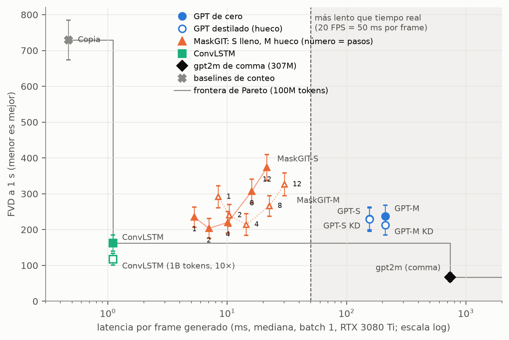
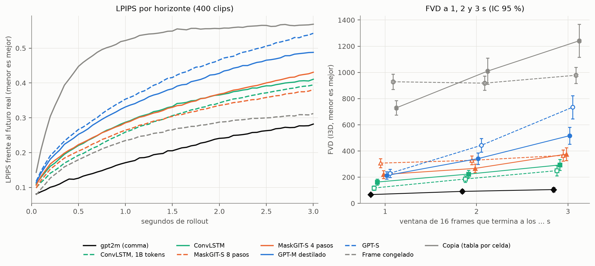
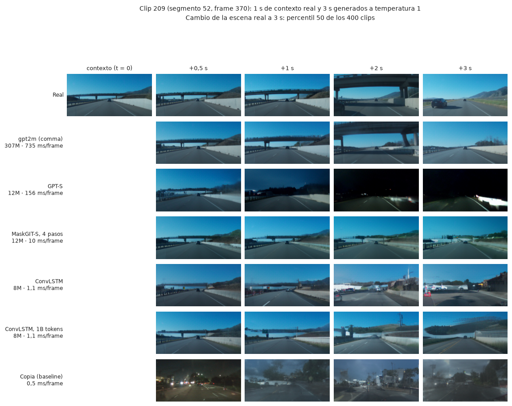
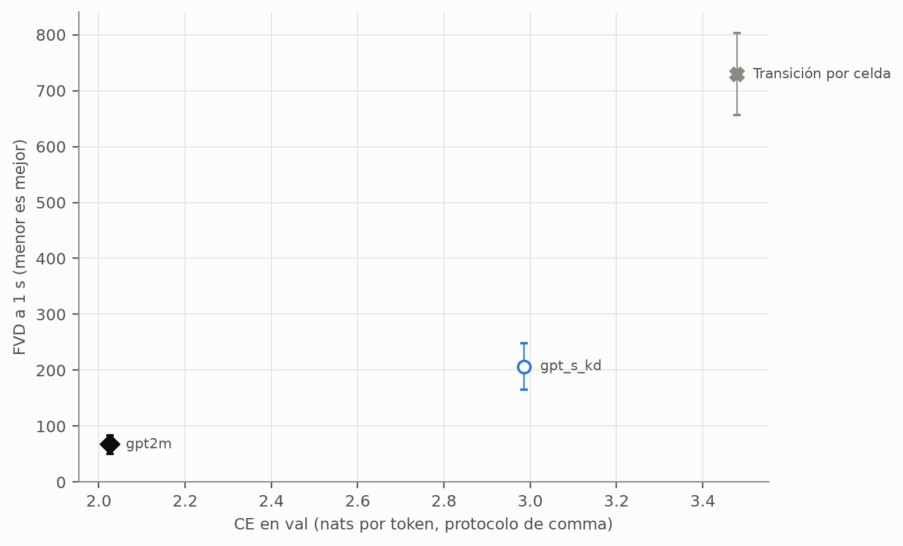
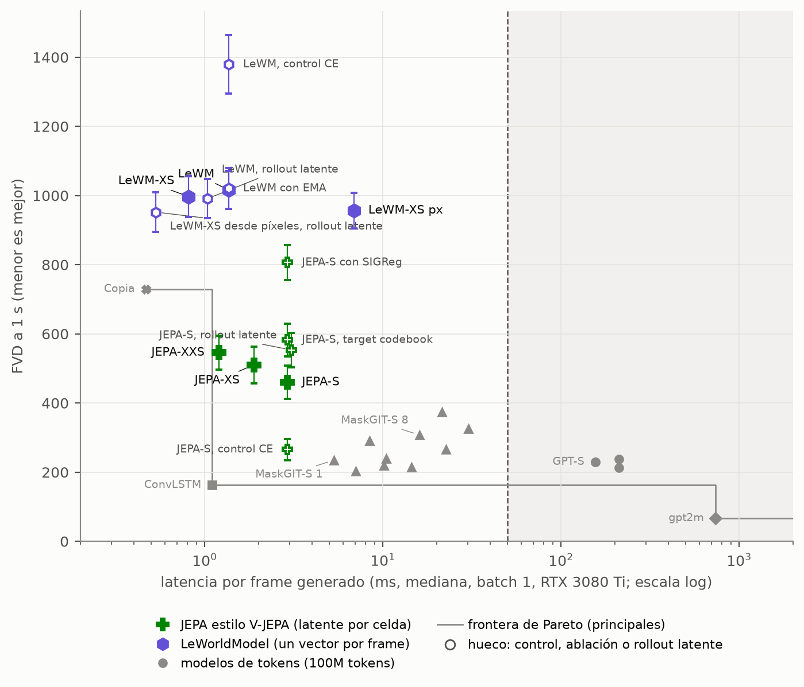
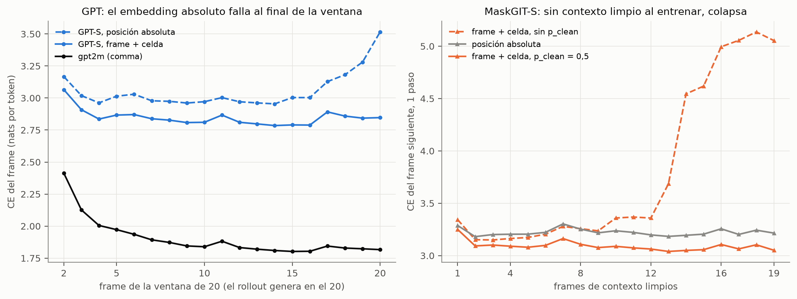
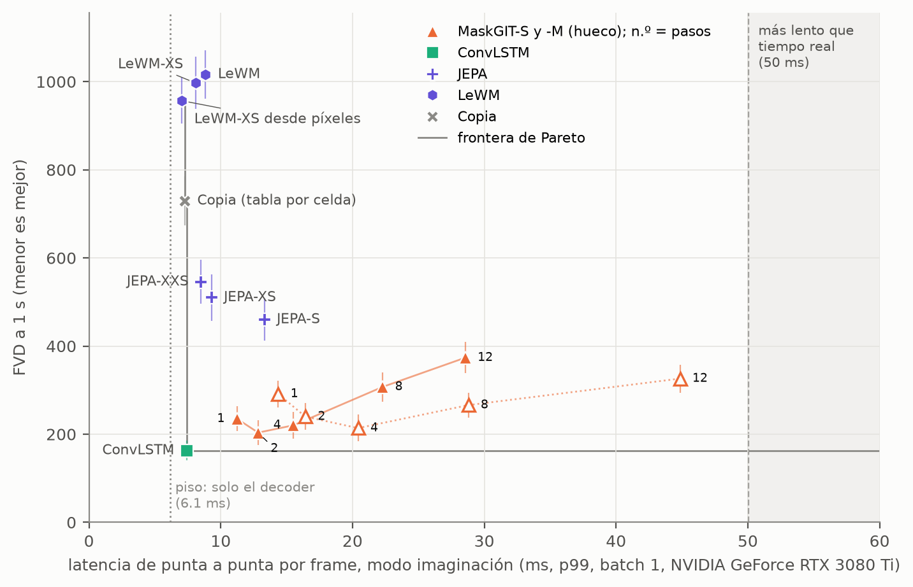

# Resultados: world models de manejo más chicos y más rápidos

Ejecución completa de [`plan-proyecto.md`](plan-proyecto.md): E0–E3, la optimización de inferencia (H3), los extras de la etapa 3 y el cierre. Además, E5: los world models latentes JEPA y LeWorldModel ([`plan-jepa.md`](plan-jepa.md), sección 7). Cómo se implementó y validó: [`plan-implementacion.md`](plan-implementacion.md). Números crudos: `results/*.json`. Tabla de todas las configuraciones: [`results/summary.md`](../results/summary.md). Pruebas de las hipótesis: [`results/hypotheses.md`](../results/hypotheses.md).

## Resumen

- **Tiempo real, sí; calidad de gpt2m, no.** gpt2m (307M) tarda 735 ms por frame aun con fp16 y CUDA graphs: 15 veces más que los 50 ms de 20 FPS. Los GPT chicos tampoco llegan (156–211 ms), porque generar 128 tokens de a uno pone un piso. MaskGIT (5–23 ms con 1 a 8 pasos) y ConvLSTM (1,1 ms) entran con margen, incluso sumando el decoder (15 ms). Pero con 100M tokens ningún modelo chico se acerca al CE 2,03 de gpt2m: el mejor llega a 2,88 y su FVD a 1 s es 163 contra 67.
- **La frontera de Pareto a 100M tokens es copia, ConvLSTM y gpt2m.** ConvLSTM (8M) domina a todos los transformers chicos: mejor CE (2,879), mejor FVD a 1 s (163) y 1,1 ms por frame. Con 10× más tokens baja a CE 2,685 y FVD 117, y la brecha con gpt2m se achica pero no se cierra.
- **H1 (destilación): se confirma, pero el efecto es chico.** El destilado le gana al de cero en 99–100 de 100 segmentos de val, pero por 0,007 nats en S y 0,032 en M. En video se nota a 3 s (GPT-M: FVD 630 → 517), no a 1 s en S.
- **H2 (MaskGIT): se confirma.** Con 2 a 8 pasos baja de 50 ms (7–23 ms) y su LPIPS a 1 s es **mejor** que el del GPT del mismo tamaño, que tarda 156–211 ms. Con más pasos mejora el LPIPS y el FVD a 3 s, pero el FVD a 1 s empeora con 8.
- **H3 (precisión):** fp16 no cambia la calidad (CE ± 1e-5, LPIPS y FVD dentro del ruido). Lo que acelera es fp16 + CUDA graphs (2,8–3,1×). fp16 solo apenas ayuda a batch 1 e int8 no acelera: en CPU el GPT-S int8 es **más lento** (1048 contra 844 ms).
- **H4 (CE vs. FVD): se confirma.** CE y FVD a 1 s ordenan igual las 9 configuraciones autoregresivas (Spearman ρ = 1,00).
- **E5 (JEPA y LeWorldModel): predecir en el espacio latente no ayuda en este problema.**
  - **JEPA-S (V-JEPA):** queda peor que su control entrenado con CE, que tiene la misma arquitectura (FVD a 1 s 460 contra 265).
  - **LeWM:** es lo más rápido después de la copia (1,0–1,4 ms por frame) y planifica 42 veces más barato que JEPA. Pero su vector de 192 por frame no guarda los tokens, y el video queda al nivel del unigrama.
  - **Acciones:** los dos modelos casi no usan la pose, y el CEM no la recupera (sección 7).
  - **Versiones chicas (E5b):** JEPA-XXS (1,7M) baja a 1,2 ms con FVD 546, y LeWM-XS (10,9M) a 0,81 ms con la misma calidad que LeWM. Ninguna entra en la frontera de Pareto.
  - **LeWM desde píxeles (E5c), como en el paper:** misma calidad de video y sin el encoder de comma en inferencia. Con la cámara a la entrada, la cadena con video de salida baja de 10,8 a 7,0 ms, y llegar al latente cuesta 0,8 ms. Su latente detecta mejor las violaciones físicas, pero pierde la velocidad.
- **Inferencia de punta a punta** (video → encoder → world model → decoder → video, todo en la GPU con fp16 y CUDA graphs): en la 3080 Ti todo entra en 50 ms salvo GPT-S. ConvLSTM, la de mejor calidad, hace la cadena completa en 10,3 ms. El codec de comma es el 85–95 % de ese tiempo (sección 10 y [`plan-inferencia.md`](plan-inferencia.md)).
- **Dos hallazgos de diseño fueron necesarios para que los modelos chicos funcionen:**
  - embedding de posición factorizado (frame + celda);
  - en MaskGIT, frames de contexto sin máscara al entrenar (`p_clean`). Sin eso los rollouts colapsan.

## 1. Qué se corrió

| Ítem | Cómo |
|---|---|
| Hardware | RTX 3080 Ti (12 GB, Ampere), Ryzen 9 5900X, Windows 11, torch 2.11 + CUDA 12.8. La GPU de referencia del plan (D1) era la T4: acá todo se midió en la 3080 Ti y cada JSON anota el hardware. `notebooks/colab.ipynb` repite el bench en una T4. |
| Datos | Shard 0 de train (2.500 segmentos, 2.354 rutas) y los 100 segmentos de val oficiales, sin rutas compartidas. Los últimos 50 segmentos de train quedan para monitorear el entrenamiento. |
| Presupuesto | 100M tokens por modelo (batch 16 × 20 frames, 2.423 pasos, AdamW, coseno, AMP fp16, semilla 0). Scratch y destilado ven los mismos batches en el mismo orden y arrancan de la misma inicialización. |
| Tamaños | S = 6 capas × 384 (11,5M), M = 8 × 512 (26,3M), L = 12 × 768 (88M, solo latencia). ConvLSTM: 2 capas de 256, 8,0M. |
| CE | Protocolo de comma: 59 ventanas de 20 frames por segmento, 100 segmentos. `ce_all` incluye los targets BOS. `ce_last`: CE del último frame de cada ventana; para MaskGIT es la CE con 1 paso (frame entero enmascarado). |
| Video | 400 clips fijos (100 segmentos × 4 arranques): 1 s de contexto y 3 s generados, temperatura 1, semillas fijas. Referencia: los tokens reales decodificados con el mismo decoder. LPIPS (AlexNet) pareado por frame; FVD con I3D en ventanas de 16 frames que terminan a 1, 2 y 3 s. IC 95 % por bootstrap sobre clips. |
| Latencia | `bench.py`: batch 1, eventos CUDA, 20 frames de warm-up y mediana de 100 frames, sin el decoder. Con la GPU sin otros trabajos. |

### Desvíos respecto del plan

- **Baseline de copia.** El "mismo token del frame anterior" de las slides (CE 3,48) es una tabla de transición por celda, p(token | token de la misma celda en el frame anterior), ajustada en train: reproduce 3,4797. La mezcla literal "copiar o unigrama" da 4,89 y queda como `copy_mix`; a temperatura 0 es el frame congelado.
- **Embedding de posición factorizado** (frame + celda) en todos los transformers propios, en vez de uno absoluto por posición. Con el absoluto, el GPT empeora en los últimos frames de la ventana, justo donde genera (sección 3).
- **MaskGIT con `p_clean = 0,5`.** La mitad de los frames de cada ventana se dejan sin máscara al entrenar. Sin eso, los rollouts se rompen (sección 3). Tasa de máscara con schedule coseno; el de Genie (uniforme en [0,5; 1]) queda como ablación.
- **Intervalo del FVD.** Valor ± 1,96 · desvío bootstrap. Remuestrear repite clips y sube el FVD, así que la distribución bootstrap queda corrida hacia arriba y el intervalo percentil a veces ni contiene al valor medido.
- **Rollouts de calidad en fp16 con CUDA graphs** para los transformers (fp32 para ConvLSTM y baselines). H3 muestra que fp16 no cambia la calidad.

## 2. Referencias y E0

| Modelo | CE | CE último frame | LPIPS 1 s | FVD 1 s | FVD 3 s |
|---|---:|---:|---:|---:|---:|
| Unigrama | 6,846 | 6,854 | 0,571 | 1471 | 1524 |
| Copia (tabla por celda) | 3,480 | 3,331 | 0,522 | 729 | 1241 |
| Frame congelado | – | – | 0,235 | 929 | 978 |
| **gpt2m (comma, 307M)** | **2,026** | **1,751** | **0,171** | **67** | **105** |

- **E0 reproducido en GPU:** `ce_all` = 2,0257 sobre los 100 segmentos (el README decía 2,026). En fp16 da 2,0257 (diferencia 1,4e-5).
- **LPIPS premia la cautela.** El frame congelado tiene mejor LPIPS a 1 s (0,235) que todos los modelos chicos, porque LPIPS es pareado contra el futuro real y penaliza cualquier divergencia plausible. El FVD, que mide realismo del video, lo pone último entre los modelos (929). Por eso las conclusiones usan las dos métricas y el FVD manda para comparar realismo.

## 3. Dos hallazgos de diseño

### Posición absoluta vs. factorizada (GPT)

CE de cada frame de la ventana de 20 (protocolo de comma, 10 segmentos de val):

| Modelo | f1 | f3 | f8 | f12 | f15 | f16 | f17 | f18 | f19 |
|---|---:|---:|---:|---:|---:|---:|---:|---:|---:|
| GPT-S, posición absoluta | 3,17 | 2,96 | 2,96 | 2,96 | 3,00 | 3,13 | 3,18 | 3,28 | **3,52** |
| GPT-S, frame + celda | 3,06 | 2,84 | 2,81 | 2,80 | 2,79 | 2,89 | 2,86 | 2,84 | **2,85** |
| ConvLSTM | 3,18 | 2,83 | 2,67 | 2,65 | 2,64 | 2,78 | 2,71 | 2,70 | 2,70 |
| gpt2m | 2,41 | 2,01 | 1,85 | 1,82 | 1,80 | 1,84 | 1,83 | 1,82 | 1,82 |

Con el embedding absoluto (un vector aprendido por cada una de las 2.580 posiciones), el GPT chico empeora en los últimos frames. Ese es justo el lugar donde genera cada frame del rollout (con 19 de contexto, el frame nuevo ocupa el lugar 20). Con frame + celda, la misma celda comparte embedding en todos los frames y la curva queda plana: la CE de val baja de 3,158 a 2,957 y el FVD a 1 s de 285 a 230. El pequeño salto en f16 aparece en todos los modelos, gpt2m incluido: es de los datos.

### MaskGIT necesita contexto limpio al entrenar

CE del frame f (todo enmascarado, 1 paso) dados los f frames anteriores limpios:

| Modelo | f1 | f2 | f4 | f8 | f12 | f15 | f17 | f19 | FVD 1 s (8 pasos) |
|---|---:|---:|---:|---:|---:|---:|---:|---:|---:|
| MaskGIT-S, frame + celda, sin `p_clean` | 3,34 | 3,15 | 3,16 | 3,26 | 3,36 | 4,62 | 5,06 | **5,05** | **3295** |
| MaskGIT-S, posición absoluta | 3,29 | 3,18 | 3,20 | 3,25 | 3,20 | 3,20 | 3,20 | 3,22 | 253 |
| MaskGIT-S, frame + celda, `p_clean = 0,5` | 3,25 | 3,09 | 3,09 | 3,11 | 3,06 | 3,06 | 3,06 | **3,05** | 307 |

Al entrenar, cada frame de contexto está enmascarado en promedio un 64 %, así que un contexto largo y limpio no aparece nunca; en inferencia el contexto siempre está limpio. Con el embedding factorizado, el modelo sin `p_clean` colapsa a partir de ~15 frames de contexto y sus rollouts son peores que tokens al azar (FVD 3295 contra 1471 del unigrama). Dejar la mitad de los frames sin máscara (`p_clean = 0,5`) cierra la brecha: la CE mejora con más contexto y queda por debajo de la versión absoluta. La máscara de Genie (tasa uniforme en [0,5; 1], también con `p_clean`) queda peor: CE 3,260 contra 3,022 y FVD a 1 s 338 contra 307.

## 4. Calidad vs. velocidad



*FVD a 1 s contra ms por frame (batch 1, RTX 3080 Ti, fp16 + CUDA graphs para los transformers). La frontera de Pareto se calcula entre las configuraciones con el mismo presupuesto de 100M tokens; ConvLSTM con 1B tokens (hueco) se muestra aparte. GPT-S y GPT-S destilado se superponen: misma latencia y FVD 230 contra 229. Con LPIPS en el eje vertical: [`fig_pareto_lpips.png`](../results/fig_pareto_lpips.png).*

| Configuración | Params | CE | CE último frame | LPIPS 1 s | FVD 1 s [IC 95 %] | FVD 3 s | ms/frame | < 50 ms |
|---|---:|---:|---:|---:|---:|---:|---:|:-:|
| Copia (tabla por celda) | – | 3,480 | 3,331 | 0,522 | 729 [674, 784] | 1241 | 0,47 | sí |
| gpt2m (comma) | 307M | 2,026 | 1,751 | 0,171 | 67 [56, 79] | 105 | 735 | no |
| ConvLSTM | 8,0M | 2,879 | 2,618 | 0,287 | 163 [140, 186] | 293 | 1,1 | sí |
| GPT-S | 11,5M | 2,957 | 2,763 | 0,354 | 230 [199, 260] | 735 | 156 | no |
| GPT-S destilado | 11,5M | 2,949 | 2,749 | 0,356 | 229 [196, 263] | 617 | 156 | no |
| GPT-M | 26,3M | 2,963 | 2,770 | 0,343 | 237 [207, 268] | 630 | 211 | no |
| GPT-M destilado | 26,3M | 2,931 | 2,726 | 0,331 | 213 [185, 242] | 517 | 211 | no |
| MaskGIT-S, 1 paso | 11,5M | – | 3,022 | 0,352 | 235 [207, 263] | 489 | 5,3 | sí |
| MaskGIT-S, 2 pasos | 11,5M | – | 3,022 | 0,320 | 204 [176, 232] | 446 | 7,0 | sí |
| MaskGIT-S, 4 pasos | 11,5M | – | 3,022 | 0,286 | 220 [190, 250] | 376 | 10,1 | sí |
| MaskGIT-S, 8 pasos | 11,5M | – | 3,022 | 0,264 | 307 [274, 341] | 366 | 16,1 | sí |
| MaskGIT-M, 4 pasos | 26,3M | – | 3,134 | 0,298 | 214 [184, 244] | 380 | 14,4 | sí |
| MaskGIT-M, 8 pasos | 26,3M | – | 3,134 | 0,269 | 266 [238, 294] | 341 | 22,6 | sí |
| *ConvLSTM, 1B tokens (extra)* | 8,0M | 2,685 | 2,398 | 0,259 | 117 [101, 134] | 250 | 1,1 | sí |

La CE de MaskGIT es la del último frame con 1 paso (todo enmascarado): no se compara con la CE de las familias autoregresivas, que usan teacher forcing dentro del frame. Todas las configuraciones, con ablaciones y extras: [`results/summary.md`](../results/summary.md).

- **El decoder también cuesta.** Decodificar un frame tarda 15,3 ms (fp32; fp16 no lo acelera), así que el presupuesto real para el world model es de ~35 ms. Entran ConvLSTM y todos los MaskGIT.
- **Por qué el GPT no llega.** Cada frame son 128 pasadas secuenciales. Con CUDA graphs cada pasada de GPT-S tarda ~1,2 ms (el plan estimaba un mínimo de 0,39 ms). MaskGIT con 4 pasos hace 32 veces menos pasadas.
- **Horizonte.** ConvLSTM es el que mejor sostiene el video a 3 s entre los modelos chicos (FVD 293). Los GPT se degradan más rápido (630–735 a 3 s) y MaskGIT queda en el medio (341–489).



*El frame congelado tiene mejor LPIPS que todos los modelos chicos y el peor FVD entre ellos. LPIPS pareado premia no moverse, y por eso el realismo se juzga con FVD.*

### Cómo se ve



*Un clip típico: percentil 50 de cuánto cambia la escena real en 3 s. Los clips de muestra se eligen solo por el movimiento de la escena real, no por cómo le va a cada modelo. Los otros dos son el [percentil 75](../results/ejemplos/clip258.png) y el [percentil 90](../results/ejemplos/clip179.png). Los GIF animados se generan con `python -m src.ejemplos` en `results/ejemplos/`. Para ver cualquier clip o modelo, o generar en vivo: [`notebooks/resultados.ipynb`](../notebooks/resultados.ipynb).*

En los tres clips de muestra se repite el mismo patrón, coherente con las métricas:

- gpt2m sigue la escena real durante los 3 s: pasa bajo el puente, sigue la obra y los autos de adelante.
- Los modelos chicos mantienen la escena alrededor de medio segundo y se separan entre 1 y 2 s.
- GPT-S se degrada hacia imágenes borrosas u oscuras, de ahí su FVD a 3 s alto.
- MaskGIT-S conserva la geometría de la ruta pero deriva en color.
- ConvLSTM inventa una escena distinta pero plausible, por eso tiene mejor FVD y no mejor LPIPS. Con 1B tokens se mantiene más cerca de la real.
- La copia no conserva la escena ni en el primer medio segundo.

## 5. Hipótesis

Detalle y tests en [`results/hypotheses.md`](../results/hypotheses.md) (`scripts/analysis.py`). Las comparaciones son pareadas: mismos 100 segmentos de val para la CE y mismos 400 clips para LPIPS, con IC 95 % por bootstrap y test de Wilcoxon.

**H1: el alumno destilado le gana al de cero del mismo tamaño. Se confirma, con efecto chico.**

| Tamaño | CE val: destilado − de cero | Segmentos donde gana | LPIPS 1 s: destilado − de cero | FVD 1 s / 3 s: de cero → destilado |
|---|---:|---:|---:|---:|
| S | −0,0073 [−0,0080, −0,0065] | 99 de 100 | +0,002 [−0,006, +0,010], p = 0,57 | 230 → 229 / 735 → 617 |
| M | −0,0319 [−0,0336, −0,0302] | 100 de 100 | −0,012 [−0,018, −0,005], p < 0,001 | 237 → 213 / 630 → 517 |

- **El efecto crece con el tamaño:** el alumno M aprovecha más al maestro.
- **En S la mejora es real pero chica:** en CE se ve; en video solo se nota a 3 s.
- **Costo:** destilar costó 4–7 veces más tiempo de entrenamiento, por el forward del maestro de 307M.
- **Igualdad de condiciones:** mismos datos, orden de batches, inicialización, LR y tokens (100M). Lo único que cambia es la loss: α = 0,5, τ = 1, KL(maestro ‖ alumno).

**H2: MaskGIT con pocos pasos baja de 50 ms con pérdida moderada. Se confirma, y no hay pérdida.**

| | Pasos | ms/frame | LPIPS 1 s | MaskGIT − GPT del mismo tamaño [IC 95 %] | FVD 1 s | FVD 3 s |
|---|---:|---:|---:|---:|---:|---:|
| GPT-S | 128 | 156 | 0,354 | | 230 | 735 |
| MaskGIT-S | 1 | 5,3 | 0,352 | −0,001 [−0,009, +0,006] | 235 | 489 |
| | 2 | 7,0 | 0,320 | −0,034 [−0,041, −0,026] | 204 | 446 |
| | 4 | 10,1 | 0,286 | −0,068 [−0,075, −0,061] | 220 | 376 |
| | 8 | 16,1 | 0,264 | −0,089 [−0,096, −0,082] | 307 | 366 |
| GPT-M | 128 | 211 | 0,343 | | 237 | 630 |
| MaskGIT-M | 1 | 8,4 | 0,378 | +0,035 [+0,028, +0,042] | 291 | 476 |
| | 2 | 10,4 | 0,340 | −0,003 [−0,010, +0,004] | 240 | 474 |
| | 4 | 14,4 | 0,298 | −0,045 [−0,051, −0,038] | 214 | 380 |
| | 8 | 22,6 | 0,269 | −0,074 [−0,080, −0,068] | 266 | 341 |

- **Todas las configuraciones de MaskGIT bajan de 50 ms**, y desde 2 pasos (S) o 4 (M) igualan o mejoran el LPIPS del GPT, que es 15–30 veces más lento.
- **Más pasos dan predicciones más estables:** mejor LPIPS y mejor FVD a 3 s. Pero a 8 pasos el FVD a 1 s empeora: al fijar primero los tokens más confiables, los frames se parecen más al contexto.
- **El mejor balance es 4 pasos.**
- **La CE con 1 paso** (3,02 en S) sí es peor que la del GPT, como anticipaba el plan.

**H3: fp16 / int8 aceleran casi sin perder calidad. Se confirma para fp16 (junto con CUDA graphs) y se refuta para int8.**

- **Calidad en fp16:**
  - Cambio en CE de 1,4e-5 (gpt2m), 3e-6 (GPT-S) y 1e-5 (MaskGIT-S).
  - LPIPS fp16 − fp32: −0,0007 [−0,004, +0,003] en GPT-S y +0,0001 [−0,001, +0,001] en MaskGIT-S.
  - FVD 233 → 230 en GPT-S y 309 → 307 en MaskGIT-S.
- **Latencia ([`fig_latency.png`](../results/fig_latency.png)):**
  - fp16 solo apenas acelera a batch 1: −2 % en GPT-S y −15 % en gpt2m. El cuello de botella es lanzar kernels, no la aritmética.
  - Con CUDA graphs, la aceleración total es de 2,8–3,1× en todos los transformers.
  - En ConvLSTM, fp16 no cambia nada (1,1 ms).
- **int8** (cuantización dinámica de `nn.Linear`, CPU):
  - GPT-S: 844 → 1048 ms, más lento.
  - MaskGIT-S, 4 pasos: 375 → 357 ms.
  - ConvLSTM: 8,7 → 8,1 ms. Solo cuantiza la capa lineal; las convoluciones quedan en fp32.
  - En CUDA no se midió: requiere torchao, que no está instalado.


**H4: CE y FVD están correlacionadas. Se confirma.**

- Entre las 9 configuraciones autoregresivas con CE, Spearman da ρ = 1,00 entre CE y FVD a 1 s (p < 0,001), y ρ = 0,93 entre CE y LPIPS a 1 s.
- Iterar con la CE, que es barata, predice bien el orden en video dentro de una familia de modelos.
- Ojo: la CE de MaskGIT no entra en esta comparación, y GPT-S contra GPT-S destilado está empatado en FVD dentro del ruido.



## 6. Extras (etapa 3)

| Extra | Resultado |
|---|---|
| **Presupuesto 10×** (ConvLSTM, 1B tokens, ~70 min) | CE 2,879 → 2,685, último frame 2,618 → 2,398, FVD a 1 s 163 → 117 y a 3 s 293 → 250. Es la mejor configuración en tiempo real, pero sigue lejos de gpt2m (2,026 / 67). |
| **Barrido de contexto** (4 · 8 · 20 frames, en inferencia) | Con 4 u 8 frames la calidad es la misma que con 19, dentro del IC. GPT-S, FVD a 1 s: 236 / 221 / 230. MaskGIT-S con 4 pasos, LPIPS a 1 s: 0,284 / 0,284 / 0,286. En la GPU la latencia casi no cambia (MaskGIT-S con 4 pasos: 10,0 contra 10,1 ms), porque con batch 1 el prefill de un modelo chico es barato. En CPU, donde el prefill domina (MaskGIT-S tarda 375 ms), acortar el contexto sí debería rendir. |
| **Tamaño L** (12 × 768, 88M, sin entrenar) | Solo latencia: 337 ms por frame (GPT, fp16 + graphs) y 20–23 ms (MaskGIT, 1–2 pasos). No se entrenó: con 100M tokens, M no le ganó a S. |
| **Control del LR de M** (GPT-M con LR 1e-3 en vez de 6e-4) | CE de monitoreo 2,868, contra 2,880 con 6e-4 y 2,877 de GPT-S. El LR no explica que M no mejore a S: con este presupuesto, más tamaño no ayuda. |
| **NPU / ONNX** (D8) | `src/export_onnx.py` exporta una pasada de MaskGIT de forma fija y `src/ort_model.py` la corre con ONNX Runtime. En CPU coincide con PyTorch (diferencia máxima de 7,5e-5, 100 % de argmax iguales) y tarda 53 ms por pasada de 645 tokens. La ruta con el EP de Vitis AI está escrita según la sección 2.5 del plan, pero no se pudo probar: esta máquina no tiene NPU. |
| **E4 (pose)** | No se hizo como experimento propio: quedaba fuera del núcleo (D6) y val no trae poses. Las poses de train se extrajeron para E5, como acciones de JEPA y LeWM (sección 7). |

## 7. E5: world models latentes (JEPA y LeWorldModel)

Plan, arquitecturas y adaptaciones: [`plan-jepa.md`](plan-jepa.md). Son dos familias que **predicen la representación del próximo frame** en vez de clasificar sus tokens:

- **`jepa`, estilo V-JEPA:** 128 celdas × 384 por frame y target EMA.
- **`lewm`, estilo LeWorldModel:** un vector de 192 por frame y SIGReg.

Una lectura entrenada aparte convierte ẑ en tokens, así que entran en la misma tabla. Tienen el mismo presupuesto y los mismos batches que el resto. En val corren con la acción nula (val no trae poses), así que la comparación con los modelos de tokens es justa.



*FVD a 1 s contra ms por frame (fp16 + CUDA graphs). En gris, los modelos de tokens de la sección 4 y su frontera de Pareto. Huecos: controles, ablaciones y rollouts latentes. Con LPIPS: [`fig_pareto_latente_lpips.png`](../results/fig_pareto_latente_lpips.png).*

| Configuración | Params | CE | CE último frame | LPIPS 1 s | FVD 1 s [IC 95 %] | FVD 3 s | ms/frame |
|---|---:|---:|---:|---:|---:|---:|---:|
| **JEPA-S (V-JEPA: celda + EMA)** | 11,6M | 3,708 | 3,525 | 0,441 | 460 [412, 508] | 1188 | 2,9 |
| JEPA-S, control CE | 11,6M | 2,959 | 2,739 | 0,358 | 265 [235, 296] | 826 | 2,9 |
| JEPA-S con SIGReg | 11,6M | 4,256 | 4,033 | 0,541 | 806 [755, 857] | 850 | 2,9 |
| JEPA-S, target = codebook | 11,4M | 4,336 | 3,863 | 0,488 | 582 [535, 630] | 971 | 2,9 |
| JEPA-S, rollout latente | 11,6M | – | – | 0,438 | 553 [504, 603] | 2990 | 3,1 |
| **LeWM (vector + SIGReg)** | 21,7M | 6,637 | 6,683 | 0,501 | 1016 [962, 1071] | 1080 | 1,4 |
| LeWM, control CE | 21,7M | 6,574 | 6,615 | 0,597 | 1379 [1295, 1464] | 1945 | 1,4 |
| LeWM con EMA | 21,7M | 6,628 | 6,673 | 0,519 | 1021 [961, 1080] | 1043 | 1,4 |
| LeWM, rollout latente | 21,7M | – | – | 0,481 | 991 [934, 1047] | 1029 | 1,0 |
| *Ref.: MaskGIT-S, 1 paso* | 11,5M | – | 3,022 | 0,352 | 235 [207, 263] | 489 | 5,3 |
| *Ref.: ConvLSTM* | 8,0M | 2,879 | 2,618 | 0,287 | 163 [140, 186] | 293 | 1,1 |
| *Ref.: unigrama* | – | 6,846 | 6,854 | 0,571 | 1471 [1376, 1566] | 1524 | – |

- **Ninguna familia latente entra en la frontera de Pareto:** ConvLSTM es más rápido y mejor que las dos.
- **JEPA-S:** es 1,8 veces más rápido que MaskGIT-S con 1 paso (2,9 contra 5,3 ms), pero su FVD a 1 s es el doble (460 contra 235).
- **Latencia:** con CUDA graphs, LeWM baja de 19 ms (fp32) a 1,4 ms, 14 veces menos. Son 21 capas angostas, y sin graphs domina el lanzamiento de kernels. JEPA-S baja de 11,8 a 2,9 ms.

**E5b: versiones más chicas.** El objetivo era ver si alguna entra en la zona rápida del Pareto, entre la Copia (0,47 ms) y ConvLSTM (1,1 ms). Tienen el mismo presupuesto, los mismos batches y el mismo lr que su familia.

| Configuración | Params | CE último frame | LPIPS 1 s | FVD 1 s [IC 95 %] | FVD 3 s | ms/frame |
|---|---:|---:|---:|---:|---:|---:|
| JEPA-S (6 capas, D 384) | 11,6M | 3,525 | 0,441 | 460 [412, 508] | 1188 | 2,9 |
| JEPA-XS (4 capas, D 256) | 3,7M | 3,676 | 0,463 | 510 [457, 563] | 1121 | 1,9 |
| JEPA-XXS (3 capas, D 192) | 1,7M | 3,724 | 0,463 | 546 [496, 595] | 1264 | 1,2 |
| LeWM (ViT de 12 capas, predictor de 6) | 21,7M | 6,683 | 0,501 | 1016 [962, 1071] | 1080 | 1,4 |
| LeWM-XS (ViT de 6 capas, predictor de 4) | 10,9M | 6,683 | 0,508 | 997 [938, 1056] | 1025 | 0,8 |

- **Ninguna entra en la frontera:**
  - JEPA-XXS queda a 1,2 ms, apenas detrás de ConvLSTM (1,1 ms y FVD 163).
  - LeWM-XS es más rápido que ConvLSTM, pero la Copia es más rápida y mejor (0,47 ms y FVD 729).
- **JEPA pierde poco al achicarse.** Con un tercio de los params, el FVD a 1 s pasa de 460 a 510; con un séptimo, a 546. Coincide con lo de E2 y E3: con 100M tokens, el tamaño no es lo que limita.
- **LeWM-XS da la misma calidad que LeWM con la mitad de los params:**
  - CE, probe de velocidad (r 0,40), sorpresa ante un teletransporte (20,6× contra 19,9×) y CEM (20,6 contra 19,4 m/s) salen casi iguales.
  - El límite es el vector de 192, no la capacidad.
  - Planificar le cuesta 0,31 s por plan, contra 0,54 s de LeWM.
- **Las versiones chicas de JEPA** codifican la pose un poco mejor que JEPA-S (r 0,57 y 0,55 contra 0,52). La pose real baja su error latente un 1,3 %.
- **Costo:** entrenar cada una tarda 2–3,6 min.

**E5c: LeWM desde píxeles, como en el paper.** El LeWM de E5 recibía los tokens de comma, cada uno como su vector del codebook. Eso lo ataba al encoder de comma en inferencia. `lewm_px_xs` tiene la misma arquitectura que LeWM-XS, salvo la entrada: un ViT sobre parches de 16×16 de la imagen RGB. Como el dataset solo trae tokens, los frames se generan al vuelo con el decoder de comma congelado. Mismo presupuesto, mismos batches y mismo lr.

| | LeWM-XS desde tokens | LeWM-XS desde píxeles |
|---|---:|---:|
| Params | 10,9M | 11,0M |
| CE último frame | 6,683 | 6,681 |
| FVD 1 s, rollout de tokens [IC 95 %] | 997 [938, 1056] | 957 [905, 1009] |
| FVD 1 s, rollout latente | – | 952 [895, 1010] |
| LPIPS 1 s, rollout latente | – | 0,457 |
| Probe de velocidad (r, latente predicho) | 0,40 | −0,03 |
| Sorpresa: teletransporte / salto de 2 s | 20,6× / 5,8× | 26,2× / 7,8× |
| Error de velocidad del CEM (repetir la última pose: 0,13) | 20,6 | 23,3 |
| Cadena en línea, cámara → video (p50 / p99) | 10,8 / 12,4 ms | 7,0 / 7,1 ms |
| Cámara → latente | 4,5 ms (encoder de comma 3,8 + modelo) | 0,8 ms |
| Costo de entrenar | 3 min | 59 min (casi todo, generar los frames: 4,1 ms cada uno) |

- **La entrada desde píxeles no cambia la calidad de video:**
  - El FVD a 1 s mejora un poco, pero dentro del ruido.
  - La CE es la misma, cerca de adivinar al azar (6,93).
  - El límite sigue siendo el vector de 192: la lectura desde el latente del frame real da la misma CE que desde el predicho.
- **El latente cambia de contenido.**
  - Detecta mejor lo que viola la física: 26× contra 21× ante un teletransporte.
  - Pero pierde la velocidad: el probe lineal pasa de r 0,40 a ~0.
  - Usa la pose un poco más (error latente 0,3 % menor con la pose real, p < 1e-6), pero sigue siendo casi nada.
- **En inferencia es claramente mejor:**
  - Sin el encoder de comma, la cámara llega al latente en 0,8 ms, contra 4,5.
  - La cadena en línea con video de salida baja de 10,8 a 7,0 ms; casi todo lo que queda es el decoder de comma (6,1 ms), que solo hace falta para mostrar video.
  - Imaginando en el latente, el modelo solo tarda 0,53 ms por frame. Re-codificar cada frame imaginado desde píxeles cuesta 6,9 ms, porque hay que decodificarlo.

**H5: latente vs. tokens con la misma arquitectura. En JEPA, el latente es peor; en LeWM no se puede leer.**

- **JEPA-S contra su control CE** (solo cambia la pérdida):
  - CE de val: +0,75 nats [+0,71, +0,80].
  - LPIPS a 1 s: +0,083 [+0,074, +0,093], p < 1e-39.
  - FVD a 1 s: 460 contra 265.
  - El control CE queda a la par de MaskGIT-S con 1 paso (LPIPS 0,358 contra 0,352): la arquitectura está bien y lo que pierde es el objetivo latente.
- **LeWM y su control CE** quedan los dos cerca del unigrama (CE 6,64 y 6,57), así que la comparación no dice nada sobre el objetivo. El LPIPS sale mejor en el latente (−0,096), pero entre dos modelos que casi no predicen.
  - **El vector de 192 no guarda los tokens.** La lectura desde el embedding *real* del frame (`ce_techo`, 6,69) da lo mismo que desde el predicho. MSE + SIGReg no premian guardar el detalle de la imagen; guardan lo predecible, como el movimiento.
  - **Entrenado de punta a punta con CE**, el control aprende lento: su CE de train baja recién a 6,57. El encoder y el decoder pueden sobreajustar un batch hasta CE 0,002, así que no es un bug: con 100M tokens, comprimir el frame en un vector no alcanza.
  - Su CE de monitoreo tuvo un pico transitorio (7,3 a mitad de camino), por las estadísticas del BatchNorm en modo eval. Al final coincide con la de train.
- **Rollout latente** (ẑ entra al contexto sin re-codificar el frame muestreado):
  - A 1 s da el mismo LPIPS que el rollout por tokens.
  - En JEPA el video se rompe a 3 s (FVD 1188 → 2990): sin volver a los tokens, el error del latente se acumula.
  - En LeWM es un poco mejor (LPIPS −0,021) y el más rápido de todos: 1,0 ms por frame.

**H6: acciones. Se usan, pero muy poco, y el CEM no las recupera.**

Se mide en los 46 segmentos del holdout cuya ruta no aparece en train, con las poses reales:

- **Peso de la acción:** con la pose real, el error latente baja respecto de la acción nula. Es significativo pero chico:
  - JEPA-S: −0,9 % (0,2210 → 0,2189).
  - LeWM: −0,1 %.
  - A 20 FPS, los frames anteriores ya dicen cómo se mueve el auto, y la pose siguiente agrega poco.
- **CEM** con horizonte de 0,5 s, error medio de velocidad:

  | Plan | Error de velocidad (m/s) |
  |---|---:|
  | CEM con JEPA-S | 9,5 |
  | CEM con LeWM | 19,4 |
  | Repetir la última pose | 0,13 |
  | Pose media de train | 8,6 |

  Con un costo casi plano en la acción, el CEM deriva hacia acciones fuera de distribución, aunque arranca en la última pose. Planificar haría falta un modelo que dependa más de la acción. Por ejemplo: horizonte más largo, menos historia, o sin dropout de acción. Queda abierto.
- **Costo de planificar:** un plan tarda 22,7 s con JEPA-S y 0,54 s con LeWM. El vector único hace la planificación 42 veces más barata, que es el argumento central del paper.

**H7: el 2×2 (latente por celda o vector × EMA o SIGReg).**

| Latente | Antiaplastamiento | FVD 1 s | `z_std` final | Probe de velocidad (r) | Sorpresa: teletransporte | Sorpresa: salto de 2 s |
|---|---|---:|---:|---:|---:|---:|
| Celda | EMA (`jepa_s`) | 460 | 0,78 | 0,52 | 8,2× | 5,0× |
| Celda | SIGReg | 806 | 0,26 | 0,53 | 6,9× | 4,4× |
| Vector | EMA | 1021 | 1,89 | 0,47 | 4,5× | 1,5× |
| Vector | SIGReg (`lewm_s`) | 1016 | 0,92 | 0,40 | 19,9× | 5,5× |
| Tokens | GPT-S | | | 0,27 | | |
| Tokens | MaskGIT-S | | | 0,67 | | |

- **La granularidad decide la calidad.** Por celda, FVD 460–806; con un vector, ~1020 con cualquier antiaplastamiento.
- **Con latente por celda, EMA le gana a SIGReg:** FVD 460 contra 806. Además SIGReg colapsa en parte: `z_std` baja de 0,93 a 0,26.
- **Con un vector, EMA y SIGReg empatan en calidad.** Pero con EMA la escala del latente crece (`z_std` 1,89) y la sorpresa ante un teletransporte cae de 19,9× a 4,5×. SIGReg da lo que promete el paper: un latente bien condicionado y sensible a lo que no puede pasar.
- **Probes de pose:** lineal, r de Pearson sobre ẑ en el holdout.
  - Los latentes no codifican la pose mejor que los modelos de tokens. MaskGIT-S llega a 0,67, y el control CE de JEPA a 0,67 en velocidad y 0,64 en giro.
  - El giro casi no aparece en ningún latente (r ≤ 0,16).
  - El probe MLP rinde menos que el lineal porque se sobreajusta con 874 ventanas; se reporta el lineal.
- **Sorpresa:** todos los latentes detectan los dos cortes (p < 1e-11).
- **Rectitud** (coseno entre pasos consecutivos de la trayectoria latente): es negativa en todos, de −0,21 a −0,31. La trayectoria zigzaguea de frame a frame, en vez de enderezarse como reporta LeWM.
- **Barrido de λ en LeWM:**
  - Con λ = 0,03 y 0,09, probes y sorpresa son parecidos.
  - Con 0,3, SIGReg aplasta la información: r de velocidad 0,17 y sorpresa 3,8×.
  - La calidad no cambia con λ (CE del último frame 6,67–6,68).

## 8. Limitaciones

- **Una GPU de escritorio, no la T4.** Las latencias absolutas cambian de GPU a GPU; en una T4 serán mayores. Lo comparable es el orden y la relación entre configuraciones. `notebooks/colab.ipynb` corre el mismo bench en una T4.
- **Presupuesto fijo y una sola semilla.** Con 100M tokens, M no mejora a S y ConvLSTM le gana a los transformers. Con 10× más tokens ConvLSTM sigue mejorando; los transformers no se corrieron más largo, y su sesgo inductivo más débil podría pagar con más datos.
- **FVD con 400 clips** y frames de 128 × 256 llevados a 224 × 224 para I3D: los valores absolutos no son comparables con papers. Diferencias de ~30 de FVD están dentro del ruido (ver IC). LPIPS es pareado y más preciso, pero premia la cautela.
- **Re-prefill por frame.** Con posiciones absolutas dentro de la ventana, cada frame nuevo obliga a recalcular el contexto. En GPU, a batch 1, pesa poco para los modelos chicos, pero domina en CPU y en gpt2m. Un esquema con caché que se desplace (posición relativa) es el siguiente paso natural para la CPU o la NPU.
- **La CE de MaskGIT** (1 paso) no es comparable con la de los modelos autoregresivos. Por eso las familias se comparan con LPIPS y FVD.
- **E5 tiene el mismo presupuesto corto.**
  - LeWM, entrenado de punta a punta con CE, todavía estaba aprendiendo. Con más tokens podría salir del nivel del unigrama, y eso cambiaría la lectura de H5 para esa familia.
  - Las evaluaciones con acciones (H6, probes) usan solo los 46 segmentos del holdout de train separados por ruta, porque val no trae poses.
  - El CEM se corrió con 10 iteraciones y 46 planes por modelo, y no en los controles de JEPA. El barrido de λ no tiene rollouts de video.

## 9. Cómo reproducir

```bash
python -m src.data --poses-only                 # poses de train para E5 (del tar local)
bash scripts/train_all.sh                       # E1, E2, E2b, E3, E5 y ablaciones (~4 h en la 3080 Ti; E5c suma ~2 h)
bash scripts/eval_all.sh quality                # CE, rollouts, LPIPS y FVD
bash scripts/eval_all.sh latent                 # E5: probes, sorpresa, acciones y CEM
bash scripts/extras.sh quality                  # contexto, 1B tokens, control del LR
bash scripts/eval_all.sh bench && bash scripts/eval_all.sh bench-latent && bash scripts/extras.sh bench   # latencias, con la GPU libre
python scripts/make_configs.py && python -m src.report && python scripts/analysis.py
python scripts/ce_por_posicion.py               # datos de la figura de la sección 3
python -m src.ejemplos                          # muestras visuales (PNG y GIF) -> results/ejemplos/
bash scripts/e2e_all.sh all && bash scripts/e2e_all.sh quality   # inferencia de punta a punta (sección 10), con la GPU libre
python -m src.infer.report_e2e                  # results/infer/summary_e2e.md y results/fig_pareto_e2e.png
python -m src.infer.demo --model convlstm       # video real y predicho lado a lado -> results/demo/
```

Notebooks: [`notebooks/resultados.ipynb`](../notebooks/resultados.ipynb) muestra tablas, figuras y muestras, y genera en vivo con un modelo entrenado. [`notebooks/entrenamiento.ipynb`](../notebooks/entrenamiento.ipynb) entrena una configuración, muestra la curva de aprendizaje y la evalúa.

Para no reentrenar: `python -m src.store pull --all` baja los checkpoints del almacén compartido (ver README).



## 10. Inferencia de punta a punta

Todo lo anterior mide el world model solo, desde tokens. Lo que importa en uso es la cadena completa: **video de entrada → encoder VQ → world model → decoder VQ → video de salida**, con 50 ms por frame como límite. Implementación, métodos y cómo correrlo en otros dispositivos: [`plan-inferencia.md`](plan-inferencia.md). Tablas completas: [`results/infer/summary_e2e.md`](../results/infer/summary_e2e.md).



Medido en la RTX 3080 Ti con batch 1 y 3000 frames por configuración; en ms por frame, p50 / p99:

| Configuración | FVD@1s | En línea | Imaginación |
|---|---:|---:|---:|
| Solo el codec (encoder 3,8 + decoder 6,2) | – | 10,0 / 10,1 | – |
| ConvLSTM | 163 | 10,3 / 10,5 | 6,8 / 7,4 |
| MaskGIT-S, 4 pasos | 220 | 18,9 / 19,0 | 15,3 / 15,5 |
| MaskGIT-M, 12 pasos | 326 | 39,0 / 39,3 | 39,3 / 44,9 |
| JEPA-S | 460 | 13,0 / 14,9 | 9,2 / 13,3 |
| LeWM-XS | 997 | 10,8 / 12,4 | 7,0 / 8,1 |
| GPT-S | 230 | 167 / 171 | 164 / 171 |

- **Pasar todo a la GPU en fp16 con CUDA graphs es lo que hace la diferencia, sin reentrenar.** El codec baja de 21,9 a 9,9 ms, y fp16 no cambia su calidad: el LPIPS de la reconstrucción se mueve 0,0008.
- **Con los modelos rápidos, el codec es el 85–95 % de la cadena.** Achicar más el world model casi no cambia el total.
- **Sobra presupuesto, pero gastarlo en más pasos de MaskGIT empeora el FVD:** 220 con 4 pasos, 307 con 8 y 374 con 12, en MaskGIT-S.
- **A ritmo de cámara (un frame cada 50 ms), la latencia sube a ~20 ms** porque la GPU baja los relojes entre frames. Sigue entrando en el presupuesto.
- **Predecir el frame siguiente en línea es difícil de mejorar respecto de repetir el último frame:** 38,9 % de tokens iguales y LPIPS 0,075. A temperatura 0, solo ConvLSTM lo supera apenas (40,0 %, LPIPS 0,073).
- **ConvLSTM no deriva en streams de 1 minuto:** arrastra el estado sin reinicios.
- **El camino nuevo da la misma calidad que la tabla:** con MaskGIT-S, los tokens son idénticos en los 400 clips; con ConvLSTM, el FVD da 160 contra 163.
- **LeWM desde píxeles** (E5c, sección 7): sin el encoder de comma, la cadena en línea de LeWM-XS baja de 10,8 a 7,0 ms y la cámara llega al latente en 0,8 ms. La calidad de video es la misma.
- **Falta medir en la T4 y en la laptop.** Ahí el codec solo podría ocupar la mayor parte de los 50 ms.
