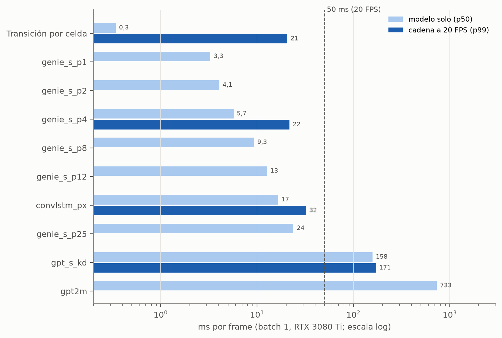

# Resultados: modelo → performance

Todos los números de este documento salen de un JSON `vigente` de `results/`. Cada uno lo produjo `python -m src.cli` (o la cola) con el árbol limpio y tiene su entrada en la bitácora. Cada fila apunta a sus JSON y a la guía para reentrenar el modelo. Todos los modelos se entrenaron con el mismo presupuesto, 780.000 frames vistos, en una RTX 3080 Ti de 12 GB. Qué se hizo y por qué: [`resumen.md`](resumen.md).

## En pocas líneas

- **Calidad.** `gpt2m`, el maestro de comma de 307M, es el techo. Entre los modelos chicos (12–15M), Genie S y GPT-S destilado quedan cerca, y cuál gana depende del horizonte ([diferencias pareadas](#diferencias-pareadas), con Genie a 8 pasadas, la configuración de las semillas):
  - a 1 s, GPT-S es mejor;
  - a 2 s, empatan;
  - a 3 s, Genie es mejor.
- **Velocidad.** Genie S tarda 5,7 ms por frame ([bench](../results/bench/genie_s_p4__fp16_graphs_s4.json)) y GPT-S destilado 158 ms ([bench](../results/bench/gpt_s_kd__fp16_graphs.json)), porque genera los 128 tokens de a uno. Entre los modelos chicos generativos, solo Genie y el ConvLSTM sostienen 20 FPS con la cadena completa, cámara → encoder → modelo → decoder; el ConvLSTM, con 0,2 % de frames tarde ([sección 3](#3-latencia-modelo--performance)).
- **El ConvLSTM** es rápido pero borroso: una predicción determinista en píxeles promedia los futuros posibles. Su FVD queda peor que el de repetir el último frame.
- **Las semillas mueven poco.** El desvío entre 3 semillas es chico frente a la distancia entre modelos.
- **Los latentes no aprendieron un modelo del mundo útil con este presupuesto.**
  - LeWM queda casi empatado con copiar el último latente.
  - V-JEPA 2-AC le gana a copiar, pero casi no usa la acción, y el CEM no recupera las acciones.
  - Sus features leen la velocidad peor que los píxeles crudos ([sección 2](#2-modelos-latentes-modelo--performance)).

## Cómo leer las tablas

- **Una fila por modelo.** Un dato distinto (otro número de pasadas, otra semilla, otra receta) es otro modelo o variante, con su propia fila.
- **Solo datos actuales.** Un valor aparece solo si hay un JSON `vigente` que lo respalde (`python -m src.cli resultados`). La columna de resultados de cada fila apunta a esos JSON.
- **Video** se mide con 400 clips fijos (100 segmentos por 4 arranques), 1 s de contexto y 3 s generados.
  - Los intervalos salen de un bootstrap por segmento: los 4 clips de un segmento no son independientes.
  - **CE** sigue el protocolo de comma; `ce_all` incluye los BOS.
- **El piso de FVD** es real contra real: los 400 clips de evaluación contra otros 400 reales de los mismos segmentos, con otro arranque.
  - Es una referencia, no una cota. Un modelo condicionado en el contexto real genera continuaciones que comparten escena con el clip real, así que a 1 s puede quedar por debajo: `gpt2m` lo hace.
  - El "piso en mitades" que imprime `metrics_video` (unos 317 a 1 s) es otra cosa. Compara dos mitades disjuntas de segmentos, con 200 clips por lado, y no se compara con la columna de FVD.
- **La temperatura** de cada familia salió del barrido en el holdout, nunca de val: GPT-S destilado usa T = 0,9 ([barrido](../results/temperatura_gpt_s_kd.json)) y Genie S, T = 1,0 ([barrido](../results/temperatura_genie_s.json)).
- **Semillas:** `genie_s` y `convlstm_px` se entrenaron con 3 semillas (0, 1 y 2); la fila de semillas es media ± desvío.
- **Los modelos latentes** no se miden con FVD: tienen su tabla, con sus referencias al lado.

## Estado de cada modelo

| modelo | entrenamiento | evaluación | latencia | estado |
|---|---|---|---|---|
| `gpt_s_kd` | hecho | video y CE | modelo y cadena | vigente |
| `genie_s` | hecho, 3 semillas | video con 1 a 25 pasadas; calidad en línea | modelo y cadena | vigente |
| `convlstm_px` | hecho, 3 semillas | video | modelo y cadena | vigente |
| `lewm` y `lewm_lrx3` | hecho | latente | por paso | vigente |
| `vjepa2` | hecho (`vjepa2_s`) | latente | encoder | vigente |
| `vjepa2_ac` | hecho, sobre `vjepa2_s` | latente y CEM | por paso | vigente |
| referencias (`unigram`, `transicion`, `congelado`, `gpt2m`, `real`) | no se entrenan | video y CE | modelo; `transicion` también la cadena | vigente |
| opcionales (`gpt_s`, `gpt_m`, `genie_m`, `maskgit_s` y sus ablaciones) | no se corrieron (trabajos 17 a 20 de la cola) | no | no | sin correr |
| corridas 10× de `vjepa2` y `lewm` | no se corrieron (etapa D) | no | no | sin correr |

## 1. Modelos de video: modelo → performance

<!-- tabla:video -->
| modelo | variante | CE (`ce_all`) | LPIPS 1 s | LPIPS 3 s | FVD 1 s [IC 95 %] | FVD 3 s | corrida y resultados | cómo reentrenar |
|---|---|---|---|---|---|---|---|---|
| real (piso de FVD) | 400 contra otros 400 reales de los mismos segmentos | no aplica | no aplica | no aplica | 103,3 | 110,7 | `real_eval_b` · [piso](../results/piso_fvd.json) | no se entrena |
| unigram | baseline | 6,846 | 0,571 | 0,575 | 1470,9 [1340,6; 1601,2] | 1523,9 | `unigram` · [eval](../results/eval_unigram.json) · [video](../results/video_unigram.json) | [guía](modelos/referencias.md#unigram-evaluar) |
| transicion | baseline | 3,480 | 0,522 | 0,569 | 729,4 [656,3; 802,5] | 1241,4 | `transicion` · [eval](../results/eval_transicion.json) · [video](../results/video_transicion.json) | [guía](modelos/referencias.md#transicion-evaluar) |
| congelado | baseline, T = 0 | 4,892 | 0,235 | 0,312 | 928,6 [860,7; 996,4] | 978,2 | `congelado` · [eval](../results/eval_congelado.json) · [video](../results/video_congelado.json) | [guía](modelos/referencias.md#congelado-evaluar) |
| gpt2m | maestro de comma, 307M | 2,026 | 0,171 | 0,282 | 67,1 [50,3; 83,8] | 105,2 | `gpt2m` · [eval](../results/eval_gpt2m.json) · [video](../results/video_gpt2m.json) | [guía](modelos/referencias.md#gpt2m-evaluar) |
| gpt_s_kd | S destilado, 12M, T = 0,9 | 2,986 | 0,295 | 0,376 | 206,7 [165,0; 248,5] | 468,5 | `gpt_s_kd` · [eval](../results/eval_gpt_s_kd.json) · [video](../results/video_gpt_s_kd.json) | [guía](modelos/gpt.md#entrenar) |
| genie_s | 1 pasada, 15M, T = 1,0 | no aplica | 0,384 | 0,575 | 278,8 [232,7; 324,9] | 1307,3 | `genie_s_p1` · [eval](../results/eval_genie_s.json) · [video](../results/video_genie_s_p1.json) | [guía](modelos/genie.md#entrenar) |
| genie_s | 2 pasadas, 15M, T = 1,0 | no aplica | 0,320 | 0,471 | 227,8 [188,1; 267,4] | 683,1 | `genie_s_p2` · [eval](../results/eval_genie_s.json) · [video](../results/video_genie_s_p2.json) | [guía](modelos/genie.md#entrenar) |
| genie_s | 4 pasadas, 15M, T = 1,0 | no aplica | 0,281 | 0,383 | 232,4 [193,9; 270,8] | 413,0 | `genie_s_p4` · [eval](../results/eval_genie_s.json) · [video](../results/video_genie_s_p4.json) | [guía](modelos/genie.md#entrenar) |
| genie_s | 8 pasadas, 15M, T = 1,0 | no aplica | 0,265 | 0,354 | 276,1 [233,9; 318,3] | 425,0 | `genie_s_p8` · [eval](../results/eval_genie_s.json) · [video](../results/video_genie_s_p8.json) | [guía](modelos/genie.md#entrenar) |
| genie_s | 12 pasadas, 15M, T = 1,0 | no aplica | 0,259 | 0,344 | 302,0 [258,9; 345,1] | 425,3 | `genie_s_p12` · [eval](../results/eval_genie_s.json) · [video](../results/video_genie_s_p12.json) | [guía](modelos/genie.md#entrenar) |
| genie_s | 25 pasadas, 15M, T = 1,0 | no aplica | 0,255 | 0,335 | 325,8 [281,5; 370,0] | 444,1 | `genie_s_p25` · [eval](../results/eval_genie_s.json) · [video](../results/video_genie_s_p25.json) | [guía](modelos/genie.md#entrenar) |
| genie_s | 8 pasadas, 3 semillas: media ± desvío | no aplica | 0,267 ± 0,002 | 0,354 ± 0,001 | 260,0 ± 14,4 | 402,5 ± 19,6 | `genie_s_p8, genie_s_s1_p8, genie_s_s2_p8` · [semillas](../results/semillas_genie_s_p8.json) | [guía](modelos/genie.md#entrenar) |
| convlstm_px | 8M, determinista | no aplica | 0,447 | 0,544 | 1789,9 [1629,7; 1950,2] | 2400,2 | `convlstm_px` · [video](../results/video_convlstm_px.json) | [guía](modelos/convlstm_px.md#entrenar) |
| convlstm_px | 3 semillas: media ± desvío | no aplica | 0,452 ± 0,005 | 0,553 ± 0,008 | 1680,1 ± 118,3 | 2392,7 ± 14,3 | `convlstm_px, convlstm_px_s1, convlstm_px_s2` · [semillas](../results/semillas_convlstm_px.json) | [guía](modelos/convlstm_px.md#entrenar) |
<!-- /tabla -->

- **Genie** no tiene una verosimilitud autorregresiva, así que no tiene `ce_all`. Su CE del último frame, todo enmascarado y dados los 19 anteriores (una sola pasada), es 3,03 ([eval](../results/eval_genie_s.json)). No se compara con la de los GPT, que predicen cada token viendo los anteriores del mismo frame.
- **Las pasadas de Genie.**
  - Con 1 y 2 pasadas el video se degrada rápido: a 3 s, el FVD es 3 y 1,7 veces el de 4 pasadas ([1 pasada](../results/video_genie_s_p1.json), [2](../results/video_genie_s_p2.json), [4](../results/video_genie_s_p4.json)).
  - De 4 a 25 pasadas el FVD a 3 s queda igual dentro del IC. A 1 s empeora, de 232 a 326 ([4 pasadas](../results/video_genie_s_p4.json), [25](../results/video_genie_s_p25.json)).
  - Cuatro pasadas alcanzan; el paper usa 25 (ver H2).
- **LPIPS premia el frame quieto.** El congelado tiene mejor LPIPS a 1 s que cualquier modelo chico, pero un FVD mucho peor ([video](../results/video_congelado.json)). Por eso LPIPS se lee junto con el FVD.
- **El ConvLSTM** queda peor que repetir el último frame en FVD ([video](../results/video_convlstm_px.json)): predice el promedio de los futuros posibles y el video sale borroso. Es lo esperado de un modelo determinista entrenado con una pérdida por píxel, como el de Shi et al.


### Diferencias pareadas

La diferencia de FVD entre dos modelos se estima sobre los mismos 400 clips, con un bootstrap pareado por segmento (200 repeticiones). Con 200 repeticiones, el p más chico que se puede resolver es 0,01.

<!-- tabla:diferencias -->
| a − b | horizonte | diferencia de FVD [IC 95 %] | p | lectura | resultados |
|---|---|---|---|---|---|
| `genie_s_p8` − `gpt_s_kd` | 1 s | +69,4 [43,2; 95,6] | < 0,01 | gana `gpt_s_kd` | [diferencia](../results/diferencia_genie_s_p8_vs_gpt_s_kd.json) |
| `genie_s_p8` − `gpt_s_kd` | 2 s | −7,3 [−40,0; 25,3] | 0,58 | empate | [diferencia](../results/diferencia_genie_s_p8_vs_gpt_s_kd.json) |
| `genie_s_p8` − `gpt_s_kd` | 3 s | −43,4 [−83,4; −3,5] | 0,04 | gana `genie_s_p8` | [diferencia](../results/diferencia_genie_s_p8_vs_gpt_s_kd.json) |
| `convlstm_px` − `genie_s_p8` | 1 s | +1513,8 [1375,9; 1651,7] | < 0,01 | gana `genie_s_p8` | [diferencia](../results/diferencia_convlstm_px_vs_genie_s_p8.json) |
| `convlstm_px` − `genie_s_p8` | 2 s | +1800,0 [1635,7; 1964,4] | < 0,01 | gana `genie_s_p8` | [diferencia](../results/diferencia_convlstm_px_vs_genie_s_p8.json) |
| `convlstm_px` − `genie_s_p8` | 3 s | +1975,2 [1792,6; 2157,8] | < 0,01 | gana `genie_s_p8` | [diferencia](../results/diferencia_convlstm_px_vs_genie_s_p8.json) |
<!-- /tabla -->

## 2. Modelos latentes: modelo → performance

Los latentes se leen contra sus referencias, no contra el video:

- **copiar el último latente:** una razón menor que 1 le gana;
- **el mismo encoder sin entrenar** y **los píxeles crudos:** probes lineales de la pose, entrenados en train y medidos en val con poses;
- **repetir la última acción**, para el plan con CEM.

Horizonte de 0,25 a 2 s, a 4 Hz.

<!-- tabla:latentes -->
| modelo | variante | L1 / copiar el último latente (0,25 s · 1 s · 2 s) | MSE / copiar (1 s) | R² de la velocidad: modelo · sin entrenar · píxeles | acción nula / acción real (L1 a 2 s) | sorpresa por un salto de 2 s: modelo · copiar | CEM, error de velocidad: plan · repetir la última | latencia por paso p50 | resultados | cómo reentrenar |
|---|---|---|---|---|---|---|---|---|---|---|
| lewm | fiel, lr del paper (5e-5) | 1,04 · 1,02 · 1,04 | 0,95 | 0,08 · 0,04 · 0,14 | 1,002 | 4,3 · 4,6 | 9,39 · 0,322 (0,3 s por plan) | 9,0 ms | [latente](../results/latent_lewm.json) · [bench](../results/bench/lewm__fp32.json) | [guía](modelos/lewm.md#entrenar) |
| lewm | `lewm_lrx3`, lr ×3 del humo | 1,00 · 1,01 · 1,03 | 0,94 | 0,10 · 0,04 · 0,14 | 1,004 | 4,6 · 4,7 | 9,53 · 0,322 (0,4 s por plan) | la de `lewm` | [latente](../results/latent_lewm_lrx3.json) | [guía](modelos/lewm.md#entrenar) |
| vjepa2 | `vjepa2_s`, encoder ViT-S | no aplica (sin predictor en línea) | no aplica (sin predictor en línea) | 0,02 · 0,09 · 0,15 | no aplica (sin predictor en línea) | no aplica | no aplica | 46,1 ms | [latente](../results/latent_vjepa2_s.json) · [bench](../results/bench/vjepa2_s__fp32.json) | [guía](modelos/vjepa2.md#entrenar) |
| vjepa2_ac | sobre `vjepa2_s`, congelado | 0,94 · 0,91 · 0,92 | 0,80 | 0,06 · 0,07 · 0,14 | 1,008 | 4,1 · 3,7 | 0,55 · 0,036 (7,6 s por plan) | 65,2 ms | [latente](../results/latent_vjepa2_ac.json) · [bench](../results/bench/vjepa2_ac__fp32.json) | [guía](modelos/vjepa2_ac.md#entrenar) |
<!-- /tabla -->

- **LeWM** queda casi empatado con copiar el último latente.
  - En MSE le gana un poco y en L1 pierde: predice hacia la media.
  - Con la acción nula el error cambia menos de 1 %, y el plan con CEM no recupera las acciones.
  - Con el lr ×3 que eligió el humo (`lewm_lrx3`) mejora apenas ([latente](../results/latent_lewm_lrx3.json)).
- **V-JEPA 2-AC** le gana a copiar el último latente en todos los horizontes ([latente](../results/latent_vjepa2_ac.json)), pero casi no usa la acción: con la acción nula el error sube entre 0,1 % y 2 %, según el horizonte y la métrica. El CEM del paper (800 muestras, 10 mejores, 10 iteraciones) erra la velocidad mucho más que repetir la última y tarda 7,6 s por plan.
- **Probes.**
  - Para la velocidad, los píxeles crudos leen mejor que cualquier encoder entrenado.
  - El encoder de V-JEPA 2 entrenado lee peor que el mismo encoder sin entrenar ([latente](../results/latent_vjepa2_s.json)).
  - El giro no lo lee nadie, ni los píxeles: R² ≤ 0 en todos.
- **Sorpresa.** Ante un salto de 2 s en el video, el error de cada modelo sube unas 4 veces, igual que el de copiar el último latente. La sorpresa viene del cambio en la entrada, no de lo que predijo el modelo.
- **Unidades del CEM.** Cada modelo planea en las acciones de su paper. LeWM usa 5 pasos de poses normalizadas y apiladas; V-JEPA 2-AC, 1 paso de diferencia de estado. Por eso las dos filas no se comparan entre sí, solo cada plan contra repetir la última acción.

Las corridas 10× de `vjepa2` y `lewm` (etapa D) no se hicieron: quedan para después, con todo lo demás cerrado.

## 3. Latencia: modelo → performance

Un solo protocolo: batch 1, un paso por stream, p50 y p99, con la GPU libre. Los transformers corren en fp16 con CUDA graphs; el resto, en fp32.

- **Modelo solo** mide únicamente el modelo.
- **Cadena** es cámara → encoder → modelo → decoder → frame, todo en la GPU:
  - **cerrada:** el frame siguiente arranca apenas termina el anterior;
  - **a 50 ms:** a ritmo de cámara, un frame cada 50 ms (20 FPS). Es el titular.
- **Frames tarde** cuenta los frames de la cadena a 50 ms que pasan los 50 ms.
- **Latentes:** la unidad es un paso de modelo de 250 ms de video, salvo `vjepa2`, que mide el encoder sobre un clip de 16 frames.

<!-- tabla:latencia -->
| modelo | dispositivo | modelo solo p50 | modelo solo p99 | cadena cerrada p50 | cadena a 50 ms p50 | cadena a 50 ms p99 | frames tarde | resultados | cómo medir |
|---|---|---|---|---|---|---|---|---|---|
| `codec` (decoder fp32) | RTX 3080 Ti | 14,6 ms | 16,4 ms | no aplica | no aplica | no aplica | no aplica | [bench](../results/bench/decoder__fp32.json) | [guía](modelos/referencias.md#codec-bench) |
| `transicion` | RTX 3080 Ti | 0,3 ms | 0,4 ms | 10,0 ms | 19,9 ms | 20,6 ms | 0,0 % | [bench](../results/bench/transicion__fp32.json) · [cadena](../results/infer/latencia_transicion__rtx3080ti.json) | [guía](modelos/referencias.md#transicion-bench) |
| `gpt2m` | RTX 3080 Ti | 732,9 ms | 734,4 ms | no aplica | no aplica | no aplica | no aplica | [bench](../results/bench/gpt2m__fp16_graphs.json) | [guía](modelos/referencias.md#gpt2m-bench) |
| `gpt_s_kd` | RTX 3080 Ti | 159,0 ms | 163,5 ms | 168,1 ms | 166,8 ms | 171,4 ms | 100,0 % | [bench](../results/bench/gpt_s_kd__fp16_graphs.json) · [cadena](../results/infer/latencia_gpt_s_kd__rtx3080ti.json) | [guía](modelos/gpt.md#bench) |
| `genie_s` (4 pasadas) | RTX 3080 Ti | 5,7 ms | 6,0 ms | 15,6 ms | 18,2 ms | 21,7 ms | 0,0 % | [bench](../results/bench/genie_s_p4__fp16_graphs_s4.json) · [cadena](../results/infer/latencia_genie_s_p4__rtx3080ti.json) | [guía](modelos/genie.md#bench) |
| `convlstm_px` | RTX 3080 Ti | 11,8 ms | 12,2 ms | 12,0 ms | 19,5 ms | 32,2 ms | 0,2 % | [bench](../results/bench/convlstm_px__fp32.json) · [cadena](../results/infer/latencia_convlstm_px__rtx3080ti.json) | [guía](modelos/convlstm_px.md#bench) |
| `lewm` (por paso de 250 ms) | RTX 3080 Ti | 9,0 ms | 9,2 ms | no aplica | no aplica | no aplica | no aplica | [bench](../results/bench/lewm__fp32.json) | [guía](modelos/lewm.md#bench) |
| `vjepa2` (encoder, por clip) | RTX 3080 Ti | 46,1 ms | 96,0 ms | no aplica | no aplica | no aplica | no aplica | [bench](../results/bench/vjepa2_s__fp32.json) | [guía](modelos/vjepa2.md#bench) |
| `vjepa2_ac` (por paso de 250 ms) | RTX 3080 Ti | 65,2 ms | 129,1 ms | no aplica | no aplica | no aplica | no aplica | [bench](../results/bench/vjepa2_ac__fp32.json) | [guía](modelos/vjepa2_ac.md#bench) |
<!-- /tabla -->




**Dos medidas del modelo solo.** En la tabla, el modelo solo sale de la corrida de cadena (3000 frames) cuando la hay; si no, de `bench` (100 frames). Para Genie, GPT y la transición dan lo mismo. Para el ConvLSTM, el bench con 100 frames da 16,5 ms y la corrida de 3000, 11,8 ms ([bench](../results/bench/convlstm_px__fp32.json), [cadena](../results/infer/latencia_convlstm_px__rtx3080ti.json)). La figura de Pareto usa el de `bench`.

### El piso de unos 20 ms a ritmo de cámara

- **Qué se ve.** La cadena cerrada de Genie S tarda 15,5 ms por frame, pero a ritmo de cámara el mismo trabajo tarda 18,1 ms ([diagnóstico](../results/infer/diagnostico_genie_s_p4__online__pace50__rtx3080ti.json)).
- **No es el timer.** `sleep(1 ms)` dura 1,5 ms, con y sin `timeBeginPeriod(1)` ([diagnóstico](../results/infer/diagnostico_genie_s_p4__online__pace50__rtx3080ti.json)).
- **Qué lo arregla.** Las variantes del diagnóstico separan el efecto:
  - el sleep con un kernel de keepalive en la GPU da 20,1 ms ([diagnóstico](../results/infer/diagnostico_genie_s_p4__online__pace50__rtx3080ti.json));
  - la espera activa sola en la CPU da 18,2 ms ([diagnóstico](../results/infer/diagnostico_genie_s_p4__online__pace50__rtx3080ti.json));
  - las dos juntas vuelven a 15,3 ms, el nivel de la cadena cerrada ([diagnóstico](../results/infer/diagnostico_genie_s_p4__online__pace50__rtx3080ti.json)).
- **Lectura.** Hace falta que ni la CPU ni la GPU se duerman entre frames. La explicación más probable es el ahorro de energía de los dos: con 50 ms de espera entre frames bajan su reloj y tardan en volver.
- **Varía entre corridas.** En la primera medición, del trabajo 14 (commit 85c9b44), el sleep simple llegaba a unos 32 ms. Al repetirla dio 18. En las dos, la cadena cerrada y la espera activa con keepalive quedaron en unos 15 ms.
- **Para tiempo real alcanza igual.** A 20 FPS Genie entra en los 50 ms con 0 % de frames tarde, así que no hace falta mantener ocupadas la CPU y la GPU.

### Calidad en línea

- **Predecir el frame siguiente.** En línea, el modelo ve cada frame real y predice el siguiente. Genie S con 4 pasadas acierta el 24,7 % de los tokens y el frame congelado, el 38,9 %. En LPIPS, 0,114 contra 0,075 ([en línea](../results/infer/online_genie_s_p4.json)). A 20 FPS el frame siguiente se parece tanto al actual que repetirlo le gana a predecir un paso: el valor del world model está en imaginar varios segundos, no el próximo frame.
- **Stream contra lotes.** El camino por stream (fp16, CUDA graphs, un frame a la vez) da los mismos tokens que los rollouts por lotes en los 400 clips, así que su FVD a 1 s es el mismo, 232,4 ([stream](../results/video_genie_s_p4_stream.json), [comparación](../results/infer/imagine_check_genie_s_p4.json)).
- **El piso que imprime el stream no se compara.** El piso de 316,8 que imprime `metrics_video` para el stream es el de mitades. El comparable es el de 400 contra 400: 103,3 a 1 s ([stream](../results/video_genie_s_p4_stream.json), [piso](../results/piso_fvd.json)).

Otros dispositivos (T4 de Colab, CPU, laptop con ROCm, DirectML y NPU) serían otras filas, con su dispositivo. Se miden con `bench --device <dispositivo>` ([`uso.md`](uso.md#dispositivos-e-inferencia)); en esta tanda solo se midió la RTX 3080 Ti.

## 4. Hipótesis y conclusiones

| hipótesis | qué se compara | resultado | estado |
|---|---|---|---|
| H1: destilar ayuda | `gpt_s_kd` contra `gpt_s` de cero | `gpt_s` de cero es un trabajo opcional (17) y no se corrió | sin evaluar |
| H2: pocos pasos de decodificación bastan | `genie_s` con 1, 2, 4, 8, 12 y 25 pasadas, en calidad y latencia | Con 4 pasadas, el FVD a 3 s queda igual dentro del IC que con 8, 12 y 25, y la latencia baja de 23,9 a 5,7 ms por frame. Con 1 y 2 pasadas el video se degrada ([4 pasadas](../results/video_genie_s_p4.json), [25 pasadas](../results/video_genie_s_p25.json), [latencia con 4](../results/bench/genie_s_p4__fp16_graphs_s4.json), [latencia con 25](../results/bench/genie_s_p25__fp16_graphs_s25.json)) | confirmada: 4 pasadas bastan (el paper usa 25) |
| H3: fp16 con CUDA graphs acelera sin perder calidad | fp32 contra fp16 con graphs | En el codec, fp16 no pierde calidad: 99,7 % de los tokens coinciden con los de fp32 y el decoder queda a 61 dB de PSNR ([codec](../results/infer/codec_rtx3080ti.json)). El decoder en fp16 sin graphs no fue más rápido que en fp32: 22,3 contra 14,6 ms, con una medición ruidosa en fp16 ([fp16](../results/bench/decoder__fp16.json), [fp32](../results/bench/decoder__fp32.json)). Los transformers se midieron solo en fp16 con graphs: falta la comparación con fp32 | parcial |
| H4: la CE ordena igual que el FVD | correlación de rangos entre la CE y el FVD a 1 s, en los modelos autorregresivos | Hay tres: `gpt2m`, `gpt_s_kd` y la transición por celda. Están en el mismo orden por CE y por FVD, pero con menos de 5 puntos ni una permutación exacta llega a p < 0,05, así que el reporte no informa la correlación ([CE de gpt_s_kd](../results/eval_gpt_s_kd.json), [CE de gpt2m](../results/eval_gpt2m.json), [CE de la transición](../results/eval_transicion.json)) | sin evaluar: faltan los GPT de cero (trabajos 17 y 18) |

**Conclusiones**

1. **Para tiempo real en esta GPU, el modelo es Genie S.** Tiene el mejor FVD a 3 s entre los modelos chicos, y con 4 pasadas ya llega a ese nivel ([4 pasadas](../results/video_genie_s_p4.json), [semillas](../results/semillas_genie_s_p8.json)). Su cadena completa entra en 20 FPS con margen: p99 de 21,7 ms y 0 % de frames tarde ([cadena](../results/infer/latencia_genie_s_p4__rtx3080ti.json)).
2. **GPT-S destilado gana a 1 s (contra Genie con 8 pasadas) pero no llega a tiempo real.** Su cadena tarda 171,4 ms por frame en el p99 ([cadena](../results/infer/latencia_gpt_s_kd__rtx3080ti.json)). El cuello es generar los 128 tokens de a uno; para tiempo real hace falta decodificar en paralelo, como Genie.
3. **Achicar cuesta calidad con este presupuesto.** `gpt2m` (307M) llega al piso a 3 s, y los modelos chicos (12–15M) quedan unas 4 veces arriba ([gpt2m](../results/video_gpt2m.json), [Genie S](../results/video_genie_s_p4.json), [piso](../results/piso_fvd.json)). Respondiendo la pregunta del proyecto con estos números: 20 veces menos parámetros y 130 veces menos latencia (de 733 a 5,7 ms por frame) llevan el FVD a 3 s de 105 a 413 ([bench de gpt2m](../results/bench/gpt2m__fp16_graphs.json), [bench de Genie S](../results/bench/genie_s_p4__fp16_graphs_s4.json)).
4. **El ConvLSTM de píxeles no sirve como generador.** Es rápido, pero su video promedia los futuros y queda peor que repetir el último frame ([semillas](../results/semillas_convlstm_px.json), [congelado](../results/video_congelado.json)). Rápido no alcanza: el modelo tiene que poder elegir un futuro.
5. **Los latentes no aprendieron un modelo del mundo útil con 780.000 frames.**
   - LeWM queda casi empatado con copiar el último latente.
   - V-JEPA 2-AC le gana a copiar, pero casi no usa la acción, y el CEM no recupera las acciones.
   - Ninguno lee la velocidad mejor que los píxeles crudos ([LeWM](../results/latent_lewm.json), [V-JEPA 2-AC](../results/latent_vjepa2_ac.json)).
   - Las corridas 10× (etapa D) dirían si es falta de presupuesto.
6. **Las semillas no cambian las conclusiones de video.** El desvío entre 3 semillas es chico frente a la distancia entre Genie y el ConvLSTM ([Genie](../results/semillas_genie_s_p8.json), [ConvLSTM](../results/semillas_convlstm_px.json)). Entre Genie y GPT-S destilado, en cambio, el ganador depende del horizonte.

## 5. Limitaciones conocidas

- **Presupuesto.** El común (780.000 frames) es chico frente al de los papers. Cada receta declara cuánto se escaló en su tabla de fidelidad. Los latentes, sobre todo, pueden necesitar más: por eso existen las corridas 10×, que quedaron sin hacer.
- **Hardware.** Una sola GPU de 12 GB, un trabajo a la vez, y latencias medidas solo en la RTX 3080 Ti.
- **Datos.** Los modelos latentes y el ConvLSTM se entrenan con los frames reconstruidos por el VQ-VAE de comma, no con video crudo.
- **Semillas.** Solo `genie_s` y `convlstm_px` tienen 3 semillas; el resto, una.
- **Intervalos.** El bootstrap pareado usa 200 repeticiones, así que su p más chico es 0,01.

## 6. Cómo reproducir

Todo sale de la CLI o de la cola ([`uso.md`](uso.md)). Para repetir un resultado concreto, copiá su comando de la bitácora (`bitacora ver`) o usá `bitacora repetir <id>`.

```bash
python -m src.cli cola correr --dry-run         # la cola completa, expandida
python -m src.cli cola correr                   # la ejecuta, de a un trabajo
python -m src.cli resultados                    # estado de cada resultado
python -m src.cli reporte                       # tablas y figuras desde results/
python -m src.cli bitacora verificar            # cada resultado vigente tiene su comando
```
