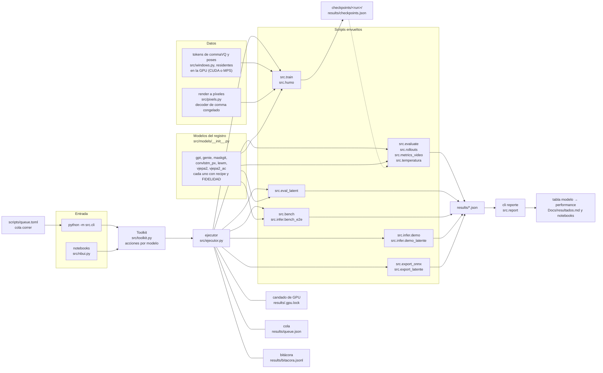
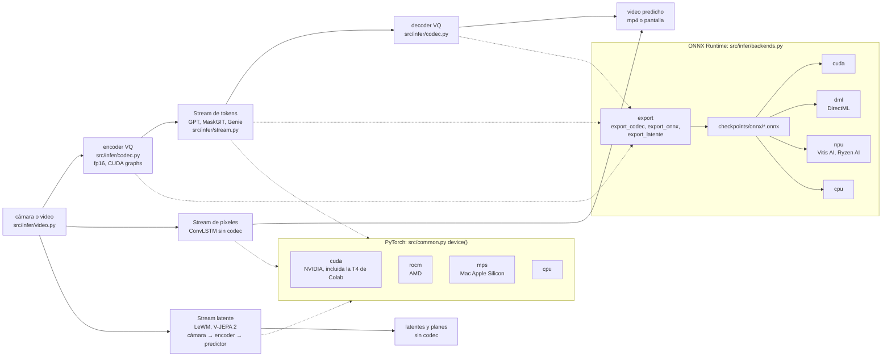

# Guía de uso del framework

Cómo entrenar, evaluar, medir y mostrar cualquier modelo del repo con las mismas herramientas: un único punto de entrada (`python -m src.cli`), la misma API para los notebooks, una cola de GPU y una bitácora de todo lo que se corre. Las guías de cada modelo están en [`modelos/`](modelos/README.md); lo que se hizo y por qué, en [`resumen.md`](resumen.md); las reglas para contribuir, en [`../CONTRIBUTING.md`](../CONTRIBUTING.md).

## Índice

1. [Cómo está armado](#cómo-está-armado)
2. [Instalación y uso por sistema](#instalación-y-uso-por-sistema)
3. [Modelos entrenados (Hugging Face)](#modelos-entrenados-hugging-face)
4. [Datos](#datos)
5. [La CLI](#la-cli)
6. [La cola](#la-cola)
7. [Bitácora](#bitácora)
8. [Seguimiento](#seguimiento)
9. [Continuar un entrenamiento](#continuar-un-entrenamiento)
10. [Notebooks](#notebooks)
11. [Dispositivos e inferencia](#dispositivos-e-inferencia)
12. [Resultados y reporte](#resultados-y-reporte)
13. [Verificar el repo](#verificar-el-repo)

## Cómo está armado

### Entrenamiento y evaluación

La CLI y los notebooks usan la misma clase (`Toolkit`), que arma el comando de cada acción. El ejecutor lo corre como subproceso con candado de GPU, cola y bitácora. Nada se ejecuta en el proceso del notebook.



### Inferencia

La cadena de punta a punta para los modelos de tokens es cámara, encoder VQ, world model (un `Stream` por familia), decoder VQ y video. Los modelos de píxeles y los latentes no usan el codec para predecir. El mismo modelo corre con PyTorch en el dispositivo que haya, o exportado a ONNX con ONNX Runtime.



Las flechas punteadas indican dónde corre cada etapa. Los scripts que miden la cadena (`src.infer.bench_e2e`, `src.infer.bench_ort`) y los que la muestran (`src.infer.demo`) están en [Dispositivos e inferencia](#dispositivos-e-inferencia).

## Instalación y uso por sistema

Los ejemplos de los docs usan `python -m ...`: `python` es el del entorno virtual del repo. Hay dos formas de llamarlo: activar el entorno (después alcanza con `python`) o llamar directo al del venv (`.venv\Scripts\python` en Windows, `.venv/bin/python` en Linux y Mac).

### Windows con GPU NVIDIA

El torch de PyPI para Windows es solo CPU: hay que instalarlo desde el índice de PyTorch. En PowerShell, desde la raíz del repo:

```powershell
py -3.12 -m venv .venv
.venv\Scripts\Activate.ps1
python -m pip install torch torchvision --index-url https://download.pytorch.org/whl/cu128
python -m pip install -r requirements.txt -r requirements-metrics.txt
git clone --depth 1 https://github.com/commaai/commavq.git third_party/commavq
```

Sin activar el entorno: `.venv\Scripts\python -m src.cli listar`. En una GPU de 12 GB, por encima de unos 11 GB el driver (WDDM) pagina a la RAM sin avisar y el trabajo se vuelve 10 a 20 veces más lento: por eso la cola corre una sola tarea de GPU a la vez.

### Linux

```bash
python3.12 -m venv .venv
source .venv/bin/activate
python -m pip install torch torchvision          # el build con CUDA que corresponda a tu driver
python -m pip install -r requirements.txt -r requirements-metrics.txt
git clone --depth 1 https://github.com/commaai/commavq.git third_party/commavq
```

Sin activar: `.venv/bin/python -m src.cli listar`.

### Mac con Apple Silicon (M1 a M5)

Conviene un Python arm64 nativo: con uno x86_64 (Rosetta) solo se consigue torch 2.2.2.

```bash
uv venv --python cpython-3.12-macos-aarch64-none .venv
source .venv/bin/activate
uv pip install -r requirements.txt -r requirements-metrics.txt
git clone --depth 1 https://github.com/commaai/commavq.git third_party/commavq
```

- **La GPU se usa por MPS.** `src/common.py` (`device()`) elige CUDA si hay, si no MPS, si no CPU, así que en un Mac no hay que pedir nada: se usa MPS solo si está disponible. Para pedirlo o para forzar la CPU, `--device mps` o `--device cpu` (o `ML2_DEVICE=mps` / `ML2_DEVICE=cpu` en el entorno).
- **Operaciones sin soporte en MPS:** `export PYTORCH_ENABLE_MPS_FALLBACK=1` hace que caigan a la CPU en vez de fallar.
- **Qué anda bien:** la CLI (`receta`, `estado`, `--dry-run`), los notebooks, las demos de clase, la evaluación y la inferencia de los modelos ya entrenados (con `--limite` para probar rápido) y el bench de latencia.
- **Qué es lento:** entrenar las recetas completas (780.000 frames por modelo): están pensadas para una GPU NVIDIA de 12 GB. Los CUDA graphs y el fp16 con graphs de la inferencia son de CUDA; en Mac la latencia no es comparable con la de las tablas. Para probar, usá `--limite`.
- **Los modelos entrenados se bajan solos de Hugging Face** ([Modelos entrenados](#modelos-entrenados-hugging-face)). La demo corre igual que en cualquier máquina:

```bash
python -m src.cli genie demo --tamaño s --pasos 4 --limite 100
```

### Colab (T4)

[`../notebooks/colab.ipynb`](../notebooks/colab.ipynb) clona el repo, monta Drive, instala, baja los datos y corre el bench en la T4; copia los JSON a Drive. La T4 usa el backend `cuda` como cualquier GPU NVIDIA.

### Laptop con Radeon (ROCm) y NPU

`requirements-rocm.txt` instala el torch de AMD para gfx1152 (antes que `requirements.txt`; ver los comentarios del archivo). Los builds ROCm usan la API `torch.cuda`, así que `device()` elige `cuda` igual. `requirements-npu.txt` es para el extra de ONNX Runtime en la NPU (`src/export_onnx.py`, `src/ort_model.py`), con la variable `ML2_VITISAI_EP_DIR`.

```bash
python -m src.infer.bench_codec --tag radeon860m
python -m src.cli genie bench --tamaño s --pasos 4 --cadena --aleatorio --device rocm
```

Para la NPU hay que exportar el codec a ONNX (`python -m src.cli codec exportar`) y medir con `python -m src.infer.bench_ort` eligiendo el provider de cada etapa (`--enc vitisai`, `--dec dml`); `--profile` dice cuántos nodos caen en la CPU. La NPU está sin probar en la máquina de desarrollo.

## Modelos entrenados (Hugging Face)

Los modelos de la tabla de resultados y sus decoders están en un repo público de Hugging Face, [KevinSoulier/ml2-gen-world-model](https://huggingface.co/KevinSoulier/ml2-gen-world-model) (`HF_REPO` en [`src/store.py`](../src/store.py)). `results/checkpoints.json`, que va en git, dice qué hay y el sha256 de cada archivo.

- **Bajar no pide nada:** `load_model("<run>")`, `evaluar`, `bench` y `demo` bajan el `final.pt` que falte, y la demo también el decoder, sin cuenta ni login. El archivo queda solo si el sha256 coincide con el manifiesto.
- **Lo local no se pisa:** si un archivo local no coincide con el manifiesto, queda al lado como `<nombre>.local-<sha>` antes de bajar el del repo.
- **Subir pide sesión:** `hf auth login`, con permiso de escritura en el repo. Con la sesión iniciada, `entrenar` sube la corrida al terminar y `demo --entrenar-decoder` sube el decoder; sin sesión, avisan y la cola sigue.
- **Qué se sube:** solo lo registrado en el manifiesto, o sea las corridas completas y sus decoders. Los humos, las pruebas con `--limite`, `last.pt` y `pre_decay.pt` quedan locales.

```bash
python -m src.store pull --all        # baja todos los modelos y decoders de una vez
python -m src.store push lewm_lrx3    # sube a mano una corrida registrada (y sus decoders)
python -m src.store list              # qué hay, si está local y dónde está subido
python -m src.store verify            # compara cada archivo local con su sha256
```

## Datos

```bash
python -m src.data               # shard 0 (train), val oficial, decoder y pesos del GPT de comma -> data/
python -m src.data --val-poses   # data-0001 (un shard de train no usado): val con poses -> data/valp_*
python -m src.viz                # frames de val decodificados -> results/
```

- **Train:** `data-0000.tar.gz`, 2.500 segmentos de 1 min (1200 frames de 8 x 16 tokens) y sus poses.
- **Val:** los 100 segmentos de `val.zip`; la lista queda en `results/val_split.json`. No comparten rutas con train.
- **Clips de evaluación:** 400 clips fijos (100 segmentos por 4 arranques) en `results/clips_eval.json`, y 200 de un holdout de train en `results/clips_holdout.json` para elegir hiperparámetros (nunca val).
- **Residentes en el dispositivo:** con CUDA los tokens (~0,5 GB) y las poses se suben una sola vez a la GPU y los índices de todos los pasos se precalculan; el entrenamiento no copia entre CPU y GPU por paso. Los batches dependen solo de (semilla, paso).
- **Píxeles:** los modelos de píxeles y latentes renderizan los tokens al vuelo con el decoder de comma congelado (`src/pixels.py`).
- Si la descarga de Hugging Face se cuelga, probar con `HF_HUB_DISABLE_XET=1`.

## La CLI

```bash
python -m src.cli --help                       # modelos, acciones y comandos generales
python -m src.cli listar                       # modelos, acciones y corridas registradas
python -m src.cli <modelo> <acción> [opciones] [-- args del script]
```

Cada modelo declara sus acciones (`ACCIONES` en su módulo): pedir una que no aplica da un error claro. Los defaults de las opciones salen de la receta y de la Config del modelo, y todo se puede pisar.

| Acción | Qué hace | Script que envuelve |
|---|---|---|
| `receta` | receta y Config efectivas, con overrides y forzados marcados | `src.recipes` |
| `entrenar` | entrena de cero con la receta de la fuente; `--humo` es la prueba corta | `src.train` |
| `continuar` | retoma una corrida cortada o, con `--presupuesto`, la extiende | `src.train` |
| `evaluar` | métricas propias: video (CE, rollouts, LPIPS, FVD) o latentes (error, probes, sorpresa, CEM) | `src.evaluate`, `src.rollouts`, `src.metrics_video`, `src.eval_latent` |
| `bench` | latencia del modelo, o de la cadena con `--cadena` | `src.bench`, `src.infer.bench_e2e` |
| `demo` | mp4 real contra predicho, o figura para los latentes | `src.infer.demo`, `src.infer.demo_latente` |
| `exportar` | ONNX, donde aplica | `src.export_onnx`, `src.export_latente` |
| `estado` | porcentaje, paso, loss, lr, tramo y ETA | `src.status` |

### Opciones comunes

`--run`, `--tamaño`, `--semilla`, `--variante`, `--presupuesto` (en frames, o `10x`), `--device`, `--limite`, `--set`, `--dry-run`, `--esperar`, `--encolar` y `--permitir-sucio`; la tabla completa con su ayuda está en [`modelos/README.md`](modelos/README.md#opciones-comunes). `python -m src.cli <modelo> <acción> --help` muestra todas.

- **`--set receta.lr_peak=3e-4 --set config.n_layer=4`:** se valida contra el dataclass antes de lanzar y queda registrado como desvío de la fuente. Un campo que no existe falla con un mensaje.
- **`--dry-run`:** imprime los comandos que ejecutaría y no corre nada (ni escribe en la bitácora). Es la forma de ver qué hace una acción.
- **`--` seguido de argumentos:** pasan tal cual al script envuelto.
- **`--limite N`:** recorta la acción (pasos al entrenar, segmentos o clips al evaluar, frames en bench y demo).

```bash
python -m src.cli genie entrenar --tamaño s --semilla 1
python -m src.cli vjepa2 continuar --run vjepa2_s --presupuesto 10x
python -m src.cli lewm evaluar --run lewm --limite 50 --device cpu
python -m src.cli convlstm_px bench --cadena --ritmo 50
python -m src.cli gpt entrenar --tamaño s --dry-run
```

### Comandos generales

| Comando | Qué hace |
|---|---|
| `cola {ver,correr,quitar}` | la cola de GPU (ver más abajo) |
| `listar` | modelos, acciones y corridas registradas |
| `resultados` | estado (`vigente`, `protocolo anterior` o `pendiente`) de cada resultado |
| `reporte` | tablas y figuras (`src.report`) |
| `estadistica {semillas,piso,diferencia}` | media entre semillas, piso de FVD, diferencia pareada de FVD |
| `bitacora {ver,verificar,repetir}` | la bitácora |
| `docs [--check]` | las tablas automáticas de las guías |
| `verificar [--cuda]` | pytest, bitácora y los chequeos de docs y notebooks |

### Una sola tarea de GPU a la vez

Toda acción de GPU toma el candado `results/.gpu.lock` (atómico, con pid, corrida, acción y hora). Si está tomado, la acción va a `results/queue.json` y vuelve, o espera con `--esperar`. Un candado huérfano (su pid ya no existe) se libera con un aviso. `--encolar` deja la acción en la cola sin correrla ahora. Los números de latencia solo valen con la GPU libre.

## La cola

`scripts/queue.toml` es la lista de trabajos de la GPU: cada trabajo es una secuencia de llamadas a la CLI (sin el prefijo `python -m src.cli`). `cola correr` es el único proceso que la ejecuta, de a un trabajo, y se frena ante una falla.

```bash
python -m src.cli cola correr --dry-run           # la cola completa, expandida a los subprocesos
python -m src.cli cola correr --trabajo 2         # solo el trabajo 2 (repetible)
python -m src.cli cola correr --desde 5           # desde el trabajo 5
python -m src.cli cola correr --incluir-opcionales
python -m src.cli cola ver                        # GPU, items encolados y su estado
```

Los trabajos marcados `opcional = true` (los modelos implementados que no entran en la cola principal: `gpt_s`, `gpt_m`, `genie_m` y el `maskgit` propio con sus ablaciones) corren solo con `--trabajo N` o `--incluir-opcionales`. El humo (`entrenar --humo`) se corre donde cambió el batch respecto de la fuente, con los lr de la fuente, por raíz y x3 (`--humo-candidatos`); el lr elegido entra a la receta con un commit. Las corridas 10x de `vjepa2` y `lewm` no están en la cola: van al final, con todo lo demás verificado.

Si un trabajo falla por un bug: la cola frena y la entrada fallada queda en la bitácora; el arreglo va por el camino normal (código, test, `verificar` en verde, commit) y se repite el mismo comando con `bitacora repetir <id>`.

## Bitácora

`results/bitacora.jsonl` tiene una línea por acción, con la fecha, la línea de comando exacta, el commit y si el árbol estaba limpio, el hash de la receta, el dispositivo, la duración, el código de salida y los archivos que escribió. Cada JSON de resultados guarda además el comando y el commit que lo produjeron.

```bash
python -m src.cli bitacora ver
python -m src.cli bitacora verificar
python -m src.cli bitacora repetir <id> --dry-run
```

- **Árbol sucio:** una acción de GPU no corre con cambios sin commitear en `src/` o `scripts/`. `--permitir-sucio` la deja pasar, queda anotado y el resultado no cuenta como `vigente`.
- **`bitacora repetir <id>`** vuelve a lanzar una entrada tal cual; con `--dry-run` solo la imprime.
- **`bitacora verificar`** exige que cada resultado `vigente` tenga una entrada con salida 0, árbol limpio y un commit que esté en `main`.
- **`bitacora vigentes`** cierra un bloque de la cola: marca `vigente` en `results/estado.json` cada resultado nuevo cuya última escritura cumple esas tres condiciones, y lista los que no las cumplen.
- **Las entradas falladas no se borran:** quedan como historia, seguidas del commit del arreglo y de la nueva ejecución.

## Seguimiento

`train.py` escribe `checkpoints/<run>/status.json` en cada log, con el estado, el paso y el total, el porcentaje, la loss, el lr, el tramo del schedule, los frames por segundo, la ETA y el pid. Una fila por corrida: en curso, en cola, lista, fallada o "colgada" (3 minutos sin actualizar o el pid ya no existe).

```bash
python -m src.cli genie estado                 # las corridas de un modelo
python -m src.cli genie estado --vigilar 30    # se actualiza cada 30 segundos
python -m src.status --watch                   # todas las corridas
python -m src.cli cola ver
```

## Continuar un entrenamiento

Retomar una corrida cortada anda siempre: `continuar` sigue desde `last.pt` con la receta guardada. Extender el presupuesto (`--presupuesto Nx`) crea una corrida nueva `<run>_x<k>` con `parent`, hash y receta. Cómo se continúa depende de la forma del schedule de la receta:

| Forma | Modelos | Cómo se continúa | Equivalencia |
|---|---|---|---|
| Warmup, constante, decaimiento | `vjepa2`, `vjepa2_ac` | se guarda `pre_decay.pt` al entrar al decaimiento; la extensión parte de ahí, sigue constante y decae al final | exacta respecto de una corrida larga con el mismo warmup absoluto |
| Constante | `gpt`, `convlstm_px` | sigue desde `last.pt` | exacta |
| Warmup y coseno | `lewm`, `genie`, `maskgit` | para la tabla, reentrenar de cero con el presupuesto nuevo; para explorar, `--restart` (re-warmup corto y coseno nuevo) | `--restart` no es equivalente: queda marcada y fuera de la tabla principal |

```bash
python -m src.cli vjepa2 continuar --run vjepa2_s
python -m src.cli vjepa2 continuar --run vjepa2_s --presupuesto 10x
python -m src.cli genie continuar --tamaño s --presupuesto 2x --restart
```

## Notebooks

Los notebooks hacen con un modelo todo lo que hace la CLI, de forma visual, y lanzan todo por `Toolkit`, así que sus corridas quedan también en la bitácora. Una celda de entrenamiento lanza un subproceso separado del kernel: se ve la barra de porcentaje y las curvas, y si la GPU está ocupada la acción queda en la cola.

| Notebook | Para qué |
|---|---|
| `notebooks/modelos/<modelo>.ipynb` | una guía de modelo en celdas: receta, entrenar o continuar, evaluar, latencia, demo y exportar, más una sección propia del modelo |
| `notebooks/resultados.ipynb` | la tabla modelo → performance, con el estado de cada resultado; no entrena nada |
| `notebooks/colab.ipynb` | la preparación en Colab y las latencias en la T4 |

Desde un notebook, la misma API que la CLI:

```python
from src.toolkit import Toolkit
tk = Toolkit("genie")
tk.accion("entrenar", tamano="s", semilla=1, dry_run=True)   # imprime los comandos, no corre nada
tk.entrenar(tamano="s", presupuesto="1x")                     # entrena; queda en results/bitacora.jsonl
```

Localmente necesitan un kernel en el entorno: `python -m pip install ipykernel` (VS Code) o `jupyter`. Las celdas de resultados muestran "pendiente" cuando falta el JSON.

## Dispositivos e inferencia

`--device` acepta `cuda`, `cpu`, `rocm`, `mps`, `dml` y `npu`. Sin `--device` se usa `src/common.py` (`device()`): CUDA (incluye ROCm) si hay, si no MPS, si no CPU; `ML2_DEVICE` lo fuerza. Cada JSON de resultados anota el hardware usado.

- **PyTorch:** `cuda` (NVIDIA, la T4 de Colab incluida), `rocm` (AMD, mismo `torch.cuda`), MPS (Mac) y `cpu`.
- **ONNX Runtime:** `dml` (DirectML, iGPU), `npu` (Vitis AI en Ryzen AI), `cpu` y `cuda`, con los modelos exportados (`exportar`). `src/infer/backends.py` registra todos los backends (`cuda`, `cpu`, `rocm`, `mps`, `dml`, `npu`): sumar uno es una entrada nueva ([`../CONTRIBUTING.md`](../CONTRIBUTING.md#sumar-un-backend)).
- **Latencia:** un solo protocolo (batch 1, un paso por stream, fp16 con CUDA graphs donde ande, p50 y p99). `bench --cadena` mide video, encoder, modelo, decoder, video; `--ritmo 50` lo mide a ritmo de cámara (20 FPS), y `--diagnostico` explica el piso de unos 20 ms del timer.

```bash
python -m src.cli genie bench --tamaño s --pasos 4 --cadena --ritmo 50
python -m src.cli codec bench
python -m src.cli codec exportar
python -m src.cli lewm exportar
```

Los modelos sin entrenar (`--aleatorio`) sirven para medir la latencia de una arquitectura sin bajar checkpoints.

## Resultados y reporte

`results/` contiene solo lo que sale de la CLI. Cada archivo tiene un estado en `results/estado.json`: `vigente` (medido con el protocolo y la receta actuales), `protocolo anterior` o `pendiente`. El reporte grafica solo lo vigente y rotula cada fila con su estado.

```bash
python -m src.cli resultados
python -m src.cli reporte
python -m src.cli estadistica piso --b real_eval_b
```

`reporte` corre antes `python -m src.configs`, que arma la tabla modelo → performance desde `results/`. La tabla modelo → performance que ven los docs es [`resultados.md`](resultados.md): una fila por modelo y variante; un dato distinto es otro modelo o variante, no una columna. Mientras una corrida no se hizo, la celda dice "pendiente".

## Verificar el repo

```bash
python -m src.cli verificar            # pytest, bitácora, docs y notebooks (en CPU)
python -m src.cli verificar --cuda     # con la GPU visible: corren también los tests needs_cuda
python -m src.cli verificar --notebooks   # además ejecuta los notebooks
python -m src.cli docs --check         # las tablas de las guías están al día
python scripts/check_docs.py           # links, números sin respaldo y ejemplos con --dry-run
```

Los ejemplos de las guías se prueban con `--dry-run`: si una opción se renombra o se borra, `check_docs.py` lo detecta.
