# World models de conducción: path de papers

> Versión en Markdown de [`World models de conducción - path de papers.pdf`](World%20models%20de%20conducci%C3%B3n%20-%20path%20de%20papers.pdf) (Tomás, 17 de octubre de 2026). Los diagramas están recortados del PDF y viven en [`img/`](img/).

Recorrido por 14 papers (2015–2025), en el orden aproximado en que aparecieron las ideas, para encarar un world model de manejo con commaVQ. Cada sección tiene resumen, diagrama, conceptos clave, aportes, resultados y qué aporta al TP.

## Índice

- [Cómo usar este documento](#cómo-usar-este-documento)
- [Parte 1 · Fundamentos](#parte-1--fundamentos): ConvLSTM, VQ-VAE, World Models, VQGAN
- [Parte 2 · Generadores sobre tokens y latentes](#parte-2--generadores-sobre-tokens-y-latentes): MaskGIT, DiT, IRIS
- [Parte 3 · World models de conducción y de video](#parte-3--world-models-de-conducción-y-de-video): GAIA-1, DriveDreamer, V-JEPA, GenAD/Vista, DIAMOND, comma, V-JEPA 2
- [Parte 4 · Métricas de evaluación](#parte-4--métricas-de-evaluación)
- [Propuesta de proyecto](#propuesta-de-proyecto)
- [Camino sugerido para el proyecto](#camino-sugerido-para-el-proyecto)
- [Referencias](#referencias)

## Cómo usar este documento

Un world model de video siempre tiene tres piezas:

1. Algo que representa el frame: píxeles, tokens o embeddings.
2. Algo que predice el siguiente estado.
3. Opcionalmente, una condición (la acción).

Los papers cambian sobre todo la segunda pieza. Por eso están agrupados en cuatro familias:

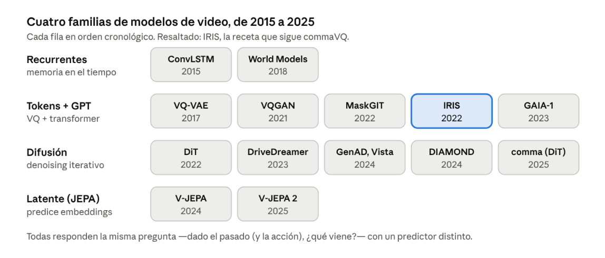

*Mapa de los 14 papers por familia de arquitectura.*

- **Parte 1 · Fundamentos:** ConvLSTM, VQ-VAE, World Models y VQGAN. Las piezas básicas.
- **Parte 2 · Generadores sobre tokens y latentes:** MaskGIT, DiT e IRIS. Las arquitecturas candidatas para el TP.
- **Parte 3 · World models de conducción y de video:** GAIA-1, DriveDreamer, V-JEPA, GenAD/Vista, DIAMOND, el paper de comma y V-JEPA 2.
- **Parte 4 · Métricas:** y al final, un camino sugerido con orden de lectura y experimentos.

Sobre las dos arquitecturas que mencionaste, las dos entran:

- **ConvLSTM** es el baseline clásico de predicción de video y es barato de entrenar sobre la grilla de tokens.
- **JEPA** es la línea alternativa más fuerte hoy (predecir embeddings en vez de generar). V-JEPA 2 ya se usa para planificar.

**commaVQ en cinco datos** (del [README oficial](https://github.com/commaai/commavq)):

- 100.000 minutos de manejo comprimidos, en segmentos de 1 minuto a 20 FPS.
- Cada frame es una grilla de 8×16 = 128 tokens de 10 bits (codebook de 1024), comprimidos con un VQ-VAE.
- Trae el encoder y el decoder, y también las poses del vehículo junto a los tokens.
- Incluye un world model GPT entrenado con 3.000.000 de minutos, con una receta similar a IRIS.
- Licencia MIT. Se carga desde Hugging Face con `load_dataset('commaai/commavq')`.

---

## Parte 1 · Fundamentos

### 1. ConvLSTM (2015): memoria recurrente que conserva el espacio

**Paper:** [Convolutional LSTM Network: A Machine Learning Approach for Precipitation Nowcasting](https://arxiv.org/abs/1506.04214) · Shi et al. · NeurIPS 2015

**Resumen.** Toma la LSTM clásica y reemplaza por convoluciones las multiplicaciones matriciales de las compuertas. El estado oculto deja de ser un vector y pasa a ser un tensor H×W×C, así que la memoria "sabe dónde" está cada cosa. Lo aplicaron a predecir la lluvia de las próximas horas a partir de imágenes de radar.

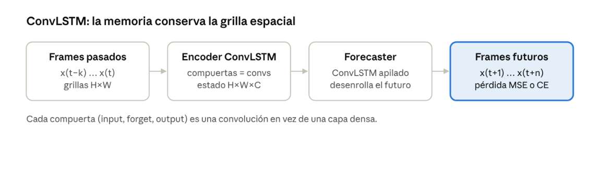

*ConvLSTM · encoder–forecaster sobre grillas.*

**Conceptos clave**

- **Compuertas convolucionales:** cada celda mira solo a sus vecinos (el kernel). Funciona como una CNN que además recuerda.
- **Encoder–forecaster:** un stack de ConvLSTM resume el pasado y otro desenrolla el futuro frame a frame.
- **Predicción determinística:** se entrena con MSE o cross-entropy y devuelve un solo futuro.

**Aportes**

- Fue la primera receta estándar para modelar video end-to-end como secuencia espacio-temporal.
- Abrió una familia entera: PredRNN (2017), PredRNN++, E3D-LSTM. Después SimVP (2022) mostró que una CNN simple, sin recurrencia, compite.

**Resultados**

- Le ganó a la LSTM fully-connected en Moving MNIST y al algoritmo operativo de flujo óptico (ROVER) en predicción de radar.

**Limitaciones**

- Con MSE el futuro sale borroso: si hay varios futuros posibles, predice el promedio. Es justo el problema que resuelven los modelos generativos de las partes 2 y 3.
- En horizontes largos se degrada rápido.

**Utilidad para el proyecto: baseline barato.** Los tokens de commaVQ ya vienen en una grilla de 8×16 por frame. Una ConvLSTM sobre esa grilla es un baseline natural, rápido de entrenar y fácil de explicar: embedding por token y predicción de las 1024 clases por celda. Sirve para mostrar en el informe cuánto gana el transformer.

### 2. VQ-VAE (2017): convertir imágenes en tokens

**Paper:** [Neural Discrete Representation Learning](https://arxiv.org/abs/1711.00937) · van den Oord, Vinyals, Kavukcuoglu · NeurIPS 2017

**Resumen.** Es un autoencoder con espacio latente discreto. Cada vector que sale del encoder se reemplaza por el vector más cercano de un "diccionario" aprendido (el codebook). La imagen queda representada como una grilla de índices, igual que un texto es una secuencia de palabras. Es el tokenizer que usa commaVQ.

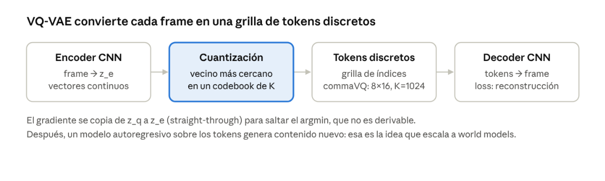

*VQ-VAE · encoder, codebook y decoder.*

**Conceptos clave**

- **Codebook:** K vectores aprendibles. El token de cada posición es el índice del vector más cercano.
- **Straight-through estimator:** el argmin no tiene gradiente, así que en el backward se copia el gradiente del decoder directo al encoder.
- **Loss en 3 partes:** reconstrucción, codebook loss (acerca los códigos al encoder) y commitment loss con peso β (evita que el encoder se escape del codebook).
- **Prior en dos etapas:** primero se entrena el autoencoder. Después, un modelo autoregresivo (PixelCNN en el paper) aprende la distribución de los tokens.

**Aportes**

- Evita el "posterior collapse" de los VAE con decoders potentes.
- Separa la compresión (autoencoder) de la generación (modelo sobre tokens). De acá sale toda la línea VQGAN → IRIS → GAIA-1 → commaVQ.

**Resultados**

- Comprimió ImageNet 128×128 a una grilla de 32×32 códigos con buena reconstrucción.
- También mostró audio (conversión de voz) y video en DeepMind Lab condicionado por acciones, un world model temprano.

**Utilidad para el proyecto: entender los datos.** Cada frame de commaVQ es una grilla de 8×16 tokens de 10 bits (codebook de 1024), a 20 FPS, en segmentos de 1 minuto. No hace falta entrenar el tokenizer, porque viene el decoder para pasar de tokens a video. Ojo: la calidad del decoder es el techo de todo el pipeline. Conviene medir el FID de las reconstrucciones reales como cota de referencia.

### 3. World Models (2018): el concepto que da nombre al proyecto

**Paper:** [World Models](https://arxiv.org/abs/1803.10122) · Ha & Schmidhuber · NeurIPS 2018 · [versión interactiva](https://worldmodels.github.io/)

**Resumen.** Propone que un agente tenga un modelo interno del mundo: comprime lo que ve, predice qué va a pasar y decide en base a eso. El controlador puede incluso entrenarse 100% dentro del "sueño" del modelo y después transferirse al entorno real.

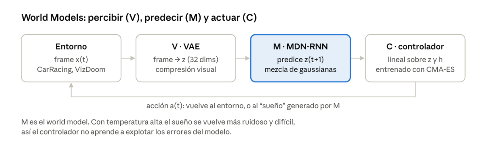

*World Models · V, M y C en lazo cerrado.*

**Conceptos clave**

- **V (visión):** un VAE que comprime cada frame en un vector z chico.
- **M (memoria / world model):** una RNN con salida de mezcla de gaussianas (MDN). Predice la distribución del próximo z dados z, la acción y el estado oculto h.
- **C (controlador):** deliberadamente mínimo (lineal), entrenado con un algoritmo evolutivo (CMA-ES). Toda la complejidad vive en V y M.
- **Entrenar en el sueño + temperatura:** subir la temperatura del muestreo hace el sueño más incierto y evita que el agente explote fallas del modelo.

**Aportes**

- Formalizó y popularizó el término *world model* en deep learning.
- Mostró que un modelo aprendido puede reemplazar al simulador para entrenar una política.

**Resultados**

- Resolvió CarRacing-v0, un entorno de manejo de juguete, con 906 ± 21 de score (el umbral es 900).
- En VizDoom el controlador se entrenó solo dentro del sueño y funcionó en el juego real.

**Utilidad para el proyecto: el marco conceptual.** commaVQ es exactamente un "M": predice el próximo estado (tokens) dado el pasado. Además, el dataset trae las poses del vehículo (`pose.npy`) junto a los tokens, que pueden jugar el rol de la acción *a* para condicionar la predicción. La idea de la temperatura sirve directo para el muestreo del GPT.

### 4. VQGAN (2021): la receta tokenizer + transformer

**Paper:** [Taming Transformers for High-Resolution Image Synthesis](https://arxiv.org/abs/2012.09841) · Esser, Rombach, Ommer · CVPR 2021

**Resumen.** Mejora el VQ-VAE para que cada token cargue más información: entrena el decoder con una loss perceptual y un discriminador adversarial. Con tokens tan ricos alcanza una grilla chica, y un transformer tipo GPT puede generar imágenes de alta resolución token por token.

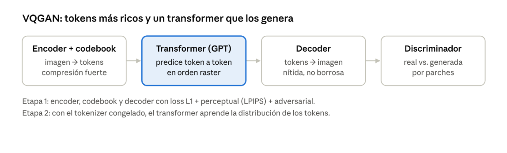

*VQGAN · tokenizer adversarial + transformer.*

**Conceptos clave**

- **Loss perceptual (LPIPS) + adversarial (PatchGAN):** al decoder no se lo premia por acertar píxel a píxel sino por "verse real". Eso evita el borroneo típico del MSE.
- **Compresión agresiva:** imágenes de 256×256 quedan en grillas de 16×16 tokens, una secuencia manejable para un transformer.
- **Dos etapas:** primero el tokenizer, después el transformer sobre tokens congelados.
- **Condicionamiento:** se puede anteponer a la secuencia una clase, un mapa de segmentación o uno de profundidad.

**Aportes**

- Unió lo mejor de las CNN (sesgo local para comprimir) y de los transformers (relaciones globales para generar).
- Es la receta que copiaron casi todos los world models con tokens, incluido commaVQ.

**Resultados**

- Primeras imágenes de alta resolución generadas con un transformer autoregresivo (hasta megapíxel, con atención por ventana deslizante).
- Muy buen desempeño en síntesis condicional (segmentación → imagen, profundidad → imagen).

**Utilidad para el proyecto: entender el tokenizer real.** El README de commaVQ cita a VQ-VAE y VQGAN como base de su compresor. Que el decoder sea adversarial explica por qué los frames decodificados se ven nítidos aunque cada frame tenga solo 128 tokens. Y la etapa 2 es literalmente lo que van a entrenar.

---

## Parte 2 · Generadores sobre tokens y latentes

### 5. MaskGIT (2022): generar en paralelo en vez de token a token

**Paper:** [MaskGIT: Masked Generative Image Transformer](https://arxiv.org/abs/2202.04200) · Chang et al. (Google) · CVPR 2022

**Resumen.** Un GPT genera los tokens uno por uno en orden fijo. MaskGIT, en cambio, arranca con todo enmascarado, predice todos los tokens a la vez, se queda con los más confiables y repite. En unas 8 iteraciones tiene la imagen completa. Se entrena como BERT: enmascarar y reconstruir.

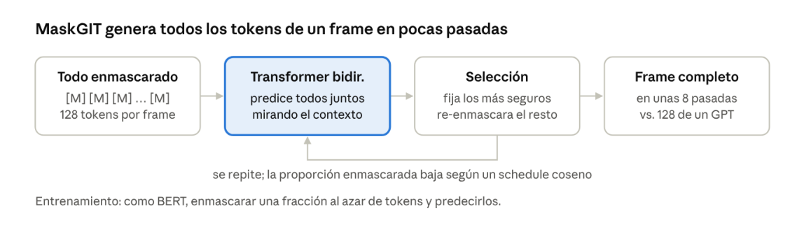

*MaskGIT · decodificación paralela iterativa.*

**Conceptos clave**

- **Masked token modeling:** el transformer es bidireccional (ve toda la imagen) y aprende a completar huecos.
- **Schedule de enmascarado:** en entrenamiento la proporción de máscara se sortea. En inferencia baja a lo largo de las iteraciones según una función coseno.
- **Confianza como criterio:** en cada paso se fijan los tokens con mayor probabilidad predicha.

**Aportes**

- Mostró que para generar imágenes con tokens no hace falta el orden raster del GPT.
- Edición gratis: inpainting y outpainting son solo enmascarar la zona a regenerar.
- Dio origen a MAGVIT (video) y Muse (texto → imagen).

**Resultados**

- En ImageNet 256×256 mejoró el FID del VQGAN autoregresivo y aceleró la decodificación hasta 64×.

**Utilidad para el proyecto: la alternativa rápida al GPT.** Con commaVQ, un GPT necesita 128 pasadas para generar un frame (una por token). Un enfoque tipo MaskGIT, causal entre frames y bidireccional dentro del frame, lo haría en unas 8: del orden de 16× menos pasadas (estimación nuestra). Comparar calidad vs. velocidad entre los dos es un experimento central muy claro para el TP.

### 6. DiT (2022): difusión con transformers

**Paper:** [Scalable Diffusion Models with Transformers](https://arxiv.org/abs/2212.09748) · Peebles & Xie · ICCV 2023

**Resumen.** Los modelos de difusión aprenden a sacar ruido de a poco hasta llegar a una muestra limpia. DiT reemplaza por un transformer la U-Net convolucional que se usaba como "denoiser"; el transformer trabaja sobre parches del espacio latente de un VAE. Muestra que estos modelos escalan como los LLM: más cómputo, mejor calidad.

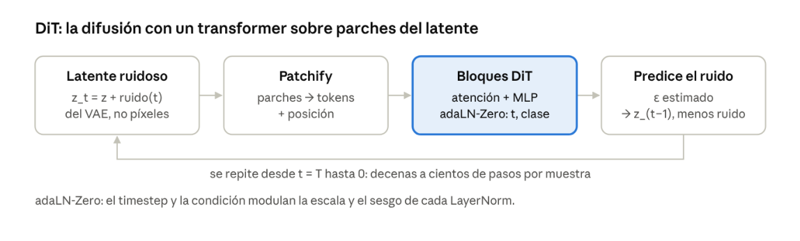

*DiT · difusión latente con transformer.*

**Conceptos clave**

- **Difusión:** en entrenamiento se agrega ruido con intensidad *t* y la red aprende a predecirlo. En inferencia se parte de ruido puro y se limpia en T pasos.
- **Difusión latente:** se trabaja en el espacio comprimido de un autoencoder, no en píxeles. Es mucho más barato.
- **Patchify:** el latente se corta en parches, que pasan a ser los tokens del transformer.
- **adaLN-Zero:** una forma de inyectar condiciones (timestep, clase, acciones) modulando las normalizaciones. Fue la variante que mejor anduvo.

**Aportes**

- Hizo del transformer la arquitectura estándar de la difusión (base de Sora y Stable Diffusion 3).
- Mostró una relación clara entre los GFLOPs del modelo y el FID: escalar paga.

**Resultados**

- DiT-XL/2 llegó a FID 2,27 en ImageNet 256×256 condicional por clase, estado del arte en ese momento.

**Utilidad para el proyecto: la opción más ambiciosa.** Es la arquitectura que usa comma hoy (ver sección 13). El desafío es que los tokens de commaVQ son discretos y DiT necesita un latente continuo. Hay dos opciones: difundir sobre los vectores del codebook y redondear al código más cercano al final, o tratar el enmascarado tipo MaskGIT como "difusión discreta". También es la más cara de muestrear, por los T pasos.

### 7. IRIS (2022): la receta exacta de commaVQ

**Paper:** [Transformers are Sample-Efficient World Models](https://arxiv.org/abs/2209.00588) · Micheli, Alonso, Fleuret · ICLR 2023

**Resumen.** Arma un world model con dos piezas. La primera es un autoencoder discreto que convierte cada frame en pocos tokens. La segunda es un transformer tipo GPT que modela la secuencia de tokens y acciones. Con eso, un agente aprende a jugar Atari entrenando casi todo "en la imaginación" del modelo, con muy pocos datos reales.

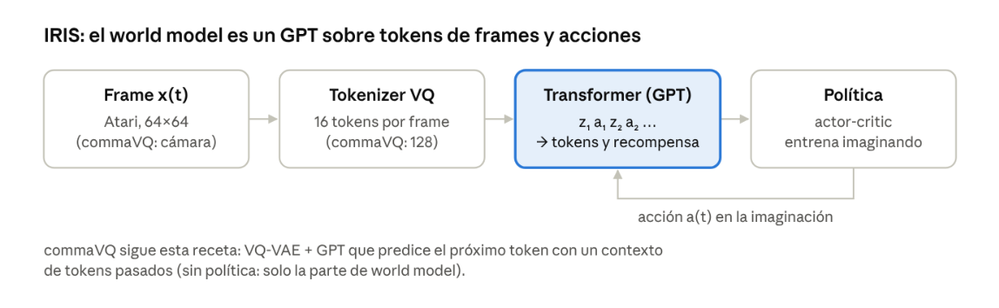

*IRIS · tokenizer + GPT + política en imaginación.*

**Conceptos clave**

- **Secuencia intercalada:** tokens del frame 1, acción 1, tokens del frame 2, acción 2, y así. El GPT predice el próximo token, igual que un LLM.
- **Cabezas extra:** además de los tokens del próximo frame, predice la recompensa y el fin de episodio.
- **Imaginación:** la política genera trayectorias dentro del world model y aprende de ellas (actor-critic).
- **Sample efficiency:** el cuello de botella son los datos del entorno, no el cómputo.

**Aportes**

- Fue el primer world model competitivo basado puramente en tokens + transformer, sin RNN.
- Mostró que la analogía "video = lenguaje de tokens" funciona para modelar dinámica.

**Resultados**

- En Atari 100k (unas 2 horas de juego real) alcanzó un score humano-normalizado medio de 1,046 y superó a humanos en 10 de 26 juegos. Fue el mejor resultado sin lookahead en ese momento.

**Utilidad para el proyecto: el paper base.** El README de commaVQ dice explícitamente que su world model sigue una receta similar a IRIS. La diferencia clave es que commaVQ usa 128 tokens por frame (IRIS, 16), así que 20 frames de contexto son 2.560 tokens y la atención pesa. Para condicionar por acción, las poses del dataset pueden intercalarse como tokens, igual que las acciones de IRIS.

---

## Parte 3 · World models de conducción y de video

### 8. GAIA-1 (2023): la referencia obligada en manejo

**Paper:** [GAIA-1: A Generative World Model for Autonomous Driving](https://arxiv.org/abs/2309.17080) · Hu et al. (Wayve) · 2023

**Resumen.** Lleva la receta tokens + transformer a escala industrial en conducción. El world model recibe video, texto y acciones del auto, y predice los tokens del futuro. Un decoder de difusión aparte convierte esos tokens en video fluido y de alta calidad.

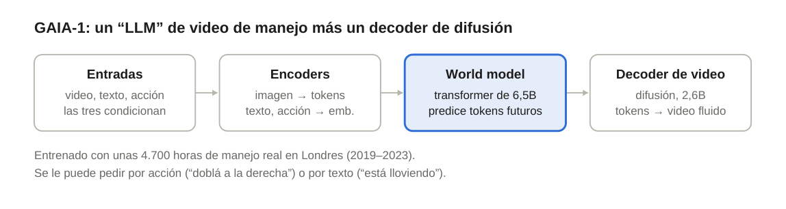

*GAIA-1 · encoders, world model y decoder de video.*

**Conceptos clave**

- **Multimodalidad:** video, texto y acción van a la misma secuencia. El texto permite controlar clima, hora o situación; la acción, lo que hace el auto propio.
- **Separar "qué pasa" de "cómo se ve":** el transformer razona en tokens (semántica y dinámica). El decoder de difusión se encarga del detalle visual y la suavidad temporal.
- **Scaling laws:** la loss del world model baja con el cómputo de forma parecida a la de los LLM.

**Aportes**

- Mostró comportamientos emergentes: varios futuros plausibles desde el mismo pasado, otros autos que reaccionan, comprensión de la geometría de la escena.
- Posicionó a los world models como herramienta para simular situaciones de manejo raras (y peligrosas).

**Resultados**

- Unos 9B de parámetros en total (6,5B el world model, 2,6B el decoder), entrenados con unas 4.700 horas de manejo propias de Wayve. La evaluación es sobre todo cualitativa, con ejemplos de generación controlada.

**Utilidad para el proyecto: el "techo" y las ideas de evaluación.** No se puede replicar a esa escala, pero deja tres ideas copiables:

1. Muestrear varios futuros desde el mismo contexto y mostrar la diversidad.
2. Condicionar por acción (las poses de commaVQ) y verificar que el video "obedece".
3. Usar el decoder de commaVQ como el "cómo se ve" y concentrarse en el "qué pasa".

### 9. DriveDreamer (2023): difusión guiada por la estructura de la escena

**Paper:** [DriveDreamer: Towards Real-world-driven World Models for Autonomous Driving](https://arxiv.org/abs/2309.09777) · Wang et al. · ECCV 2024

**Resumen.** Es un world model de manejo basado en difusión y entrenado con escenas reales de nuScenes. Primero aprende a generar escenas que respeten la estructura del tráfico (mapa, cajas 3D de autos y peatones). Después aprende a predecir cómo sigue el video y qué acciones de manejo vienen.

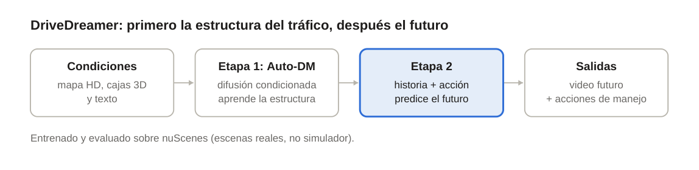

*DriveDreamer · dos etapas de difusión.*

**Conceptos clave**

- **Condicionamiento estructurado:** en vez de texto suelto, la difusión recibe el layout de la escena (carriles, objetos). Eso da control fino y coherencia geométrica.
- **Entrenamiento en dos etapas:** primero "cómo es una escena válida", después "cómo evoluciona".
- **Predicción conjunta de video + acción:** el modelo también predice la política de manejo, no solo píxeles.

**Aportes**

- Fue uno de los primeros world models de manejo entrenado 100% con datos reales y evaluado en un benchmark público.
- Abrió la línea DriveDreamer-2, que usa un LLM para traducir texto a trayectorias y layouts.

**Resultados**

- En nuScenes, a baja resolución (128×192), reportó FID 52,6 y FVD 452. DriveDreamer-2 bajó a FID 11,2 y FVD 55,7, lo que muestra lo rápido que avanzó el área.

**Utilidad para el proyecto: la idea de la cabeza de acción.** commaVQ no trae mapas ni cajas 3D, así que el condicionamiento estructurado no aplica directo. Lo copiable es predecir la acción junto con el video: agregar una cabeza que prediga la próxima pose a partir de los tokens. Además, sus tablas sirven para calibrar qué valores de FID/FVD son "buenos".

### 10. V-JEPA (2024): predecir en el espacio de representaciones

**Paper:** [Revisiting Feature Prediction for Learning Visual Representations from Video](https://arxiv.org/abs/2404.08471) · Bardes et al. (Meta) · 2024

**Resumen.** Es la apuesta de Yann LeCun contra los modelos generativos. En vez de predecir píxeles o tokens, predice la *representación* de las partes ocultas del video. Así el modelo no gasta capacidad en detalles impredecibles (hojas que se mueven, reflejos) y aprende la dinámica y la semántica. Se entrena sin etiquetas.

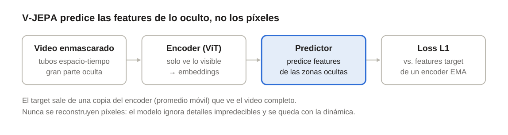

*V-JEPA · predicción en espacio de features.*

**Conceptos clave**

- **JEPA (Joint-Embedding Predictive Architecture):** dos encoders (contexto y target) y un predictor que mapea uno al otro en espacio latente.
- **Enmascarado en tubos:** se ocultan bloques que se extienden en el tiempo, para que no alcance con copiar el frame vecino.
- **Encoder target con EMA:** sus pesos son un promedio móvil del encoder de contexto. Evita el colapso (todo mapeado al mismo vector).
- **Evaluación con encoder congelado:** se entrena solo un clasificador chico encima (probe) para medir la calidad de las features.

**Aportes**

- Mostró que predecir features alcanza para aprender buenas representaciones de video, sin reconstruir píxeles, sin texto y sin negativos.
- Es la base conceptual de V-JEPA 2 (sección 14), que lo convierte en world model.

**Resultados**

- Se entrenó con unos 2 millones de videos públicos. Con el encoder congelado logró 81,9% en Kinetics-400, 72,2% en Something-Something v2 y 77,9% en ImageNet.

**Utilidad para el proyecto: un experimento contrastante.** La pregunta de investigación queda servida: ¿conviene clasificar el próximo token (GPT) o regresar su embedding en el espacio del codebook (estilo JEPA)? En contra: no genera video por sí solo. Para evaluarlo, entrenen un probe que prediga la pose del auto desde las features predichas.

### 11. GenAD y Vista (2024): escalar con video de YouTube

**Papers:**

- [Generalized Predictive Model for Autonomous Driving (GenAD)](https://arxiv.org/abs/2403.09630) · Yang et al. · CVPR 2024
- [Vista: A Generalizable Driving World Model with High Fidelity and Versatile Controllability](https://arxiv.org/abs/2405.17398) · Gao et al. · NeurIPS 2024

**Resumen.** Los dos parten de un modelo de difusión de imágenes o video ya preentrenado y lo adaptan a manejo con muchísimo video de YouTube grabado desde autos. GenAD armó OpenDV, un dataset de más de 2.000 horas de manejo de todo el mundo. Vista se apoyó en eso, subió la resolución y agregó controles finos.

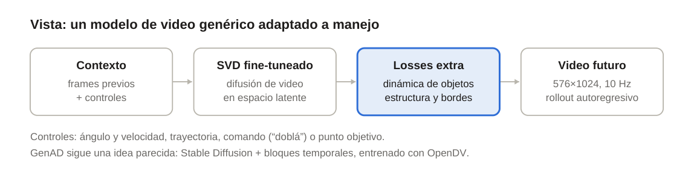

*Vista · Stable Video Diffusion adaptado a manejo.*

**Conceptos clave**

- **Transferir desde modelos generales:** en vez de entrenar de cero, se fine-tunea Stable Diffusion (GenAD) o Stable Video Diffusion (Vista).
- **Losses específicas de manejo (Vista):** una pesa más las zonas con movimiento (los autos que se mueven importan más que el cielo) y otra preserva estructura y bordes.
- **Controlabilidad múltiple:** el mismo modelo acepta ángulo y velocidad, trayectoria, comando o punto objetivo.
- **Generalización zero-shot:** al entrenar con video de muchas ciudades, funcionan en lugares que nunca vieron.

**Aportes**

- OpenDV es el dataset abierto más grande de video de manejo con anotaciones de texto.
- Vista usa su propia incertidumbre como función de recompensa para evaluar acciones sin ground truth.

**Resultados**

- En nuScenes, GenAD logró FID 15,4 / FVD 184 y Vista FID 6,9 / FVD 89,4 a 576×1024. Vista fue de los mejores de 2024.

**Utilidad para el proyecto: datos extra y una prueba de generalización.** commaVQ incluye el encoder, así que pueden tokenizar video propio. Una prueba muy vistosa para el informe: grabar o bajar video de manejo en Buenos Aires, tokenizarlo y ver si el world model, entrenado en EE.UU., generaliza. Ojo: una cámara distinta puede afectar al encoder.

### 12. DIAMOND (2024): ¿y si los tokens pierden detalles importantes?

**Paper:** [Diffusion for World Modeling: Visual Details Matter in Atari](https://arxiv.org/abs/2405.12399) · Alonso, Jelley, Micheli et al. · NeurIPS 2024

**Resumen.** Es del mismo grupo que IRIS. Plantea que comprimir cada frame en pocos tokens puede borrar detalles chicos pero decisivos: una bala en Atari, un semáforo lejano en la calle. Reemplaza el tokenizer + GPT por un modelo de difusión que genera el próximo frame directo en píxeles, condicionado en los frames y acciones previos.

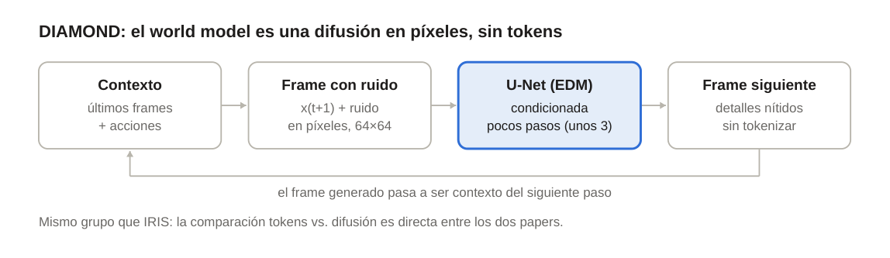

*DIAMOND · difusión autoregresiva en píxeles.*

**Conceptos clave**

- **Difusión autoregresiva:** cada frame nuevo se genera por difusión y se agrega al contexto para generar el siguiente.
- **Formulación EDM (Karras et al.):** una parametrización de la difusión que se mantiene estable con muy pocos pasos de denoising. Es clave para que el rollout sea rápido.
- **Compounding error:** el gran enemigo de cualquier world model. Errores chicos en un frame se acumulan en los siguientes. DIAMOND le dedica mucho análisis.

**Aportes**

- Mostró que la difusión, con una formulación bien elegida, compite con los tokens como base de un world model y los supera.
- Entrenó un world model jugable de Counter-Strike a partir de grabaciones de partidas, que corre en una GPU de consumo.

**Resultados**

- En Atari 100k llegó a un score humano-normalizado medio de 1,46, el mejor para agentes entrenados enteramente dentro de un world model (IRIS: 1,046).

**Utilidad para el proyecto: la discusión de fondo.** Con 128 tokens por frame, commaVQ comprime muchísimo. Vale la pena analizar en el informe qué se pierde: decodifiquen frames reales y busquen semáforos, carteles y autos lejanos. Además, el análisis de compounding error de DIAMOND es la base para el experimento de "cuántos segundos aguanta el modelo".

### 13. Learning to Drive from a World Model (2025): lo que hace comma hoy

**Paper:** [Learning to Drive from a World Model](https://arxiv.org/abs/2504.19077) · Goff, Hogan, Hotz et al. (comma.ai) · CVPR 2025 Workshops · [post de openpilot 0.11](https://blog.comma.ai/011release/)

**Resumen.** Los autores del dataset muestran cómo entrenar una política de manejo end-to-end, sin reglas a mano, usando un world model como simulador. La política maneja "dentro" del modelo, que genera el video de lo que pasaría, y aprende de sus propios errores. La desplegaron en un ADAS real (openpilot).

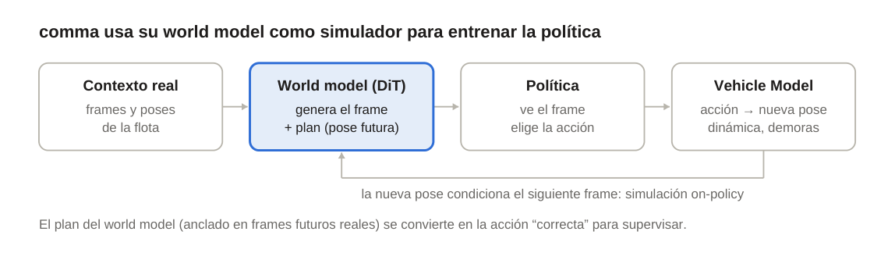

*comma · world model como simulador on-policy.*

**Conceptos clave**

- **On-policy vs. behavior cloning:** imitar al humano (off-policy) falla cuando el auto se desvía a situaciones que el humano nunca mostró. Simular permite que la política vea las consecuencias de sus acciones.
- **World model DiT:** abandonaron el GPT sobre tokens por un Diffusion Transformer que procesa video (patches 3D). Está condicionado en las poses del vehículo, el timestep del mundo y el timestep de difusión.
- **Future Anchored World Model:** también está condicionado en frames futuros y además predice la trayectoria ("Plan Model"). Ese plan da la acción correcta para supervisar la política.
- **Vehicle Model:** convierte acciones en poses e incluye efectos reales (respuesta demorada del volante, viento).

**Aportes**

- Comparan dos simuladores aprendidos: reproyección de vistas (geométrica) y world model. El world model escala mejor con datos y cómputo.
- Afirman que es el primer uso de un world model para entrenar on-policy una política desplegada en el mundo real.

**Resultados**

- Políticas que manejan sin reglas codificadas, evaluadas en simulación cerrada y en un ADAS real. openpilot 0.11 trajo el primer modelo entrenado con videos y planes generados por el world model.

**Utilidad para el proyecto: el norte y el contexto del dataset.** Explica para qué existe commaVQ y hacia dónde fue comma (GPT → DiT). Una idea alcanzable para el TP es un "Plan Model" chico: una cabeza que prediga la pose futura desde los tokens, evaluada con error L2 contra las poses reales del dataset.

### 14. V-JEPA 2 (2025): JEPA convertido en world model

**Paper:** [V-JEPA 2: Self-Supervised Video Models Enable Understanding, Prediction and Planning](https://arxiv.org/abs/2506.09985) · Assran, Bardes et al. (Meta) · 2025

**Resumen.** Escala V-JEPA a más de 1 millón de horas de video de internet y después le agrega acciones con muy pocos datos: menos de 62 horas de video de robots (dataset DROID). Así obtiene un world model que predice el efecto de una acción en el espacio latente. Le alcanza para planificar tareas de manipulación con robots reales sin entrenamiento específico.

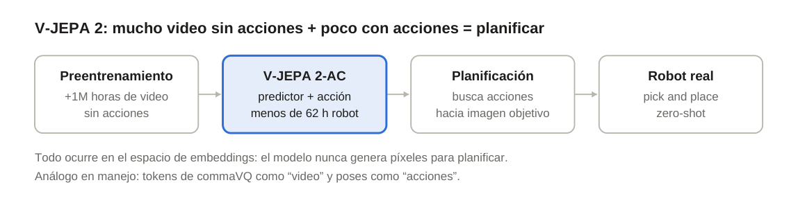

*V-JEPA 2 · de representaciones a planificación.*

**Conceptos clave**

- **Dos etapas de datos:** el "sentido común visual" sale de video pasivo, abundante y sin etiquetas. La relación acción → consecuencia sale de pocas horas con acciones.
- **World model latente condicionado por acción (V-JEPA 2-AC):** con el encoder congelado, un predictor aprende a predecir el embedding del próximo estado dados el estado actual y la acción.
- **Planificación por búsqueda:** se buscan las acciones cuyo estado predicho queda más cerca del embedding de una imagen objetivo, y se re-planifica en cada paso (control predictivo).

**Aportes**

- Es la demostración más fuerte hasta ahora de que un world model no generativo sirve para actuar en el mundo físico.
- Unifica comprensión, predicción y planificación en un solo modelo de video.

**Resultados**

- 77,3% top-1 en Something-Something v2 (comprensión de movimiento) y estado del arte en anticipación de acciones (Epic-Kitchens-100).
- Pick and place zero-shot con brazos Franka en dos laboratorios distintos.

**Utilidad para el proyecto: el paralelo es directo.** commaVQ tiene mucho video y poses, igual que la receta de V-JEPA 2. Si eligen la línea JEPA, la versión alcanzable es un predictor latente condicionado por pose sobre los embeddings del codebook. Una prueba linda: dados el frame actual y uno objetivo, buscar la secuencia de poses que lleva de uno a otro.

---

## Parte 4 · Métricas de evaluación

Conviene reportar tres familias juntas:

1. Una en el espacio de tokens: barata, para iterar.
2. Una de calidad de video: para comparar con la literatura.
3. Una de utilidad: para mostrar que el modelo "entiende" el manejo.

| Métrica | Qué mide | Mejor | Cómo usarla en el TP |
|---|---|---|---|
| Cross-entropy / perplejidad del próximo token | Qué tan bien predice los tokens reales | Menor | Métrica principal para iterar rápido. Comparable entre GPT, ConvLSTM y variantes autoregresivas. |
| Tasa de compresión (10 bits / CE en bits) | Lo mismo que la CE, expresado como en el challenge de commaVQ | Mayor | Referencia externa: con el GPT de comma + arithmetic coding se llegó a 4,0× (lzma: 1,6×). |
| Exactitud top-1 por token | Proporción de tokens acertados | Mayor | Intuitiva para el informe, pero castiga futuros plausibles distintos al real. |
| PSNR / SSIM | Parecido píxel a píxel con el futuro real | Mayor | Solo para horizontes cortos: con futuros múltiples castiga muestras buenas. |
| [LPIPS](https://arxiv.org/abs/1801.03924) | Parecido perceptual con el futuro real (features de una CNN) | Menor | Mejor que PSNR para frames generados. Medir por segundo de horizonte. |
| FID | Realismo de frames sueltos vs. frames reales (distribuciones) | Menor | Calidad visual por frame. Las reconstrucciones del decoder son la cota. |
| [FVD](https://arxiv.org/abs/1812.01717) | Realismo de clips completos, incluida la coherencia temporal (features I3D) | Menor | La métrica estándar de los papers de manejo. Necesita cientos de clips para ser estable. |
| Error L2 de pose / trayectoria | Si el modelo "sabe" hacia dónde va el auto | Menor | Cabeza de plan o probe sobre las features, contra las poses reales del dataset. |
| Diversidad entre muestras | Si genera varios futuros distintos desde el mismo contexto | Depende | Clave para mostrar que no colapsó a un futuro promedio. |

Dos cuidados:

1. La cross-entropy de MaskGIT o de la difusión no es directamente comparable con la del GPT, porque no estiman la verosimilitud igual. Para comparar familias usen FID, FVD y LPIPS.
2. FID y FVD dependen de la resolución y de la cantidad de muestras. Solo comparen números medidos con el mismo protocolo.

**El gráfico estrella:** FVD (o LPIPS) en función de los segundos de horizonte, una curva por arquitectura. Muestra el compounding error de un vistazo.

---

## Propuesta de proyecto

**Pregunta central:** ¿cuánto se puede achicar y acelerar un world model generativo de manejo, sin perder calidad, hasta generar video en tiempo real en una GPU de Colab?

**Título tentativo:** *World models de manejo en tiempo real con poco cómputo: destilación, decodificación paralela y cuantización sobre commaVQ.*

### Aportes esperados

1. Primer benchmark reproducible sobre commaVQ: splits, métricas, horizontes y baselines. No encontramos papers que lo usen así; hay que confirmarlo en Google Scholar y arXiv antes de afirmarlo.
2. Frontera de Pareto calidad vs. latencia para world models de manejo con poco cómputo, un régimen que los papers grandes no reportan.
3. Análisis de tiempo real: a 20 FPS, cada frame (128 tokens) tiene que salir en 50 ms.
4. Secundario: si la cross-entropy en tokens predice la calidad visual (FVD). Si la predice, valida iterar con la métrica barata.

### Hipótesis

- **H1:** un alumno destilado del GPT2M de comma supera a uno del mismo tamaño entrenado de cero.
- **H2:** MaskGIT con pocos pasos baja de 50 ms por frame con una pérdida moderada de FVD.
- **H3:** fp16 / int8 aceleran con pérdida casi nula.
- **H4:** CE y FVD están correlacionadas entre configuraciones.

### Técnicas para achicar y acelerar

| Técnica | Qué acelera | ¿Pierde calidad? | Dificultad | Prioridad |
|---|---|---|---|---|
| KV cache | No recalcula el contexto en cada token | No | Baja | Núcleo (baseline obligatorio) |
| Destilación del GPT2M de comma | Modelo alumno mucho más chico | Poca, si sale bien | Media | Núcleo |
| MaskGIT con pocos pasos | De 128 pasadas por frame a unas 8 o menos | A medir según los pasos | Media | Núcleo |
| Cuantización fp16 / int8 | Memoria y velocidad | Poca | Baja | Núcleo |
| Contexto corto / ventana deslizante | Menos tokens para atender | Algo, en horizontes largos | Baja | Eje a barrer |
| Atención factorizada espacio/tiempo | Costo de la atención | A medir | Media | Extra |
| Speculative decoding (GPT chico propone, GPT2M verifica) | Pasadas del modelo grande | No: misma distribución | Media | Extra |

**Por qué la destilación es el corazón.** El GPT2M de comma se entrenó con 3.000.000 de minutos, unas 30 veces el dataset público. Un alumno que aprende de sus probabilidades (soft targets) hereda parte de ese conocimiento sin ver esos datos. La comparación alumno destilado vs. alumno de cero, del mismo tamaño, es limpia y fácil de explicar.

### Diseño experimental

- **Referencia:** GPT2M de comma con KV cache: calidad máxima y latencia de base.
- **Ejes:** tamaño del alumno (2–3 tamaños), destilado o de cero, GPT o MaskGIT (y cantidad de pasos), fp16 o int8, largo de contexto.
- **Calidad:** CE en tokens, FID y FVD sobre un set fijo de clips de evaluación, LPIPS por segundo de horizonte.
- **Velocidad:** ms por frame con batch 1, en fp16, con warm-up y mediana sobre muchos frames. Siempre el mismo tipo de GPU de Colab, anotado en el paper.
- **Punto barato:** la ConvLSTM entra como extremo rápido de la curva.

### Figuras

1. **Central:** FVD vs. ms por frame, un punto por configuración, con la línea de 50 ms marcada y la frontera de Pareto resaltada.
2. **Secundaria:** FVD vs. segundos de horizonte para las mejores configuraciones (cuánto aguantan antes del drift).
3. **De yapa:** CE vs. FVD (H4).

**Cómo encaja con la escalera de experimentos:** E0 pasa a ser la referencia (GPT2M + KV cache). E1 es el punto barato. E2 se amplía a alumnos de cero y destilados. E3 es MaskGIT. La cuantización se aplica arriba de cada uno. E4 y E5 quedan fuera del núcleo.

### Riesgos y mitigación

| Riesgo | Mitigación |
|---|---|
| Correr el maestro es caro | Generar los logits del GPT2M una sola vez sobre un subconjunto y guardar solo el top-k. |
| GPUs variables en Colab | Fijar un tipo para todas las mediciones de latencia y descartar corridas en otro. |
| FVD ruidoso con pocas muestras | Set de evaluación fijo y lo más grande que permita el tiempo. Reportar la variabilidad. |
| Novedad | Revisar la literatura antes de escribir "primeros en". |

### Estructura del paper (4–6 páginas)

1. **Introducción:** por qué world models rápidos y baratos.
2. **Trabajo relacionado:** World Models, IRIS, GAIA-1, MaskGIT, DIAMOND, comma (secciones 3, 5, 7, 8, 12, 13).
3. **Método:** dataset, arquitecturas, destilación, decodificación y cuantización.
4. **Experimentos:** protocolo de calidad y de latencia.
5. **Resultados:** figura de Pareto, horizonte, CE vs. FVD.
6. **Conclusión y límites.**

---

## Camino sugerido para el proyecto

**Orden de lectura** (de lo imprescindible a lo opcional):

1. IRIS (7) y el README de commaVQ: entender exactamente qué hay en el dataset y qué modelo trae.
2. VQ-VAE (2) y VQGAN (4), rápido: alcanza con entender tokenizer + codebook.
3. World Models (3) y GAIA-1 (8): el marco conceptual y el estado del arte en manejo.
4. MaskGIT (5): la alternativa principal al GPT.
5. Paper de comma (13) y DIAMOND (12): hacia dónde va el área y la discusión tokens vs. difusión.
6. Opcionales según la línea que elijan: ConvLSTM (1) para el baseline, DiT (6) para difusión, V-JEPA (10) y V-JEPA 2 (14) para la línea latente.

**Escalera de experimentos** (cada peldaño ya es entregable si el siguiente no sale):

| Paso | Experimento | Pregunta que responde | Métricas | Dificultad |
|---|---|---|---|---|
| E0 | Evaluar el GPT que trae commaVQ | ¿Cuál es la vara a superar? | CE, FID, FVD | Baja |
| E1 | ConvLSTM sobre la grilla 8×16 | ¿Cuánto aporta la atención vs. la memoria recurrente? | CE, LPIPS | Baja |
| E2 | GPT chico entrenado por ustedes | ¿Cómo escala la calidad con tamaño y contexto? | CE, FVD vs. horizonte | Media |
| E3 | Variante tipo MaskGIT | ¿Cuánta calidad se pierde por generar más rápido? | FVD, frames/seg | Media |
| E4 | Condicionar por pose + cabeza de plan | ¿El video obedece a la acción? ¿Predice la trayectoria? | L2 de pose, FVD | Media-alta |
| E5 | Opcional: predictor latente (JEPA) o DiT | ¿Conviene predecir embeddings o difundir en vez de clasificar tokens? | Probe de pose, FID/FVD | Alta |

**Para decidir con el grupo**

- **Cómputo:** GPUs de Google Colab (cloud de respaldo). Implica GPT chicos (decenas de millones de parámetros), un subconjunto del dataset, contexto corto (4–8 frames = 512–1.024 tokens), mixed precision y checkpoints en Drive, porque las sesiones se cortan.
- **Entrega en unas 6 semanas** (principios de diciembre): E0–E3 asegurados, E4 como objetivo extra, E5 afuera salvo que sobre tiempo.
- **Si E4 usa las poses como acción:** hay que revisar en qué formato y con qué frecuencia vienen en `pose.npy`.

**Plan semana a semana** (suponiendo arranque el 19 de octubre):

| Semana | Fechas | Objetivo |
|---|---|---|
| 1 | 19–25 oct | Leer IRIS y el README; cargar commaVQ en Colab, decodificar frames y correr el GPT de comma (E0) sobre un subconjunto. |
| 2 | 26 oct–1 nov | Pipeline de evaluación (CE, LPIPS, FID/FVD por clips) + baseline ConvLSTM (E1). |
| 3 | 2–8 nov | GPT chico propio (E2): barrido de tamaño y largo de contexto. |
| 4 | 9–15 nov | Variante MaskGIT (E3) y comparación calidad vs. velocidad. |
| 5 | 16–22 nov | Condicionamiento por pose + cabeza de plan (E4), o cerrar experimentos si vienen atrasados. |
| 6 | 23 nov–1 dic | Gráfico de FVD vs. horizonte, informe y demo de video. |

---

## Referencias

**Dataset y código**

- [commaVQ (GitHub)](https://github.com/commaai/commavq) · [commaVQ (Hugging Face)](https://huggingface.co/datasets/commaai/commavq)
- [openpilot 0.11](https://blog.comma.ai/011release/): modelo entrenado con el world model

**Papers, en orden cronológico**

1. [ConvLSTM](https://arxiv.org/abs/1506.04214): Shi et al., 2015
2. [VQ-VAE](https://arxiv.org/abs/1711.00937): van den Oord et al., 2017
3. [World Models](https://arxiv.org/abs/1803.10122): Ha & Schmidhuber, 2018
4. [FVD](https://arxiv.org/abs/1812.01717): Unterthiner et al., 2018
5. [LPIPS](https://arxiv.org/abs/1801.03924): Zhang et al., 2018
6. [VQGAN](https://arxiv.org/abs/2012.09841): Esser et al., 2021
7. [MaskGIT](https://arxiv.org/abs/2202.04200): Chang et al., 2022
8. [IRIS](https://arxiv.org/abs/2209.00588): Micheli et al., 2022
9. [DiT](https://arxiv.org/abs/2212.09748): Peebles & Xie, 2022
10. [GAIA-1](https://arxiv.org/abs/2309.17080): Hu et al., 2023
11. [DriveDreamer](https://arxiv.org/abs/2309.09777): Wang et al., 2023
12. [GenAD](https://arxiv.org/abs/2403.09630): Yang et al., 2024
13. [V-JEPA](https://arxiv.org/abs/2404.08471): Bardes et al., 2024
14. [DIAMOND](https://arxiv.org/abs/2405.12399): Alonso et al., 2024
15. [Vista](https://arxiv.org/abs/2405.17398): Gao et al., 2024
16. [Learning to Drive from a World Model](https://arxiv.org/abs/2504.19077): Goff et al. (comma.ai), 2025
17. [V-JEPA 2](https://arxiv.org/abs/2506.09985): Assran et al., 2025

**Surveys para el estado del arte del informe**

- [The Role of World Models in Shaping Autonomous Driving: A Comprehensive Survey](https://arxiv.org/abs/2502.10498) (2025)
- [A Comprehensive Survey on World Models for Embodied AI](https://arxiv.org/abs/2510.16732) (2025): tiene tablas comparativas de FID/FVD en nuScenes.
- [World Models for Autonomous Driving: An Initial Survey](https://arxiv.org/abs/2403.02622) (2024)

Los links de commaVQ, del paper de comma, de V-JEPA 2 y de los surveys se chequearon al armar el documento original; el resto son los IDs de arXiv conocidos de cada paper.
