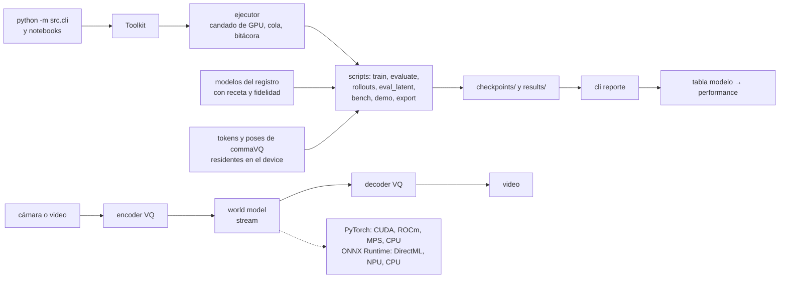

# ml2-gen-world-model

World models de manejo sobre [commaVQ](https://github.com/commaai/commavq). Trabajo práctico de Aprendizaje Automático II (MIA, UdeSA).

Pregunta del proyecto: ¿cuánto se puede achicar y acelerar un world model de video de manejo sin perder calidad?

- **Qué se hizo y por qué:** [`Docs/resumen.md`](Docs/resumen.md).
- **Resultados (tabla modelo → performance):** [`Docs/resultados.md`](Docs/resultados.md).
- **Cómo usar el framework (CLI, cola, bitácora, dispositivos):** [`Docs/uso.md`](Docs/uso.md).
- **Una guía por modelo (receta, fidelidad, acciones):** [`Docs/modelos/`](Docs/modelos/README.md).
- **Cómo contribuir:** [`CONTRIBUTING.md`](CONTRIBUTING.md).
- **Los papers del camino:** [`Docs/world-models-conduccion-papers.md`](Docs/world-models-conduccion-papers.md).

## Estado del proyecto

**La cola de GPU terminó y todos los resultados de la tabla son actuales.** Los modelos se reconstruyeron para ser fieles a su fuente; cada uno entrena con la receta de su paper, escalada a un presupuesto común de 780.000 frames. Cada número de los docs sale de un JSON de `results/` con su comando en la bitácora. Las conclusiones y las hipótesis están en [`Docs/resultados.md`](Docs/resultados.md#4-hipótesis-y-conclusiones). Quedan sin correr los opcionales (los GPT de cero, `genie_m` y el MaskGIT propio) y las corridas 10× de los latentes.

**Los modelos entrenados están en Hugging Face:** los de la tabla y sus decoders, en un repo público. `load_model("<run>")` y la CLI bajan solos lo que falte, sin cuenta ni login, y lo verifican contra el sha256 de `results/checkpoints.json` ([Modelos entrenados](Docs/uso.md#modelos-entrenados-hugging-face)). Lo que no está ahí se entrena con un comando de la CLI (más abajo).

### Modelos

Una fila por modelo. La performance está en la tabla de resultados, que a su vez lleva a la guía de cada modelo (la acción `entrenar` está a un clic).

| Modelo | Qué es | Performance | Reentrenar |
|---|---|---|---|
| `gpt_s_kd` | GPT-S destilado de `gpt2m`, receta de IRIS | FVD 207 a 1 s y 468 a 3 s; 158 ms por frame ([video](results/video_gpt_s_kd.json), [resultados](Docs/resultados.md#1-modelos-de-video-modelo--performance)) | [`gpt entrenar`](Docs/modelos/gpt.md#entrenar) |
| `genie_s` | MaskGIT fiel: la dinámica de Genie, con 1 a 25 pasadas por frame | FVD a 3 s 413 con 4 pasadas y 5,7 ms por frame ([video](results/video_genie_s_p4.json)); 402 ± 20 con 8 pasadas y 3 semillas ([semillas](results/semillas_genie_s_p8.json), [resultados](Docs/resultados.md#1-modelos-de-video-modelo--performance)) | [`genie entrenar`](Docs/modelos/genie.md#entrenar) |
| `convlstm_px` | ConvLSTM de Shi sobre píxeles | rápido (11,8 ms por frame) pero borroso: FVD a 3 s 2393 ± 14 con 3 semillas ([latencia](results/infer/latencia_convlstm_px__rtx3080ti.json), [semillas](results/semillas_convlstm_px.json), [resultados](Docs/resultados.md#1-modelos-de-video-modelo--performance)) | [`convlstm_px entrenar`](Docs/modelos/convlstm_px.md#entrenar) |
| `lewm` | LeWorldModel desde píxeles (SIGReg) | casi empata con copiar el último latente (L1 de 1,02 a 1,04 veces el de copiar) ([latente](results/latent_lewm.json), [resultados](Docs/resultados.md#2-modelos-latentes-modelo--performance)) | [`lewm entrenar`](Docs/modelos/lewm.md#entrenar) |
| `vjepa2` | V-JEPA 2: preentrenamiento autosupervisado | sus features leen la velocidad peor que los píxeles (R² 0,02 contra 0,15) ([latente](results/latent_vjepa2_s.json), [resultados](Docs/resultados.md#2-modelos-latentes-modelo--performance)) | [`vjepa2 entrenar`](Docs/modelos/vjepa2.md#entrenar) |
| `vjepa2_ac` | V-JEPA 2-AC, con acciones, sobre `vjepa2` | le gana a copiar el último latente (L1 de 0,91 a 0,94 veces), pero casi no usa la acción ([latente](results/latent_vjepa2_ac.json), [resultados](Docs/resultados.md#2-modelos-latentes-modelo--performance)) | [`vjepa2_ac entrenar`](Docs/modelos/vjepa2_ac.md#entrenar) |
| referencias | `gpt2m`, `unigram`, `transicion`, `congelado`, `real` (piso de FVD) y `codec` | `gpt2m`, el techo: FVD a 3 s 105, en el piso de 111 ([video](results/video_gpt2m.json), [piso](results/piso_fvd.json), [resultados](Docs/resultados.md#1-modelos-de-video-modelo--performance)) | [`referencias`](Docs/modelos/referencias.md) |

Implementados y entrenables, fuera de la cola: `gpt_s`, `gpt_m`, `genie_m` y `maskgit_s` (el MaskGIT propio, con sus ablaciones).

## Cómo está armado



El diagrama completo, de entrenamiento y de inferencia, está en [`Docs/uso.md`](Docs/uso.md#cómo-está-armado).

## Setup

### Windows con GPU NVIDIA

En PowerShell, desde la raíz del repo. El torch de PyPI para Windows es solo CPU: hay que instalarlo desde el índice de PyTorch.

```powershell
py -3.12 -m venv .venv
.venv\Scripts\python -m pip install torch torchvision --index-url https://download.pytorch.org/whl/cu128
.venv\Scripts\python -m pip install -r requirements.txt -r requirements-metrics.txt
git clone --depth 1 https://github.com/commaai/commavq.git third_party/commavq   # código del VQ-VAE y del GPT de comma
```

En el resto del README, `python` es el del entorno virtual (`.venv\Scripts\python` en Windows, `.venv/bin/python` en Linux y Mac). El detalle de cada sistema está en [`Docs/uso.md`](Docs/uso.md#instalación-y-uso-por-sistema).

### Linux

```bash
python3.12 -m venv .venv && source .venv/bin/activate
python -m pip install torch torchvision          # el build con CUDA que corresponda a tu driver
python -m pip install -r requirements.txt -r requirements-metrics.txt
git clone --depth 1 https://github.com/commaai/commavq.git third_party/commavq
```

### Mac con Apple Silicon

Conviene un Python arm64 nativo: con uno x86_64 (Rosetta) solo se consigue torch 2.2.2.

```bash
uv venv --python cpython-3.12-macos-aarch64-none .venv && source .venv/bin/activate
uv pip install -r requirements.txt -r requirements-metrics.txt
git clone --depth 1 https://github.com/commaai/commavq.git third_party/commavq
```

La GPU se usa por MPS (se elige sola si está; `--device mps` la pide; `PYTORCH_ENABLE_MPS_FALLBACK=1` hace que las operaciones sin soporte caigan a la CPU). Anda bien la CLI, los notebooks, las demos de clase y la inferencia; entrenar las recetas completas es lento. Los modelos entrenados se bajan solos de Hugging Face ([Modelos entrenados](Docs/uso.md#modelos-entrenados-hugging-face)).

### Colab

[`notebooks/colab.ipynb`](notebooks/colab.ipynb) clona el repo, monta Drive, instala, baja los datos y corre E0, el bench en la T4 y, opcionalmente, entrenamiento y evaluación.

### Laptop con Radeon (ROCm) y NPU

`requirements-rocm.txt` instala el torch de AMD para gfx1152 (antes que `requirements.txt`); ver los comentarios del archivo. `device()` elige `cuda` igual: los builds ROCm usan la API `torch.cuda`. `requirements-npu.txt` es para el extra de ONNX Runtime en la NPU (`src/export_onnx.py`, `src/ort_model.py`).

Para medir la inferencia de punta a punta en la laptop (iGPU con ROCm y NPU con ONNX Runtime), ver [`Docs/uso.md`](Docs/uso.md#instalación-y-uso-por-sistema) y [`Docs/uso.md`](Docs/uso.md#dispositivos-e-inferencia).

`device()` ([`src/common.py`](src/common.py)) elige CUDA (NVIDIA o ROCm), MPS o CPU. `ML2_DEVICE=cpu` lo fuerza. Cada `results/*.json` anota el hardware usado.

## Datos

```bash
python -m src.data   # shard 0 (train), val oficial, decoder y pesos del GPT de comma -> data/
python -m src.viz    # frames de val decodificados -> results/
```

- Train: `data-0000.tar.gz`, 2.500 segmentos de 1 min (1200 x 8 x 16 tokens) y sus poses.
- Val: los 100 segmentos de `val.zip`. La lista queda en `results/val_split.json`. No comparten rutas con el shard de train.
- Si la descarga de Hugging Face se cuelga, probar con `HF_HUB_DISABLE_XET=1`.

## Código

Todo modelo implementa la interfaz `WorldModel` ([`src/models/base.py`](src/models/base.py)): `logits` (CE con el protocolo de comma), `last_frame_logits`, `next_frame`, `generate` y `rollout`. La evaluación, los rollouts y el bench no saben qué modelo miden. `src.models.load_model(spec)` acepta `gpt2m`, los baselines (`unigram`, `transicion`, `congelado`), `random:<kind>_<size>` (sin entrenar, para latencia), un nombre de corrida (`gpt_s_kd`) o una ruta `.pt`.

| Qué | Dónde |
|---|---|
| Modelos | `src/models/` (`gpt`, `genie`, `maskgit`, `convlstm_px`, `lewm`, `vjepa/`, `baselines`, `gpt2m`) y `src/models/_plantilla.py`, el modelo mínimo para copiar |
| CLI, cola y bitácora | `src/cli.py`, `src/toolkit.py`, `src/ejecutor.py`, `src/cola.py`, `src/bitacora.py`; la cola declarada en `scripts/queue.toml` |
| Recetas y schedules | `src/recipes.py`, `src/schedules.py`; `python -m src.recipes --table` |
| Entrenamiento y datos | `src/train.py`, `src/windows.py`, `src/data.py`, `src/pixels.py` |
| Evaluación | `src/evaluate.py`, `src/rollouts.py`, `src/metrics_video.py`, `src/eval_latent.py`, `src/estadistica.py`, `src/evaluadores.py` |
| Latencia e inferencia | `src/bench.py`, `src/infer/` (codec, streams, cadena de punta a punta, demo, backends), `src/export_onnx.py`, `src/ort_model.py` |
| Resultados | `src/resultados.py`, `src/report.py`, `src/configs.py` |
| Docs | `src/docs_gen.py` (tablas de las guías), `scripts/check_docs.py` |

## Cómo entrenar, evaluar y medir un modelo

Todo es `python -m src.cli <modelo> <acción>`; con `--dry-run` imprime lo que ejecutaría sin correr nada. Los números salen de ahí o de la cola, nunca de scripts sueltos.

```bash
python -m src.cli --help                              # modelos y acciones
python -m src.cli genie receta --tamaño s             # la receta de la fuente y sus desvíos
python -m src.cli genie entrenar --tamaño s --humo    # elige el lr con 300 pasos por candidato
python -m src.cli genie entrenar --tamaño s           # entrena con el presupuesto común de 780.000 frames
python -m src.cli genie evaluar --tamaño s --pasos 4
python -m src.cli genie bench --tamaño s --pasos 4 --cadena
python -m src.cli genie estado --vigilar 30
python -m src.cli cola correr --dry-run               # toda la cola de GPU (scripts/queue.toml)
python -m src.cli reporte                             # tablas y figuras desde results/
```

Una sola acción de GPU corre a la vez (las demás quedan en la cola), todo queda en `results/bitacora.jsonl` con su comando exacto, y una acción de GPU no corre con cambios sin commitear en `src/` o `scripts/`. Detalles en [`Docs/uso.md`](Docs/uso.md).

## Notebooks

Hacen lo mismo que la CLI, con barra de progreso y curvas, y lanzan todo por `Toolkit`: sus corridas también quedan en la bitácora.

| Notebook | Para qué |
|---|---|
| `notebooks/modelos/<modelo>.ipynb` | una guía de modelo en celdas (enlazado desde cada guía de [`Docs/modelos/`](Docs/modelos/README.md)) |
| [`notebooks/resultados.ipynb`](notebooks/resultados.ipynb) | la tabla modelo → performance, sin entrenar nada |
| [`notebooks/colab.ipynb`](notebooks/colab.ipynb) | preparación en Colab y latencias en la T4 |

Funcionan localmente y en Colab. Localmente necesitan un kernel en el entorno: `python -m pip install ipykernel` (VS Code) o `jupyter`.

## Tests y verificación

```bash
python -m pytest tests -q
python -m src.cli verificar        # pytest, bitácora, docs y notebooks
python -m src.docs_gen --check     # las tablas de las guías están al día
python scripts/check_docs.py       # links, números sin respaldo y ejemplos con --dry-run
```

## Slides

`pre-entrega/index.html`: presentación de avance. Se navega con las flechas.

`pre-entrega/generar_imagenes.py` regenera las imágenes de las animaciones (`pre-entrega/img/anim_*.jpg`, `race_real.jpg`) e imprime los tokens y probabilidades que usa el HTML. Necesita `data/` y `third_party/commavq`.
