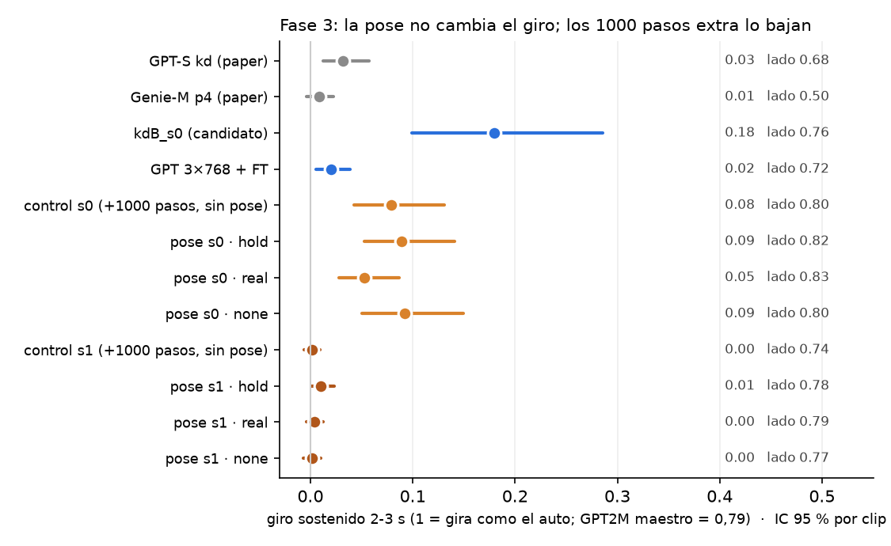
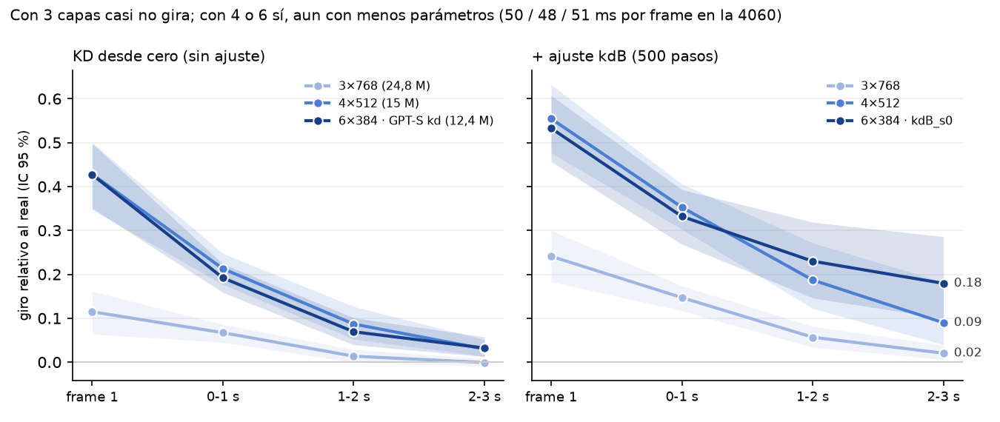

# Informe: fase 3, A (más datos), B (profundidad) y validación oficial (27–28/11/2026)

## Resumen

| pregunta | respuesta | evidencia |
|---|---|---|
| ¿Condicionar por pose hace girar al GPT? | **No.** El modelo aprendió a ignorar la pose. | giro 0,09 / 0,01 con pose contra 0,08 / 0,00 sin pose; CE igual con y sin pose |
| ¿Más ajuste sobre kdB_s0 ayuda? | **No, empeora.** 500 pasos es el punto bueno. | +1000 pasos: giro 0,18 → 0,08 / 0,00; FVD a 3 s +120 (p 0,01) |
| ¿Una base con más datos + el ajuste kdB es mejor? (A) | **No.** Arranca mejor y sostiene peor que kdB_s0. | giro 2-3 s 0,09 contra 0,18; FVD igual (p 0,34) |
| ¿Profundidad o ancho? (B) | **Profundidad.** Con 4 capas y 15 M gira mucho más que con 3 capas y 24,8 M. | giro 0-1 s 0,35 contra 0,15; lado 0,81 contra 0,72 |
| ¿Los modelos nuevos le ganan al paper en su set oficial? | **Sí, con p 0,01.** | kdB_s0: −103 de FVD a 3 s contra GPT-S kd |

**Decisiones:**
- kdB_s0 sigue siendo el modelo final de tiempo real.
- El 4×512 + ajuste es la alternativa: mismo FVD, mejor a 1 s y 3,4 ms más rápido.
- No se justifica entrenar con el shard completo.

Todo en la 4060 de esta máquina. Giro y FVD "mov." son del set de movimiento: 200 clips de data-0001, 100 curvas y 100
rectas, nunca usados para entrenar. "FVD val" es el set oficial del paper (400 clips).

## 1. Validación oficial: los modelos nuevos contra el paper

Diferencias pareadas por bootstrap sobre segmentos contra GPT-S kd. Su rollout val se regeneró con la misma receta y
dio 209 / 364 / 457, contra 207 / 358 / 468 publicados: es consistente.

| modelo | FVD val 1 / 2 / 3 s | Δ vs GPT-S kd 1 / 2 / 3 s (p) |
|---|---|---|
| GPT-S kd (paper) | 207 / 358 / 468 | – |
| **kdB_s0** | 179 / 260 / 354 | −30 (0,01) / −104 (0,01) / −103 (0,01) |
| kdB_s1 | 193 / 304 / 379 | −16 (0,07) / −60 (0,01) / −78 (0,01) |
| kdOP_ctrl | 173 / 270 / 355 | −35 (0,01) / −94 (0,01) / −102 (0,01) |
| **GPT 3×768 + ajuste** | 180 / 265 / **341** | −29 (0,01) / −99 (0,01) / −116 (0,01) |

| modelo | FVD val 1 / 2 / 3 s | Δ vs MaskGIT-S del paper (p) |
|---|---|---|
| **MaskGIT p_clean 0,8 · 4 pasos** | 217 / 281 / 363 | −3 (0,69) / −12 (0,33) / **−104 (0,01)** |
| MaskGIT p_clean 0,8 · 8 pasos | 290 / 323 / 378 | +43 (0,01) / +43 (0,01) / −2 (0,74) |

- Las mejoras del set de movimiento se confirman en el set oficial.
- A 3 s, todos los GPT nuevos de tiempo real (341–379) y MaskGIT p_clean p4 (363) quedan por debajo del mejor modelo
  del paper (Genie-M, 406).
- El maestro sigue muy lejos (105).

## 2. Fase 3: condicionamiento por pose

Detalle en [informe_fase3.md](informe_fase3.md).

**Diseño:**
- kdB_s0 + 1000 pasos con la pose del frame anterior sumada a los embeddings, contra los mismos 1000 pasos sin pose.
- Dos semillas.
- Tres modos de evaluación:
  - **hold:** mantener la última pose observada.
  - **real:** pose futura real.
  - **none:** sin pose.

| | giro 2-3 s s0 / s1 | lado s0 / s1 | FVD mov. 3 s s0 / s1 |
|---|---|---|---|
| control (sin pose) | 0,08 / 0,00 | 0,80 / 0,74 | 657 / 589 |
| pose · hold | 0,09 / 0,01 | 0,82 / 0,78 | 639 / 613 |
| pose · real | 0,05 / 0,00 | 0,83 / 0,79 | 603 / 630 |
| pose · none | 0,09 / 0,00 | 0,80 / 0,77 | 630 / 611 |

- Ninguna diferencia contra el control es significativa.
- **Contradice la hipótesis:** ni con la pose futura real gira más.
- Diagnóstico: la CE de teacher forcing da 2,950 con la pose real y 2,949 sin ella. La proyección de pose quedó en
  \|W\| ≈ 0,001.
- Causas probables (no probadas; son decisiones de diseño mías):
  - la mitad de la pérdida es la KL contra un maestro que no ve la pose, y eso premia ignorarla;
  - la mitad del batch son secuencias del maestro, que no tienen pose real.

**Hallazgo lateral.** Los controles muestran que seguir ajustando kdB_s0 lo empeora:
- giro 0,18 → 0,08 / 0,00;
- FVD mov. a 3 s +120 (p 0,01) / +51 (p 0,08).

Es el patrón de 1b: la destilación con teacher forcing primero destraba el giro y después lo apaga.

## 3. A: ¿una base con más datos mejora el ajuste kdB?

Misma receta que kdB_s0 (500 pasos, KD + secuencias del maestro, semilla 0), pero sobre kdS1 (GPT-S kd + 780 k frames
más de KD, la prueba 1b) en vez de sobre GPT-S kd.

| modelo | frame 1 | 0-1 s | 1-2 s | **2-3 s [IC]** | lado | FVD mov. 1 / 2 / 3 s |
|---|---|---|---|---|---|---|
| kdS1 (base, +780 k frames) | 0,57 | 0,31 | 0,09 | 0,02 [0,00; 0,04] | 0,80 | 377 / 550 / 672 |
| **kdB_1b** (base + ajuste kdB) | **0,67** | **0,40** | 0,21 | 0,09 [0,05; 0,14] | **0,82** | 344 / 467 / 577 |
| kdB_s0 (referencia) | 0,53 | 0,33 | 0,23 | **0,18 [0,10; 0,29]** | 0,76 | 351 / 454 / 537 |

- **El ajuste kdB vuelve a funcionar sobre otra base:** contra kdS1, el FVD mejora −33 / −83 / −95 (p 0,05 / 0,01 /
  0,01) y el giro sostenido sube de 0,02 a 0,09. La receta es robusta.
- **Contra kdB_s0, la base con más datos no gana:**
  - Gira más al principio: frame 1 0,67 contra 0,53, y lado 0,82 contra 0,76.
  - Sostiene menos: 0,09 contra 0,18 a 2-3 s, aunque los IC se tocan.
  - El FVD no cambia de forma significativa: −6 / +13 / +40, p 0,51 / 0,96 / 0,34.
- **Conclusión:** más datos de destilación mejoran el arranque, no la parte sostenida, y no mejoran el video. **No
  justifica entrenar con el shard completo** (~6,5–7 h por modelo).
- Salvedad: la base 1b se entrenó con semilla 1 y kdB_s0 sale de una base con semilla 0. Con la varianza de semilla
  que vimos (0,11–0,21 en la misma receta), una diferencia de 0,09 a 0,18 con IC que se tocan no alcanza para afirmar
  que más datos *empeoran*. Lo que sí se puede afirmar es que no mejoran.

## 4. B: profundidad contra ancho

Mismo procedimiento que el 3×768: KD desde cero (780 k frames, bs 8 × 2, lr 1e-3, semilla 0) y después el ajuste kdB
(500 pasos). Latencia con B = 1, fp16 + CUDA graphs, en la 4060.

| modelo | capas × ancho | params | ms (4060) | frame 1 | 0-1 s | 1-2 s | **2-3 s [IC]** | lado | FVD mov. 1 / 2 / 3 s |
|---|---|---|---|---|---|---|---|---|---|
| kd3x768 | 3 × 768 | 24,8 M | 49,7 | 0,11 | 0,07 | 0,01 | 0,00 [−0,01; 0,01] | 0,59 | 377 / 446 / 555 |
| **kd4x512** | 4 × 512 | 15,0 M | **48,0** | 0,43 | 0,21 | 0,09 | 0,03 [0,01; 0,05] | 0,76 | 385 / 502 / 574 |
| GPT-S kd (paper) | 6 × 384 | 12,4 M | 51,3 | 0,43 | 0,19 | 0,07 | 0,03 [0,01; 0,06] | 0,68 | 424 / 626 / 721 |
| kd3x768_B | 3 × 768 + ajuste | 24,8 M | 49,7 | 0,24 | 0,15 | 0,06 | 0,02 [0,01; 0,04] | 0,72 | 352 / 440 / 514 |
| **kd4x512_B** | 4 × 512 + ajuste | 15,0 M | **48,0** | **0,55** | **0,35** | 0,19 | 0,09 [0,04; 0,18] | **0,81** | **319** / 465 / 548 |
| kdB_s0 | 6 × 384 + ajuste | 12,4 M | 51,3 | 0,53 | 0,33 | **0,23** | **0,18 [0,10; 0,29]** | 0,76 | 351 / 454 / 537 |

Diferencias de FVD mov. (p):
- kd4x512 contra kd3x768: +8 (0,69) / **+56 (0,01)** / +19 (0,31).
- kd4x512_B contra kd3x768_B: −33 (0,07) / +24 (0,17) / +35 (0,25).
- kd4x512_B contra kdB_s0: **−32 (0,02)** / +10 (0,86) / +11 (0,86).

**Lectura:**
- **La hipótesis de la profundidad se confirma entre 3 y 4 capas.** Con menos parámetros (15 M contra 24,8 M) y la
  misma receta, el 4×512 gira entre 3 y 4 veces más en el primer segundo y elige mejor el lado (0,76 contra 0,59).
- Entre 4 y 6 capas, sin ajuste no hay diferencia (curvas superpuestas). Con ajuste, el 6×384 sostiene algo más a
  2-3 s (0,18 contra 0,09), pero los IC se superponen.
- **El ancho compra calidad de imagen, no dinámica.** El 3×768 tiene el mejor FVD a 2 s, pero no gira.
- **kd4x512_B es la alternativa a kdB_s0:**
  - mejor FVD a 1 s (−32, p 0,02), igual a 2 y 3 s;
  - mejor lado (0,81) y mejor giro en el primer segundo;
  - menos giro sostenido;
  - 6 % más rápido (48,0 contra 51,3 ms) y 20 % más grande en parámetros.

  Para el caso de uso de "adelantarse 1 segundo", **kd4x512_B es el mejor GPT de tiempo real**.

## 5. Benchmark completo

Latencias de la 3080 Ti (la del paper) donde están medidas. Las de la 4060 llevan "(4060)"; la 4060 es ~1,35× más
lenta en GPT. Giro: 2-3 s en el set de movimiento.

| modelo | params | giro 2-3 s | lado | FVD val 1 / 2 / 3 s | FVD mov. 1 / 2 / 3 s | ms |
|---|---|---|---|---|---|---|
| GPT2M (comma, maestro) | 307 M | **0,79** | 0,95 | 67 / 91 / 105 | 138 / 184 / 220 | 291 |
| *paper:* GPT-S kd | 12,4 M | 0,03 | 0,68 | 207 / 358 / 468 | 424 / 626 / 721 | 38 |
| *paper:* GPT-S d050 | 12,4 M | 0,00 | 0,49 | 235 / 390 / 479 | 471 / 570 / 611 | 38 |
| *paper:* MaskGIT-S p4 | 12,4 M | 0,00 | 0,49 | 220 / 293 / 468 | 430 / 506 / 674 | 6,4 |
| *paper:* MaskGIT-S p8 | 12,4 M | 0,00 | 0,47 | 247 / 280 / 380 | 454 / 469 / 559 | 10,4 |
| *paper:* Genie-S p4 | 15,0 M | 0,00 | 0,47 | 232 / 310 / 413 | 479 / 571 / 670 | 5,7 |
| *paper:* Genie-M p4 | 34,8 M | 0,01 | 0,50 | 244 / 315 / 406 | 464 / 533 / 609 | 9,4 |
| frame congelado | – | 0 | – | 929 / 918 / 978 | – | – |
| **kdB_s0** | 12,4 M | **0,18** | 0,76 | 179 / 260 / 354 | 351 / 454 / 537 | 38 |
| kdB_s1 | 12,4 M | 0,15 | 0,78 | 193 / 304 / 379 | 358 / 519 / 630 | 38 |
| kdOP_ctrl | 12,4 M | 0,21 / 0,11 | 0,78 | 173 / 270 / 355 | 363 / 503 / 635 | 38 |
| kdB_1b (A) | 12,4 M | 0,09 | 0,82 | no medido | 344 / 467 / 577 | 38 |
| **kd4x512_B (B)** | 15,0 M | 0,09 | **0,81** | no medido | **319** / 465 / 548 | 48,0 (4060) |
| GPT 3×768 + ajuste | 24,8 M | 0,02 | 0,72 | 180 / 265 / **341** | 352 / 440 / **514** | 49,7 (4060) |
| **MaskGIT p_clean 0,8 p4** | 12,4 M | 0,00 | 0,51 | 217 / 281 / 363 | 428 / 479 / 525 | 6,4 |
| fase 3 · pose hold (s0) | 12,4 M | 0,09 | 0,82 | – (val sin poses) | 378 / 525 / 639 | 38 |

## 6. Qué sigue (cada punto necesita OK)

| | qué | por qué | GPU (4060) |
|---|---|---|---|
| 1 | **Tercera semilla de kdB y de kd4x512_B** | Elegir entre los dos finalistas con algo más que una semilla (la varianza de semilla es de ~0,1 de giro) | ~1 h 20 |
| 2 | **FVD val de kd4x512_B** | Para la tabla del paper y el probador | ~25 min |
| 3 | **Pose v2:** solo CE sobre frames reales (sin KL ni secuencias), lr 10× en la proyección, contra control | Ataca las dos causas probables. Si la CE con pose no baja, se descarta la pose en GPT | ~1 h 40 (1 semilla) |
| 4 | Pose en MaskGIT p_clean / Genie-S | Solo si (3) muestra que la pose se usa. Ahí no hay maestro, así que la causa 1 no aplica | ~1 h impl. + ~1 h cada uno |

**Descartado por estos resultados:**
- entrenar con el shard completo (A);
- ajustes más largos de kdB (fase 3, controles);
- modelos más anchos para el giro (B).
