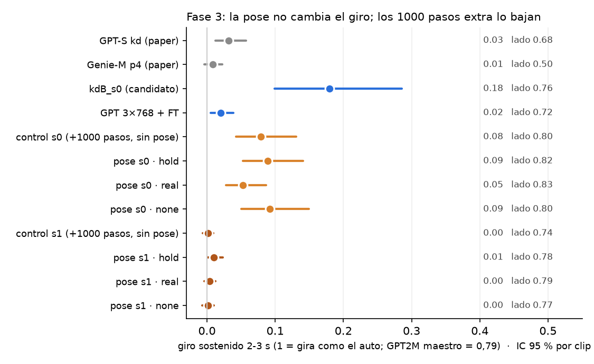

# Fase 3: condicionamiento por pose (27/11/2026)

**Resultado: no funcionó.** El GPT con pose no gira más que su control: el giro y el FVD son iguales con la pose real,
manteniendo la última pose o sin pose. El diagnóstico muestra que **el modelo aprendió a ignorar la pose**. Además, el
control descubrió algo útil: **ajustar 1000 pasos más a kdB_s0 lo empeora** (menos giro y peor FVD). Eso confirma que
el ajuste corto de 500 pasos es el punto bueno. **kdB_s0 sigue siendo el candidato de tiempo real.**

## Qué se hizo

**Modelo** (`src/models/gpt.py`, `Config.pose_dim = 6`):
- La pose del frame j−1 entra sumada a los embeddings de los 129 tokens del frame j. Es el ego-movimiento j−1 → j:
  6 velocidades normalizadas más un flag de "hay pose".
- La proyección es lineal (7 → 384) y arranca en cero, así que al inicio el modelo es idéntico a kdB_s0.
- Las estadísticas de normalización viajan en el checkpoint.

**Tests** (`tests/test_pose_gpt.py`, 4 en verde):
- Con la proyección en cero, los logits son idénticos al modelo base.
- La pose de un frame no cambia los logits de los anteriores.
- El decode con caché KV y CUDA graphs da lo mismo que teacher forcing.
- Otras poses dan otros frames.

**Rollouts** (`src/rollouts.py --poses`), tres modos:
- **hold:** las poses del contexto y, hacia adelante, la última transición observada repetida. Solo usa el pasado: es
  la prueba justa.
- **real:** las poses futuras reales. Es el techo, el modelo condicionado por la acción.
- **none:** sin pose.

**Corridas** (`scripts/motion_F3.sh`, 4060): mismo init (kdB_s0) y misma receta que kdB (KD α 0,5 + secuencias del
maestro 50 %, lr 3e-4, bs 8 × 2, 1000 pasos). Semillas 0 y 1.
- `kdP_s{0,1}`: con pose.
- `kdPc_s{0,1}`: lo mismo sin pose. Es el control: la única diferencia es `pose_dim`.
- Las ventanas del maestro entran "sin pose", porque son frames generados y no tienen pose real.
- Cada entrenamiento tardó ~50 min; el total de GPU fue 5 h 55.

## Resultados (set de movimiento: 200 clips de data-0001, T 0,9)

### Giro (relativo al auto real; IC 95 % por bootstrap sobre clips)

| modelo | f1 | 0-1 s | 1-2 s | **2-3 s [IC]** | lado correcto |
|---|---|---|---|---|---|
| kdB_s0 (punto de partida) | 0,53 | 0,33 | 0,23 | **0,18 [0,10; 0,29]** | 0,76 |
| control s0 (+1000 pasos, sin pose) | 0,51 | 0,29 | 0,14 | 0,08 [0,04; 0,13] | 0,80 |
| pose s0 · hold | 0,52 | 0,30 | 0,15 | 0,09 [0,05; 0,14] | 0,82 |
| pose s0 · real | 0,51 | 0,30 | 0,14 | 0,05 [0,03; 0,09] | 0,83 |
| pose s0 · none | 0,50 | 0,31 | 0,17 | 0,09 [0,05; 0,15] | 0,80 |
| control s1 (+1000 pasos, sin pose) | 0,44 | 0,18 | 0,03 | 0,00 [−0,01; 0,01] | 0,74 |
| pose s1 · hold | 0,46 | 0,20 | 0,05 | 0,01 [0,00; 0,02] | 0,78 |
| pose s1 · real | 0,47 | 0,20 | 0,03 | 0,00 [0,00; 0,01] | 0,79 |
| pose s1 · none | 0,46 | 0,19 | 0,02 | 0,00 [−0,01; 0,01] | 0,77 |

### FVD (movimiento) y diferencias pareadas contra el control de la misma semilla (p por bootstrap)

| modelo | FVD 1 / 2 / 3 s | Δ vs control 1 / 2 / 3 s (p) |
|---|---|---|
| kdB_s0 | 351 / 454 / 537 | – |
| control s0 | 383 / 550 / 657 | vs kdB_s0: +33 (0,19) / **+96 (0,01)** / **+120 (0,01)** |
| pose s0 · hold | 378 / 525 / 639 | −5 (0,81) / −25 (0,40) / −18 (0,75) |
| pose s0 · real | 374 / 504 / 603 | −9 (0,70) / −46 (0,10) / −54 (0,07) |
| pose s0 · none | 376 / 505 / 630 | −8 (0,69) / −45 (0,04) / −27 (0,31) |
| control s1 | 384 / 519 / 589 | vs kdB_s0: +34 (0,08) / **+64 (0,01)** / +51 (0,08) |
| pose s1 · hold | 397 / 527 / 613 | +13 (0,41) / +9 (0,41) / +24 (0,17) |
| pose s1 · real | 384 / 532 / 630 | 0 (0,91) / +13 (0,34) / +41 (0,07) |
| pose s1 · none | 393 / 530 / 611 | +9 (0,74) / +11 (0,60) / +22 (0,30) |

### Criterios fijados antes de correr

| criterio | objetivo | resultado |
|---|---|---|
| giro 2-3 s en hold | ≥ 0,35, con IC por encima del control | 0,09 / 0,01: **no** |
| lado correcto en hold | ≥ 0,85 | 0,82 / 0,78: **no** (+0,02 / +0,04 sobre el control, dentro del ruido) |
| FVD a 3 s no peor que el control | – | sí (diferencias no significativas, de signo opuesto en cada semilla) |
| none ≈ control | – | sí |
| techo (real) > hold | si gira en real y no en hold, el problema es predecir | **no**: real ≈ hold ≈ none |

**Contradice la hipótesis de la fase 3.** Ni siquiera con la pose futura real (el modo "real", que le dice al modelo
cuánto gira el auto en cada frame) gira más. Por eso el fracaso no está en predecir hacia dónde va el auto: el modelo
no usa la pose para nada.

## Diagnóstico: el modelo ignora la pose

CE de teacher forcing en 48 ventanas del holdout de train (`scripts/diag_pose.py`):

| modelo | CE con pose real | CE sin pose | CE con pose de otra ventana | tamaño de la proyección |
|---|---|---|---|---|
| kdP_s0 | 2,9497 | 2,9487 | 2,9549 | \|W\| 0,0013 (la init normal es 0,02) |
| kdP_s1 | 2,9590 | 2,9579 | 2,9605 | \|W\| 0,0012 |

- **La pose real no baja la CE: hasta la sube 0,001.** La pose "dice" el movimiento del frame que se predice, así que
  un modelo que la usara bajaría la CE.
- La proyección casi no creció en 1000 pasos. El embedding de pose pesa ~8 % de la norma del embedding de tokens, y la
  red aprendió a no mirarlo.

**Causas probables** (hipótesis, no probadas; las dos son decisiones de diseño mías y hay que corregirlas):
1. **La mitad de la pérdida es la KL contra el maestro, y el maestro no ve la pose.** La KL premia predecir *lo mismo
   que el maestro sin pose*, o sea, ignorarla. Solo la parte de CE sobre frames reales gana algo usándola.
2. **La mitad del batch son secuencias del maestro sin pose.** Sumadas, solo ~¼ de la señal de entrenamiento se
   beneficia de la pose. Con init en cero y lr 3e-4, 1000 pasos no alcanzan.

## Hallazgo lateral: más ajuste empeora kdB_s0

Los dos controles (kdB_s0 + 1000 pasos con la misma receta) bajan el giro sostenido de 0,18 a 0,08 y 0,00, y suben el
FVD a 3 s +120 (p 0,01) y +51 (p 0,08). Es el mismo patrón de 1b: la destilación con teacher forcing primero destraba
el giro y después lo apaga. **500 pasos es el punto bueno. Extender el ajuste no sirve**, y esto también pesa contra
"entrenar más con todo el dataset" (ver A, abajo).

Además, la semilla pesa mucho en estos ajustes: con la misma receta, s0 queda en 0,08 y s1 en 0,00.

## Benchmark completo: paper contra lo nuevo

Latencias en ms/frame del modelo, B = 1, fp16 + graphs (3080 Ti; la 4060 es ~1,35× más lenta en GPT).
"FVD val" es el set oficial del paper (400 clips); "FVD mov." es el set de movimiento (200 clips).

| modelo | params | giro 2-3 s | lado | FVD val 1 / 2 / 3 s | FVD mov. 1 / 2 / 3 s | ms |
|---|---|---|---|---|---|---|
| GPT2M (comma, maestro) | 307 M | **0,79** | 0,95 | 67 / 91 / 105 | 138 / 184 / 220 | 291 |
| *paper:* GPT-S kd | 12,4 M | 0,03 | 0,68 | 207 / 358 / 468 | 424 / 626 / 721 | 38 |
| *paper:* GPT-S d050 | 12,4 M | 0,00 | 0,49 | 235 / 390 / 479 | 471 / 570 / 611 | 38 |
| *paper:* MaskGIT-S p4 | 12,4 M | 0,00 | 0,49 | 220 / 293 / 468 | 430 / 506 / 674 | 6,4 |
| *paper:* MaskGIT-S p8 | 12,4 M | 0,00 | 0,47 | 247 / 280 / 380 | 454 / 469 / 559 | 10,4 |
| *paper:* Genie-S p4 | 15,0 M | 0,00 | 0,47 | 232 / 310 / 413 | 479 / 571 / 670 | 5,7 |
| *paper:* Genie-M p4 | 34,8 M | 0,01 | 0,50 | 244 / 315 / 406 | 464 / 533 / 609 | 9,4 |
| frame congelado | – | 0 | – | 929 / 918 / 978 | – | – |
| **kdB_s0** | 12,4 M | **0,18** | 0,76 | **179 / 260 / 354** | 351 / 454 / 537 | 38 |
| kdB_s1 (réplica) | 12,4 M | 0,15 | 0,78 | 193 / 304 / 379 | 358 / 519 / 630 | 38 |
| kdOP_ctrl (kd + 500 pasos KD) | 12,4 M | 0,21 / 0,11 (s0 / s1) | 0,78 | 173 / 270 / 355 | 363 / 503 / 635 | 38 |
| **GPT 3×768 + FT** | 24,8 M | 0,02 | 0,72 | 180 / 265 / **341** | 352 / 440 / **514** | ~37 |
| **MaskGIT p_clean 0,8 p4** | 12,4 M | 0,00 | 0,51 | 217 / 281 / 363 | 428 / 479 / 525 | 6,4 |
| MaskGIT p_clean 0,8 p8 | 12,4 M | 0,00 | – | 290 / 323 / 378 | – | 10,4 |
| fase 3: pose s0 · hold | 12,4 M | 0,09 | 0,82 | no medido (val no tiene poses) | 378 / 525 / 639 | 38 |
| fase 3: control s0 | 12,4 M | 0,08 | 0,80 | – | 383 / 550 / 657 | 38 |

Contra el paper, a la misma latencia:
- **GPT de tiempo real:** el FVD val a 3 s baja de 468 a 354 (kdB_s0, −24 %) y a 341 (3×768 + FT). El giro sostenido
  pasa de 0,03 a 0,18.
- **MaskGIT p4:** p_clean 0,8 baja el FVD val a 3 s de 468 a 363 (−104, p 0,01). A 1 y 2 s queda igual. Es mejor que
  el mejor modelo del paper a 3 s (Genie-M, 406) y corre a 6,4 ms.
- **Pendiente:** las diferencias pareadas de los GPT nuevos contra GPT-S kd en val. El rollout val de GPT-S kd no
  estaba guardado; se regenera esta noche (`scripts/motion_val_dif.sh`).

## Qué sigue

**En curso esta noche** (`scripts/motion_AB.sh`):
- **A:** ajuste de kdB sobre kdS1 (la base con +780 k frames de KD). Responde si una base con más datos más el ajuste
  corto mejora, que es la condición para que valga la pena entrenar con el shard completo. kdB_1b ya entrenó y sus
  rollouts están corriendo.
- **B:** alumno 4×512 (más profundo que 3×768, 46,8 ms en la 4060), KD desde cero y después el ajuste de kdB.

**Propuestas para la pose** (cada una necesita OK):
1. **Pose v2:** ajuste con pose **sin KL ni secuencias del maestro** (solo CE sobre frames reales; α = 1) y lr 10×
   para la proyección de pose, contra el mismo control sin pose. Ataca las dos causas probables. ~2 × 50 min con una
   semilla (~3 h 20 con dos).
   - Si la CE con pose real no baja ni así, la pose no le agrega información al modelo y se descarta para GPT.
2. **Pose en MaskGIT p_clean / Genie-S**, solo si (1) muestra que la pose se usa. Ahí no hay maestro, así que la
   causa 1 no aplica. ~1 h de implementación + ~1 h de GPU cada uno.

**Para el modelo final:** quedarse con kdB_s0 (500 pasos) y correr una tercera semilla de la receta kdB para fijar el
número (~25 min + evaluación).
