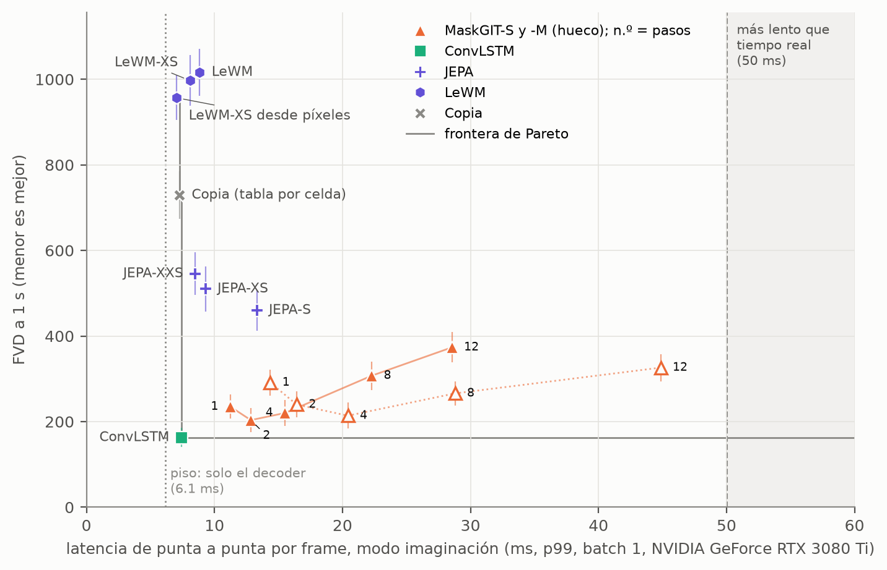

# Inferencia de punta a punta

Video en la CPU → encoder VQ → world model → decoder VQ → video en la CPU, todo residente en el dispositivo (fp16 + CUDA graphs), batch 1. Ver `Docs/plan-inferencia.md`. Lo genera `python -m src.infer.report_e2e`.

- **En línea:** llega un frame de cámara, se codifica, entra al estado del modelo y se predice y decodifica el siguiente.
- **Imaginación:** el modelo genera a partir de su propia salida; el encoder solo corre al principio. Es el modo de los rollouts de la tabla principal (FVD).

### NVIDIA GeForce RTX 3080 Ti (`rtx3080ti`)

Codec solo, batch 1 (ms, mediana; codec = frame en el host → encoder → decoder → host):

| Variante | Encoder | Decoder | Codec |
|---|---:|---:|---:|
| fp32 | 7.84 | 14.21 | 21.93 |
| fp16 | 7.50 | 11.93 | 19.51 |
| fp16_graphs | 3.74 | 6.11 | 9.89 |

Fidelidad (fp16 + graphs contra fp32, 200 frames del video de cámara de comma): tokens iguales 99.71 % (fp32 contra los de comma: 99.87 %), PSNR del decoder 61.0 dB, LPIPS de la reconstrucción contra el frame de entrada 0.102 (fp32) y 0.102 (fp16), entre las dos 0.0008.

Cadena completa, batch 1, 3000 frames en bucle cerrado salvo indicación (ms por frame; tarde = más de 50 ms):

| Configuración | FVD@1s | En línea p50 | En línea p99 | Imaginación p50 | Imaginación p99 | A 50 ms p99 | Tarde (%) | Etapas en línea (enc / modelo / dec) |
|---|---:|---:|---:|---:|---:|---:|---:|---|
| solo codec (encoder + decoder) | – | 10.0 | 10.1 | – | – | 20.2 | 0.00 | 3.8 / 0.0 / 6.2 |
| Copia (tabla por celda) | 729.4 | 10.1 | 10.3 | 6.6 | 7.3 | – | 0.00 | 3.8 / 0.1 / 6.2 |
| ConvLSTM | 162.8 | 10.3 | 10.5 | 6.8 | 7.4 | 20.8 | 0.00 | 3.8 / 0.3 / 6.2 |
| MaskGIT-S 1 paso | 234.9 | 14.8 | 14.9 | 11.1 | 11.2 | – | 0.00 | 3.8 / 4.7 / 6.2 |
| MaskGIT-S 2 pasos | 203.5 | 16.1 | 16.3 | 12.5 | 12.8 | – | 0.00 | 3.8 / 6.1 / 6.2 |
| MaskGIT-S 4 pasos | 220.2 | 18.9 | 19.0 | 15.3 | 15.5 | 21.1 | 0.00 | 3.8 / 8.9 / 6.1 |
| MaskGIT-S 8 pasos | 307.3 | 24.6 | 24.8 | 21.1 | 22.3 | – | 0.00 | 3.8 / 14.7 / 6.1 |
| MaskGIT-S 12 pasos | 373.6 | 30.4 | 30.5 | 26.9 | 28.6 | – | 0.00 | 3.8 / 20.4 / 6.1 |
| MaskGIT-M 1 paso | 291.3 | 17.9 | 18.0 | 14.2 | 14.4 | – | 0.00 | 3.9 / 7.7 / 6.3 |
| MaskGIT-M 2 pasos | 239.8 | 19.7 | 19.9 | 16.1 | 16.4 | – | 0.00 | 3.9 / 9.6 / 6.2 |
| MaskGIT-M 4 pasos | 213.8 | 23.5 | 23.7 | 19.8 | 20.4 | – | 0.00 | 3.8 / 13.5 / 6.2 |
| MaskGIT-M 8 pasos | 266.0 | 31.2 | 31.4 | 27.6 | 28.8 | 29.0 | 0.00 | 3.8 / 21.2 / 6.1 |
| MaskGIT-M 12 pasos | 326.2 | 39.0 | 39.3 | 39.3 | 44.9 | – | 0.13 | 3.8 / 29.0 / 6.1 |
| JEPA-S | 460.0 | 13.0 | 14.9 | 9.2 | 13.3 | 20.4 | 0.00 | 3.9 / 2.8 / 6.2 |
| JEPA-XS | 510.1 | 11.8 | 13.6 | 8.1 | 9.3 | – | 0.00 | 3.8 / 1.7 / 6.2 |
| JEPA-XXS | 545.7 | 11.1 | 12.7 | 7.3 | 8.5 | – | 0.00 | 3.9 / 1.0 / 6.2 |
| LeWM | 1016.3 | 11.4 | 13.1 | 7.7 | 8.8 | – | 0.00 | 3.8 / 1.4 / 6.2 |
| LeWM-XS | 996.9 | 10.8 | 12.4 | 7.0 | 8.1 | 20.1 | 0.00 | 3.8 / 0.7 / 6.2 |
| LeWM-XS desde píxeles | 956.8 | 7.0 | 7.1 | 6.7 | 7.0 | – | 0.00 | 0.0 / 0.8 / 6.1 |
| GPT-S | 229.6 | 167.3 | 170.9 | 164.3 | 170.5 | – | 100.00 | 3.8 / 157.3 / 6.1 |

Predicción a k frames en línea (k pasos del modelo y un decode; p50 / p99 en ms):

| Configuración | k | p50 | p99 |
|---|---:|---:|---:|
| ConvLSTM | 5 | 11.5 | 13.0 |
| ConvLSTM | 20 | 15.7 | 18.8 |
| MaskGIT-S 4 pasos | 5 | 54.8 | 58.3 |
| MaskGIT-S 4 pasos | 20 | 189.1 | 202.8 |
| JEPA-XXS | 5 | 14.9 | 17.0 |
| JEPA-XXS | 20 | 29.3 | 29.5 |

Primer segundo (contexto incompleto, sin graphs, y la captura de los graphs al llenarse): el peor frame es de 655 ms (GPT-S). No entra en las mediciones de arriba.

### Calidad a 1 paso en línea

El modelo ve los frames reales de val (50 segmentos × 400 frames) y en cada uno predice el siguiente. Referencia: repetir el último frame (frame congelado), acierto 38.9 % y LPIPS 0.075.

| Configuración | Temperatura | Acierto de tokens (%) | LPIPS [IC 95%] |
|---|---:|---:|---:|
| Copia (tabla por celda) | 1 | 16.9 | 0.143 [0.136, 0.151] |
| Copia (tabla por celda) | 0 | 38.9 | 0.075 [0.070, 0.081] |
| ConvLSTM | 1 | 24.0 | 0.108 [0.101, 0.114] |
| ConvLSTM | 0 | 40.0 | 0.073 [0.069, 0.079] |
| MaskGIT-S 4 pasos | 1 | 30.9 | 0.103 [0.096, 0.110] |
| MaskGIT-S 4 pasos | 0 | 38.6 | 0.076 [0.071, 0.081] |
| MaskGIT-M 8 pasos | 1 | 33.5 | 0.097 [0.090, 0.103] |
| MaskGIT-M 8 pasos | 0 | 38.7 | 0.075 [0.070, 0.081] |
| JEPA-S | 1 | 24.1 | 0.112 [0.106, 0.118] |
| JEPA-S | 0 | 38.9 | 0.075 [0.070, 0.081] |
| JEPA-XXS | 1 | 22.3 | 0.115 [0.109, 0.121] |
| JEPA-XXS | 0 | 38.8 | 0.075 [0.070, 0.081] |
| LeWM-XS | 1 | 0.2 | 0.483 [0.469, 0.497] |
| LeWM-XS | 0 | 0.4 | 0.536 [0.515, 0.557] |
| LeWM-XS desde píxeles | 1 | 0.2 | 0.455 [0.443, 0.468] |
| LeWM-XS desde píxeles | 0 | 0.5 | 0.501 [0.483, 0.519] |

Deriva de ConvLSTM en streams de 1 minuto (20 segmentos × 1200 frames), acierto por tramo, estado continuo contra recalculado con la ventana de 19 frames: frames 19-100: 22.9 % contra 22.9 %, frames 100-400: 23.9 % contra 24.0 %, frames 400-1200: 26.9 % contra 27.1 %.

Camino nuevo contra la tabla (ConvLSTM, 400 clips): tokens iguales 53.2 %, primer frame 99.9 %; FVD@1s 160.0 [138.3, 181.8] contra 162.8 [140.1, 185.5].

Camino nuevo contra la tabla (MaskGIT-S 4 pasos, 400 clips): tokens iguales 100.0 %, primer frame 100.0 %; FVD@1s 220.2 [190.1, 250.3] contra 220.2 [190.1, 250.3].
